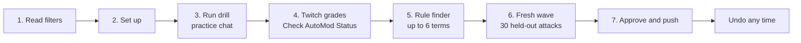
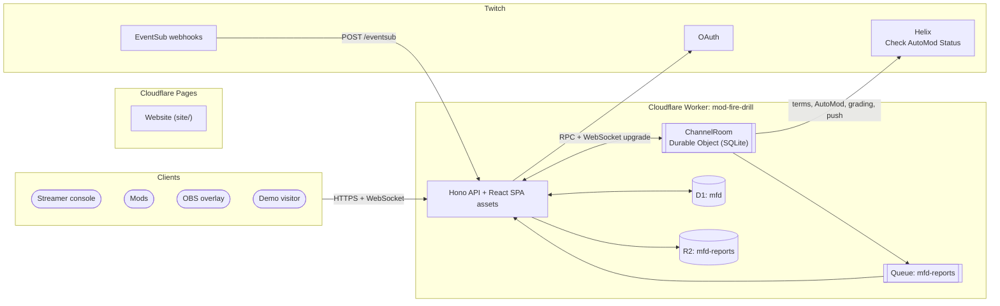

<p align="center">
  
</p>

<h1 align="center">ModScrim</h1>

<h3 align="center">Fire drills for your Twitch mod team.<br>Practise the raid. Fix the filters. Ban nobody by mistake.</h3>

<p align="center">
  <a href="https://github.com/harshbhx/modscrim/actions/workflows/ci.yml"></a>
  <a href="https://github.com/harshbhx/modscrim/actions/workflows/e2e.yml"></a>
  <a href="LICENSE"></a>
  <a href="https://twitchcon-codex.devpost.com"></a>
</p>

<p align="center">
  <b>Your mods have never practised a raid. Now they can, without anyone getting hurt.</b><br>
  ModScrim floods a practice chat that only your team can see with spam built to slip past <i>your channel's own</i> filters. Your mods race to clear it. Then Twitch grades your filters, and the blocked terms that close the gaps go live only when you approve them, with one-click undo.
</p>

<p align="center">
  <a href="https://app.modscrim.dualmindlab.tech/demo"></a>
  &nbsp;
  <a href="https://www.youtube.com/watch?v=r7xsUjA51F0"></a>
  &nbsp;
  <a href="https://modscrim.dualmindlab.tech"></a>
  &nbsp;
  <a href="https://devpost.com/software/modscrim"></a>
</p>

<p align="center">
  
</p>

<p align="center">
  <a href="#why-it-exists">Why</a> ·
  <a href="#the-drill-in-seven-steps">How it works</a> ·
  <a href="#features">Features</a> ·
  <a href="#how-it-stays-safe">Safety</a> ·
  <a href="#architecture">Architecture</a> ·
  <a href="#run-it-yourself">Run it</a> ·
  <a href="#built-with-codex">Built with Codex</a> ·
  <a href="#roadmap-and-known-limits">Limits</a> ·
  <a href="#team">Team</a>
</p>

**Try it in two minutes.** Open the [live demo](https://app.modscrim.dualmindlab.tech/demo); it needs no Twitch account and sends nothing to Twitch. Start a drill and clear a few lines with **D** (delete), **T** (time out) and **B** (ban). Then follow the console through the grade, the proposed rules and the fresh-wave proof, approve the terms, and undo them.

## Why it exists

Twitch mod teams are volunteers, and the only practice most of them get is a real raid, with real harm and an audience. Streamers tune their filters by guesswork: adding a blocked term risks banning regulars, and nobody can see that risk before the term goes live.

- **26%** of 1,053 Twitch moderators surveyed had handled a targeted attack in the past month, while only about 12% had trained another mod in that time ([Seering and Kairam, 2023](https://joseph.seering.org/papers/Seering_and_Kairam_2023_Who_Moderates_Twitch_What_Do_They_Do.pdf)).
- **Up to 94%** of hateful messages got past AutoMod on some test sets in an independent audit, and spacing and punctuation changes lowered what it caught ([arXiv 2506.07667](https://arxiv.org/abs/2506.07667)).

ModScrim gives mod teams a safe rehearsal and streamers a feedback loop. The drill is fake and contained; the grading, the proposed rules and the false-ban check use the channel's real filters. Every source is on [Research and references](docs/references.md).

## The drill in seven steps



| | Step | What happens |
|:-:|---|---|
| **1** | **Read your filters** | ModScrim reads the channel's public blocked terms and AutoMod levels from Twitch and starts a 7-day chat log used for one thing: checking that new rules will not ban regulars. |
| **2** | **Set up the drill** | Pick tactics, the number of attack and banter lines, the speed and the slip window. Share the mod link and six-digit join code, and add the overlay to OBS as a browser source. |
| **3** | **Run the drill** | The practice chat fills with attacks written to slip past the channel's filters, mixed with harmless banter. Mods delete, time out or ban from any device. The first action wins; a line nobody touches within the slip window slips through. |
| **4** | **Twitch grades your filters** | Every attack line goes to Twitch's Check AutoMod Status. In demo rooms, or when the channel's hourly limit runs out, ModScrim grades with its own matcher and labels every number "local estimate". |
| **5** | **Find better rules** | The rule finder proposes up to six blocked terms that catch what got past. A term that would match the last 7 days of real chat, or a banter line, is rejected and shown with the line it would have hit. |
| **6** | **Prove them on a fresh wave** | A second wave of 30 attacks, built from a new seed and tricks the rule finder never saw, shows how many are blocked before and after. Push stays disabled unless real-chat matches are zero. |
| **7** | **Approve, push and undo** | The streamer approves the terms, ModScrim adds them to the channel's blocked terms on Twitch, and one click removes exactly the terms that drill added. |

<p align="center">
  
  
  <br>
  <sub>Left: the streamer console, steps 2 to 6. Right: prove, push, report and undo.</sub>
</p>

The console groups the seven steps into six screens. [How it works](docs/how-it-works.md) walks through each step, the push gate and the scoring.

## Features

- **Aimed at your filters.** Lines are built to slip past this channel's public blocked terms with spacing, dotted letters, leetspeak, look-alike letters and zero-width characters.
- **Four tactics.** Fake giveaway links, viewer and follower spam, promo bots, and a placeholder hate raid that is off by default and carries a content warning.
- **Mods on any device.** A join link plus a six-digit code. The mod view works from 360 px wide, and **D**, **T** and **B** act on the focused line.
- **Kai (sim).** A simulated co-mod for rehearsing alone, always labelled and scored separately.
- **An overlay viewers can watch.** OBS shows an alarm bar, a scoreboard and a practice chat whose text is blurred into bars.
- **After-action report.** Per-mod scores, grades, proposed, rejected and pushed terms, and the fresh-wave result, with numbers-only share links.
- **Deterministic.** The same seed gives the same wave, so any drill can be replayed and tested exactly.

<p align="center">
  
  
  <br>
  <sub>Left: what a mod sees. Right: what viewers see.</sub>
</p>

## How it stays safe

<p align="center">
  
</p>

ModScrim writes fake attacks, so its safety rules are hard requirements. Each one is enforced in code; [Safety](docs/safety.md) lists where, and which test checks it.

| Promise | How it is enforced |
|---|---|
| **Practice chat only** | Attack lines are never sent to Twitch chat. The one message the app can send is a fixed announcement behind the `ANNOUNCE_ENABLED` flag, which is `false` in `app/wrangler.jsonc`; the chat-write scope is requested only when the flag is on. |
| **Every link ends in `.invalid`** | The link tricks in [`packages/core/src/tricks.ts`](packages/core/src/tricks.ts) always append `.invalid`, and the `safety.links` Playwright spec checks rendered lines. |
| **Slurs are placeholders** | Only `slurx` and `slury` exist, drawn as solid blocks. No real slur list is in the repository. |
| **Redacted overlay** | Overlay sockets receive only `{ lineId, user, len }` per line. The overlay message schema is strict, so a readable field fails to build, and a Worker test checks every overlay frame of a full drill. |
| **Approval and undo** | Nothing reaches Twitch until the streamer presses **Approve and push**. Pushes store the term IDs Twitch returns, and Undo removes only those, never terms that already existed. |
| **AutoMod is read-only** | The app reads AutoMod settings and never calls Twitch's update endpoint. |
| **Demo rooms stay local** | Demo rooms never call Twitch, D1, R2 or the report queue, and delete themselves after two idle hours. |
| **Data is minimal** | Public chat is kept for 7 days for the false-ban check, can be paused or deleted, and is removed on sign-out. Reports carry counts, not attack text or chat text. |

## Architecture



One `ChannelRoom` Durable Object owns everything about one channel: the drill clock (a single alarm multiplexed through a `schedule` table), hibernating WebSockets for the console, mods and overlay, the chat log, grades and reports. D1 holds only small global records such as users, sealed tokens and the audit log. The Queue and R2 bucket carry the report export in production only. Components, data and key flows are in [Architecture](docs/architecture.md).

| Layer | Choice |
|---|---|
| Language | TypeScript 5, `strict`, `noUncheckedIndexedAccess`, npm workspaces |
| Runtime | Cloudflare Workers with Durable Objects (SQLite), D1, Queues and R2 |
| Worker | Hono, zod at every boundary |
| Web app | React 19, React Router 7, plain CSS with custom properties, Vite with the Cloudflare plugin |
| Core engine | `@mfd/core`: a pure, seeded TypeScript package that runs unchanged in Node, browsers and `workerd` |
| Twitch | OAuth, Helix, EventSub webhooks (chat), Check AutoMod Status |
| Tests | Vitest (Node and `workerd` pools), Playwright |
| Design | Big Shoulders, Atkinson Hyperlegible Next and Mono, self-hosted; tokens in `design/` |

Versions are in [`docs/for-agents/tech-stack.md`](docs/for-agents/tech-stack.md).

## Repository structure

```text
modscrim/
├── app/                  Worker + React SPA (deployed to app.modscrim.dualmindlab.tech)
│   ├── worker/           Hono routes, auth, Twitch clients, ChannelRoom modules, jobs
│   ├── src/              React routes, components, styles, copy deck
│   ├── migrations/       D1 schema (0001_init.sql)
│   ├── test/             Worker tests (Vitest in workerd)
│   ├── e2e/              Playwright specs and fixtures
│   └── wrangler.jsonc    Worker, Durable Object, D1, Queue, R2 and preview config
├── packages/core/        @mfd/core: pure engine (matcher, tricks, waves, rule finder, proof, scoring)
├── site/                 Static website (Cloudflare Pages, modscrim.dualmindlab.tech)
├── brand/                Brand kit: DESIGN.md, logos, social images, OBS assets, fonts
├── design/               Design tokens (tokens.css, tokens.json, palette.json, overrides)
├── scripts/              Contrast gate, token sync, static server, load and Twitch helpers
├── docs/                 Documentation (start at docs/README.md); specs in docs/for-agents/
├── .github/workflows/    CI, end-to-end, deploy, preview, site, Lighthouse and demo checks
└── AGENTS.md             Rules for every AI coding agent working in the repo
```

## Run it yourself

You need Node.js 22 or newer and npm. Demo rooms run fully locally with no Twitch credentials.

```sh
git clone https://github.com/harshbhx/modscrim.git
cd modscrim
npm ci
```

Create `app/.dev.vars` with local-only values. The file is git-ignored; never commit it or reuse these values in production.

```dotenv
PUBLIC_BASE_URL=http://localhost:5173
SESSION_HMAC_KEY=local-session-key-change-me
TOKEN_ENC_KEY=AAECAwQFBgcICQoLDA0ODxAREhMUFRYXGBkaGxwdHh8
EVENTSUB_SECRET=local-eventsub-secret
TWITCH_CLIENT_ID=local-client-id
TWITCH_CLIENT_SECRET=local-client-secret
```

Then run `npm run dev` and open <http://localhost:5173/demo>. Twitch sign-in is tested on the deployed app, because Twitch accepts only HTTPS redirect URIs. More in [Getting started](docs/getting-started.md).

| Script | What it does |
|---|---|
| `npm run dev` | Vite with the Cloudflare plugin: SPA, Worker, Durable Object and local D1 on <http://localhost:5173> |
| `npm test` | Core tests (Node) and Worker tests (Vitest in `workerd`) |
| `npm run typecheck` | `tsc -b` across the workspaces |
| `npm run e2e` | Playwright against the local dev server |
| `npm run deploy` | `vite build` and `wrangler deploy` |
| `npm run db:migrate:local` | Apply the D1 migrations locally (`db:migrate:remote` for production) |
| `npm run contrast:check` | The colour contrast gate |
| `npm run site:docs:check` | Check that the website's docs pages match a fresh build from the Markdown |
| `npm run load` | Fan-out latency test against a demo room |

The rest are in the root [`package.json`](package.json).

### Tests and CI

`npm test` runs **119 tests**: 19 engine tests in `packages/core` (3 files) and 100 Worker tests in `app/test` (21 files). GitHub Actions runs them, plus the browser suites, on every pull request.

| Workflow | What it checks |
|---|---|
| [`ci.yml`](.github/workflows/ci.yml) | Contrast gate, action-border lint, site tokens and colours; then secret scan, typecheck, core tests with coverage, Worker tests, build, and a 250 KiB gzip budget for initial JavaScript |
| [`e2e.yml`](.github/workflows/e2e.yml) | Playwright surface projects against the branch's build, then setup, smoke, safety, console and mod projects against the deployed app; uploads light and dark screenshots at 375, 768 and 1440 px |
| [`site.yml`](.github/workflows/site.yml) | The website's docs-page check and its Playwright project, in light and dark at 375, 768 and 1440 px |
| [`demo-e2e.yml`](.github/workflows/demo-e2e.yml) | A nightly run of the full demo loop against production |
| [`preview-app.yml`](.github/workflows/preview-app.yml) | A preview Worker with its own database for each pull request to `main` |

Details are in [Testing](docs/testing.md).

### Deployment

The app and the website deploy separately. [`deploy-app.yml`](.github/workflows/deploy-app.yml) ships the Worker on pushes to `main` that touch the app: it typechecks, tests, applies D1 migrations, runs `npm run deploy` and health-checks `/api/health`. The website is a Git-connected Cloudflare Pages project. Secrets are set with `wrangler secret put` and never live in the repository; see [Deployment](docs/deployment.md).

## Built with Codex

ModScrim is an entry in the Codex x TwitchCon hackathon and was built with OpenAI Codex.

- **Specs first.** The [PRD](docs/for-agents/PRD.md) and [SRS](docs/for-agents/SRS.md) are the source of truth for scope, copy, safety and implementation. [`AGENTS.md`](AGENTS.md) tells every coding agent which spec wins, what it must never break, and that it may not add a feature, endpoint, dependency or table the specs do not list.
- **Tickets, tests first.** Work is split into numbered tickets on the project board. Agents write the tests the SRS names, watch them fail, then implement; `npm test` and `npm run typecheck` must pass.
- **Humans review and decide.** The PRD describes the build as Codex writing most of the code from SRS tickets, with humans reviewing, testing and deciding. Commits are authored by the human builders.
- **A written trail.** [`docs/LOG.md`](docs/LOG.md) records decisions, day-0 results and a dated note per working session with its test evidence.
- **No AI at runtime.** The attack engine, rule finder and scoring are deterministic code, and no paid AI call is made when the app runs.

| Builder | Codex session ID |
|---|---|
| Harsh Bhanushali (core and worker, 30 October 2026) | `01a1892d-f9b6-7203-bfdb-f73490bfd6c0` |
| Dhairya Patel (main build thread, submitted on Devpost) | `01a18b5a-38f1-7830-be12-4fc7454e1390` |

Both are in the Codex sessions table of [`docs/LOG.md`](docs/LOG.md).

## Roadmap and known limits

> [!WARNING]
> **The day-0 validation on a real channel is not done yet**, so this README claims no measured improvement on a real channel. What is recorded in [`docs/LOG.md`](docs/LOG.md): a fixture-only dry run, labelled as such, and a live check on 3 November 2026 in which step 4 on Harsh's production channel showed 14 of 14 attack lines graded by Twitch, after the grading quota was set to count lines ([PR #247](https://github.com/harshbhx/modscrim/pull/247)). That proves Twitch grading works end to end. It does not measure better filters.

- **Only public blocked terms are visible.** Twitch does not return private terms to apps.
- **Two engines can disagree.** Twitch's check also applies AutoMod categories and permitted terms, which the local matcher does not model.
- **Some tricks need a bot.** Blocked terms cannot express spaced or dotted letters, zero-width characters, emoji inside a word or look-alike letters. ModScrim labels those "needs a bot rule".
- **It is not a moderation bot.** It never acts on real chat.
- **Open questions**, such as whether mod teams would schedule drills without a hackathon reason (Q-01), are tracked in [`open-questions.md`](docs/for-agents/open-questions.md); ticket status is in [`build-plan.md`](docs/for-agents/build-plan.md).

Where it could go next: [How ModScrim could become a business](docs/business.md) is an honest plan for tiers, costs, go-to-market and risks, with every number marked as an assumption.

## Documentation

| For | Start here |
|---|---|
| **Streamers** | [Getting started](docs/getting-started.md) · [How it works](docs/how-it-works.md) · [Safety](docs/safety.md) · [Troubleshooting](docs/troubleshooting.md) |
| **Mods** | [How it works](docs/how-it-works.md) · [FAQ](docs/faq.md) · [Glossary](docs/glossary.md) |
| **Developers** | [Architecture](docs/architecture.md) · [Testing](docs/testing.md) · [Deployment](docs/deployment.md) · [Design system](docs/design-system.md) · [Specs for agents](docs/for-agents/INDEX.md) |
| **Judges** | [Research and references](docs/references.md) · [Build log](docs/LOG.md) · [Business plan](docs/business.md) |

Everything is indexed on the [documentation home](docs/README.md).

## Contributing

Changes are small, ticketed and test-first, and they never weaken a safety rule. Read the [contributing guide](CONTRIBUTING.md), the [code of conduct](CODE_OF_CONDUCT.md) and the [security policy](SECURITY.md); ask for help through [Support](SUPPORT.md) or [open an issue](https://github.com/harshbhx/modscrim/issues/new/choose).

## Credits and licence

MIT, see [`LICENSE`](LICENSE). ModScrim is an independent project, not affiliated with or endorsed by Twitch.

- **Fonts:** Big Shoulders (Patric King, Chicago Design System) and Atkinson Hyperlegible Next and Mono (Braille Institute), under the SIL Open Font License; the licence files ship with the fonts in [`brand/fonts/`](brand/fonts/).
- **Palette data:** [The Dictionary of Color Combinations](https://colorcombinations.org/) (Caslon Media, CC BY 4.0), with Sanzo Wada's plates digitised by Matt DesLauriers (MIT); the kasane palettes use base colours after Wikipedia's "Traditional colors of Japan" (CC BY-SA 4.0). Full attributions are kept with the colour-token tooling.
- **Design references:** hand-turned ballpark scoreboards, coaches' tactics boards and the Acme Thunderer whistle. See [`brand/DESIGN.md`](brand/DESIGN.md).

## Team

ModScrim was built in one hackathon sprint by two people who think mod teams deserve a practice field before game day.

<table>
  <tr>
    <td align="center" width="50%">
      <a href="https://github.com/harshbhx"><br><b>Harsh Bhanushali</b></a><br>
      <sub>@harshbhx</sub><br><br>
      Everything on Cloudflare (the Worker, Durable Objects, D1, cron, Queues, R2 and deploy) and the website.
    </td>
    <td align="center" width="50%">
      <a href="https://github.com/DhairyaPatel-Devloper"><br><b>Dhairya Patel</b></a><br>
      <sub>@DhairyaPatel-Devloper</sub><br><br>
      The core engine, the Twitch integration, the web app, all testing, CI and the launch.
    </td>
  </tr>
</table>

<p align="center">
  <br>
  <picture>
    <source media="(prefers-color-scheme: dark)" srcset="brand/logo/svg/modscrim-horizontal-reverse.svg">
    <source media="(prefers-color-scheme: light)" srcset="brand/logo/svg/modscrim-horizontal-color.svg">
    
  </picture>
  <br><br>
  <b>The next raid is coming. Make sure your mods have seen it before.</b><br>
  <a href="https://app.modscrim.dualmindlab.tech/demo">Run a drill now</a>
</p>
