<a id="readme-top"></a>

<p align="center">
  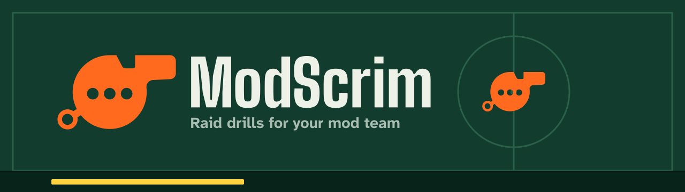
</p>

<h1 align="center">ModScrim</h1>

<h3 align="center">Fire drills for your Twitch mod team.<br>Practise the raid. Fix the filters. Ban nobody by mistake.</h3>

<p align="center">
  <a href="https://github.com/harshbhx/modscrim/actions/workflows/ci.yml"></a>
  <a href="https://github.com/harshbhx/modscrim/actions/workflows/e2e.yml"></a>
  <a href="LICENSE"></a>
  <a href="https://app.modscrim.dualmindlab.tech/demo"></a>
  <a href="https://devpost.com/software/modscrim"></a>
  <a href="https://www.youtube.com/watch?v=r7xsUjA51F0"></a>
  <br>
  
  
  
  
  
</p>

<p align="center">
  <b>Your mods have never practised a raid. Now they can, without anyone getting hurt.</b><br>
  ModScrim floods a practice chat that only your team can see with spam built to slip past <i>your channel's own</i> filters.<br>
  Your mods race to clear it. Then Twitch grades your filters, and the blocked terms that close the gaps<br>
  go live only when you approve them, with one-click undo.
</p>

<p align="center">
  <a href="https://app.modscrim.dualmindlab.tech/demo"></a>
  &nbsp;
  <a href="https://www.youtube.com/watch?v=r7xsUjA51F0"></a>
  &nbsp;
  <a href="https://modscrim.dualmindlab.tech"></a>
  &nbsp;
  <a href="https://devpost.com/software/modscrim"></a>
</p>

<p align="center"><sub>The demo needs no Twitch account and sends nothing to Twitch.</sub></p>

<p align="center">
  
</p>

<p align="center">
  <a href="#-why-it-exists">Why</a> ·
  <a href="#-the-drill-in-seven-steps">How it works</a> ·
  <a href="#-screenshots">Screenshots</a> ·
  <a href="#-features">Features</a> ·
  <a href="#-how-it-stays-safe">Safety</a> ·
  <a href="#-architecture">Architecture</a> ·
  <a href="#-run-it-yourself">Run it</a> ·
  <a href="#built-with-codex">Built with Codex</a> ·
  <a href="#roadmap-and-known-limits">Limits</a> ·
  <a href="#-team">Team</a>
</p>

> [!TIP]
> **Judging in a hurry?** Open the [live demo](https://app.modscrim.dualmindlab.tech/demo) and start a drill. Clear a few lines with **D** (delete), **T** (time out) and **B** (ban), then follow the console through the grade, the proposed rules and the fresh-wave proof. Approve the terms, then undo them. No account needed.

## 🎯 Why it exists

Twitch mod teams are volunteers, and the only practice most of them get is a real raid, with real harm and an audience. Streamers tune their filters by guesswork: adding a blocked term risks banning regulars, and nobody can see that risk before the term goes live.

<table>
  <tr>
    <td width="50%" valign="top">
      <h3>26%</h3>
      of the 1,053 Twitch moderators surveyed had handled a targeted attack in the past month, while only about 12% had trained another mod in that time.<br><br>
      <sub>Source: <a href="https://joseph.seering.org/papers/Seering_and_Kairam_2023_Who_Moderates_Twitch_What_Do_They_Do.pdf">Seering and Kairam, "Who Moderates on Twitch and What Do They Do?" (2023)</a></sub>
    </td>
    <td width="50%" valign="top">
      <h3>Up to 94%</h3>
      of hateful messages got past AutoMod on some test sets in an independent audit, and spacing and punctuation changes lowered what it caught.<br><br>
      <sub>Source: <a href="https://arxiv.org/abs/2506.07667">Auditing the Moderation of Hate Speech on Twitch (arXiv 2506.07667)</a></sub>
    </td>
  </tr>
</table>

ModScrim gives mod teams a safe rehearsal and streamers a feedback loop. The drill is fake and contained. The grading, the proposed rules and the false-ban check use the channel's real filters. Both figures are from the evidence in PRD §3.2; every source is on [Research and references](docs/references.md).

<p align="right"><a href="#readme-top">Back to top ↑</a></p>

## 🔁 The drill in seven steps

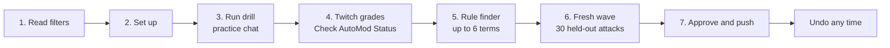

| | Step | What happens |
|:-:|---|---|
| **1** | **Read your filters** | ModScrim reads the channel's public blocked terms and AutoMod levels from Twitch and starts a 7-day chat log used for one thing: checking that new rules will not ban regulars. |
| **2** | **Set up the drill** | Pick tactics, the number of attack and banter lines, the speed and the slip window. Share the mod link and the six-digit join code, and add the overlay to OBS as a browser source. |
| **3** | **Run the drill** | The practice chat fills with attacks written to slip past the channel's filters, mixed with harmless banter. Mods delete, time out or ban from any device. The first action wins; a line nobody touches within the slip window slips through. |
| **4** | **Twitch grades your filters** | Every attack line goes to Twitch's Check AutoMod Status. When the channel's hourly limit runs out, ModScrim falls back to its own matcher and labels every number "local estimate". |
| **5** | **Find better rules** | The rule finder proposes up to six blocked terms that catch what got past. A term that would match the last 7 days of real chat, or a harmless banter line, is rejected and shown with the line it would have hit. |
| **6** | **Prove them on a fresh wave** | A second wave of 30 attacks, built from a new seed and tricks the rule finder never saw, shows how many are blocked before and after. Push stays disabled unless real-chat matches are zero. |
| **7** | **Approve, push and undo** | The streamer approves the terms, ModScrim adds them to the channel's blocked terms on Twitch, and one click removes exactly the terms that drill added. |

<table>
  <tr>
    <td width="50%" align="center"><b>Step 3: mods clear the practice chat</b><br><br>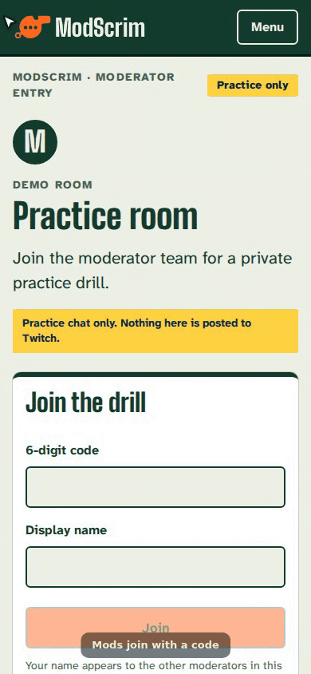</td>
    <td width="50%" align="center"><b>Steps 2 to 6: the streamer console</b><br><br>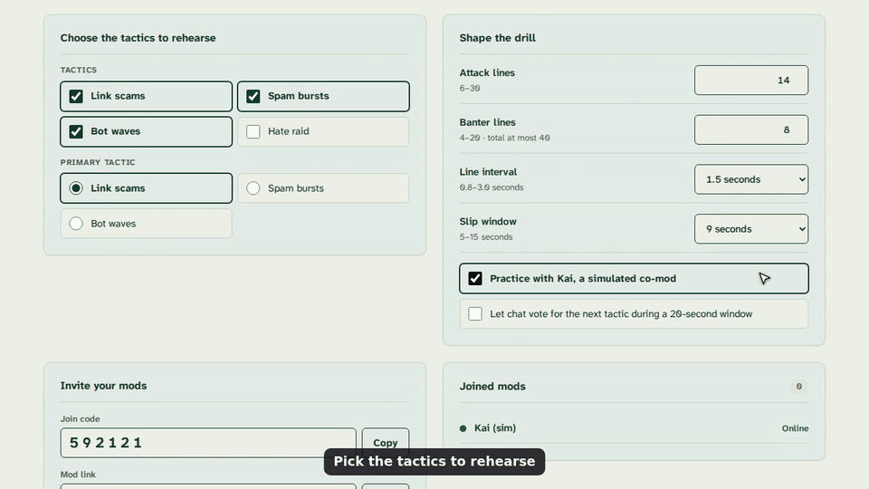</td>
  </tr>
  <tr>
    <td width="50%" align="center"><b>Steps 6 and 7: prove, push, report, undo</b><br><br>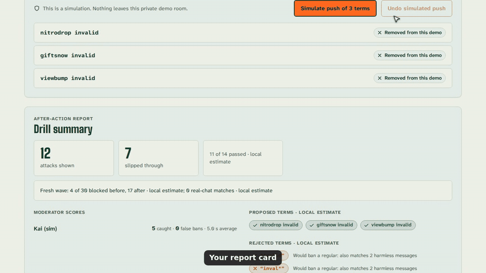</td>
    <td width="50%" align="center"><b>What viewers see: a redacted overlay</b><br><br>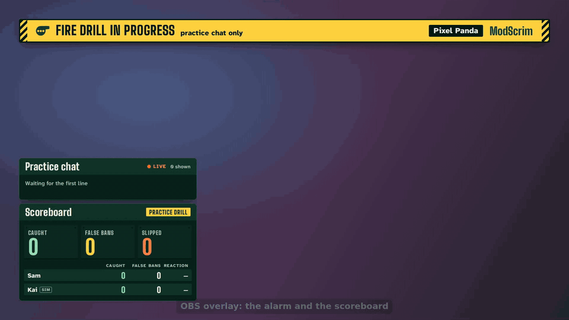</td>
  </tr>
</table>

> [!NOTE]
> The website's [How it works](https://modscrim.dualmindlab.tech/how-it-works.html) page describes the same seven steps. The streamer console groups them into six screens: Read filters, Configure, Run the drill, Twitch grades, Fix the rules, and Fresh wave and push. Read more in [How it works](docs/how-it-works.md).

<p align="right"><a href="#readme-top">Back to top ↑</a></p>

## 📸 Screenshots

| Streamer console | Mod view |
|---|---|
| 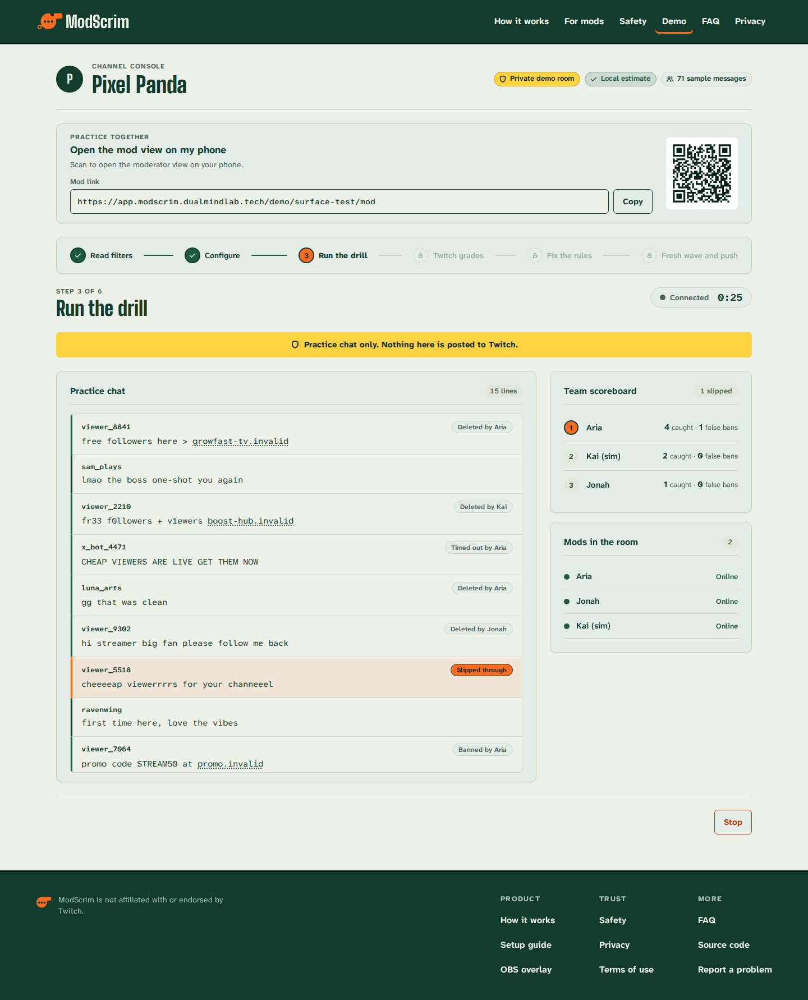 | 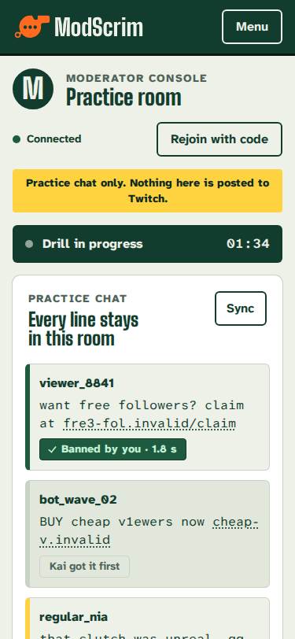 |
| **OBS overlay** | **After-action report** |
| 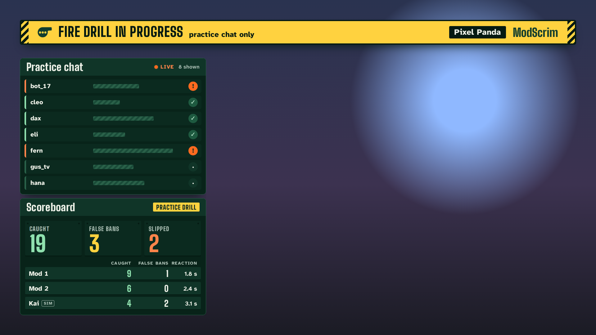 | 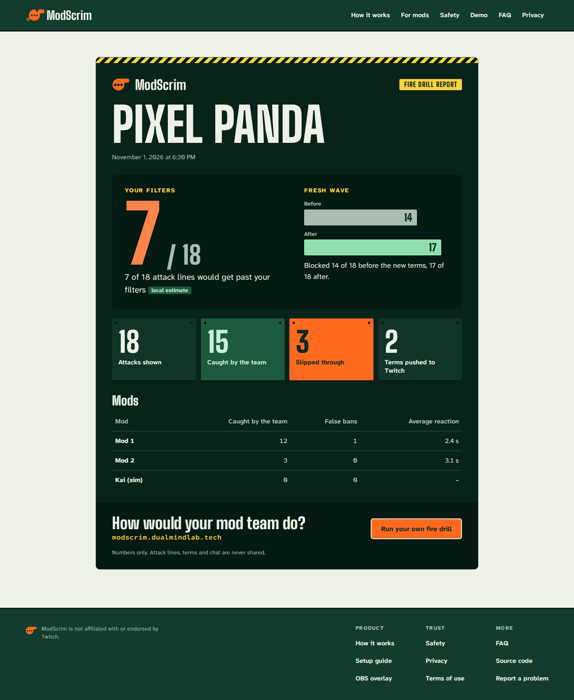 |

<p align="center">
  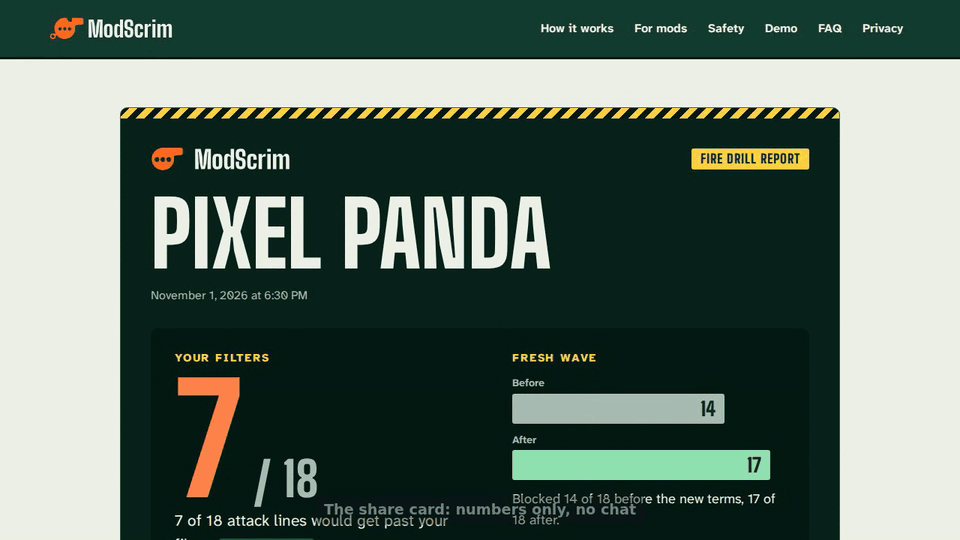
</p>

<sub>CI also uploads light and dark screenshots of every surface at 375, 768 and 1440 px as the `screenshots-<run id>` artifact of the [End-to-end workflow](.github/workflows/e2e.yml).</sub>

<p align="right"><a href="#readme-top">Back to top ↑</a></p>

## ✨ Features

<table>
  <tr>
    <td width="33%" valign="top"><h4>🧪 Practice chat, never real chat</h4>Attacks exist only inside the drill's own room. Attack lines are never sent to Twitch chat.</td>
    <td width="33%" valign="top"><h4>🎯 Aimed at your filters</h4>Lines are built to slip past this channel's public blocked terms with spacing, dotted letters, leetspeak, look-alike letters and zero-width characters.</td>
    <td width="33%" valign="top"><h4>🗂️ Four tactics</h4>Fake giveaway links, viewer and follower spam, promo bots, and a placeholder hate raid that is off by default and shown with a content warning.</td>
  </tr>
  <tr>
    <td valign="top"><h4>📱 Mods on any device</h4>A join link plus a six-digit code. The mod view works from 360 px wide, and <b>D</b>, <b>T</b> and <b>B</b> act on the focused line.</td>
    <td valign="top"><h4>🤖 Kai (sim)</h4>A simulated co-mod for rehearsing alone, always labelled and scored separately.</td>
    <td valign="top"><h4>⚖️ Honest grading</h4>Every grade names its engine: "graded by Twitch" or "local estimate".</td>
  </tr>
  <tr>
    <td valign="top"><h4>🧾 Rules proven before they ship</h4>Up to six proposed terms, checked against the last 7 days of real chat and a fresh, held-out wave.</td>
    <td valign="top"><h4>↩️ Approve, push, undo</h4>Nothing reaches Twitch without the streamer's approval, and Undo removes exactly the terms a drill added.</td>
    <td valign="top"><h4>📺 Redacted OBS overlay</h4>Viewers see an alarm bar, a scoreboard and a practice chat whose text is blurred into bars.</td>
  </tr>
  <tr>
    <td valign="top"><h4>📊 After-action report</h4>Per-mod scores, grades, proposed, rejected and pushed terms, and the fresh-wave result, with numbers-only share links.</td>
    <td valign="top"><h4>🎲 Deterministic</h4>The same seed gives the same wave, so a drill can be replayed and tested exactly.</td>
    <td valign="top"><h4>💸 No paid AI at runtime</h4>The attack engine, rule finder and scoring are deterministic code in a pure TypeScript package.</td>
  </tr>
</table>

**Three ways in**

| Action | What happens | Where |
|---|---|---|
| **Try the demo** | A private practice room with a fake channel, a simulated co-mod (Kai) and the full loop. No account. Grading in demo rooms is a labelled local estimate. | [`/demo`](https://app.modscrim.dualmindlab.tech/demo) |
| **Sign in with Twitch** | Reads your public blocked terms and AutoMod levels so the drill is aimed at your own filters. | [app.modscrim.dualmindlab.tech](https://app.modscrim.dualmindlab.tech) |
| **Start a drill** | Run it with your mods from the console; mods join with a link and a six-digit code, and OBS shows a redacted overlay. | [`/console`](https://app.modscrim.dualmindlab.tech/console) |

<p align="right"><a href="#readme-top">Back to top ↑</a></p>

## 🔒 How it stays safe

> [!IMPORTANT]
> **Safe by design.** The drill runs in a practice chat and attack lines are never sent to Twitch chat. Every generated link ends in `.invalid`, slurs exist only as the placeholders `slurx` and `slury` drawn as blocks, the OBS overlay receives redacted payloads only, and no blocked term reaches Twitch without the streamer's approval.

<p align="center">
  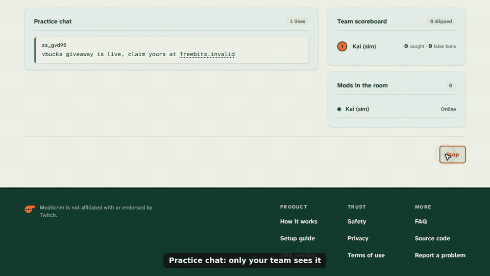
</p>

Each rule below is enforced in code and covered by tests; the full list is in [Safety](docs/safety.md).

| Promise | How it is enforced |
|---|---|
| **Practice chat only.** | Attack lines are never sent to Twitch chat. The one message the app can send is a fixed announcement behind the `ANNOUNCE_ENABLED` flag, which is `false` in `app/wrangler.jsonc`; the extra chat-write scope is only requested when the flag is on. |
| **Every link ends in `.invalid`.** | The link tricks in [`packages/core/src/tricks.ts`](packages/core/src/tricks.ts) always append `.invalid`, and the `safety.links` Playwright spec checks rendered lines. |
| **Slurs are placeholders.** | Only the placeholders `slurx` and `slury` exist, drawn as solid blocks. No real slur list is in the repository. |
| **Redacted overlay.** | Overlay sockets receive only `{ lineId, user, len }` per line, no reveal and no terms. The overlay message schema is strict, so a readable field fails to build, and a Worker test checks every overlay frame of a full drill. |
| **One-click undo.** | Pushes store the term IDs Twitch returns; Undo removes only the terms that drill added, never terms that already existed. |
| **AutoMod is read-only.** | The app reads AutoMod settings and never calls Twitch's update endpoint. |
| **Demo rooms stay local.** | Demo rooms never call Twitch, D1, R2 or the report queue, and delete themselves after two idle hours. |
| **Data is minimal.** | Public chat is kept for 7 days for the false-ban check, can be paused or deleted, and is removed on sign-out. Reports carry counts, not attack text or chat text. |

**The push gate, step by step**

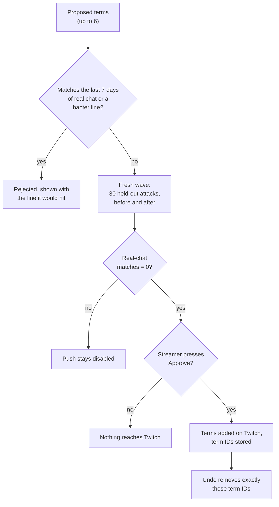

<p align="right"><a href="#readme-top">Back to top ↑</a></p>

## 🧱 Architecture


One `ChannelRoom` Durable Object owns everything about one channel: the drill clock (a single alarm multiplexed through a `schedule` table), hibernating WebSockets for the console, mods and overlay, the chat log, grades and reports. D1 holds only small global records such as users, sealed tokens and the audit log. The Queue and R2 bucket carry the report-export pipeline in production only. Details are in [Architecture](docs/architecture.md).

<details>
<summary><b>Tech stack</b></summary>
<br>

| Layer | Choice |
|---|---|
| Language | TypeScript 5, `strict`, `noUncheckedIndexedAccess`, npm workspaces |
| Runtime | Cloudflare Workers with Durable Objects (SQLite), D1, Queues and R2 |
| Worker | Hono, zod at every boundary |
| Web app | React 19, React Router 7, plain CSS with custom properties, Vite with the Cloudflare plugin |
| Core engine | `@mfd/core`: a pure, seeded TypeScript package that runs unchanged in Node, browsers and `workerd` |
| Twitch | OAuth, Helix, EventSub webhooks (chat), Check AutoMod Status |
| Tests | Vitest (Node and `workerd` pools), Playwright |
| Design | Big Shoulders, Atkinson Hyperlegible Next and Mono, self-hosted; tokens in `design/` |
| No paid AI at runtime | The attack engine, rule finder and scoring are deterministic code |

The full list with versions is in [`docs/for-agents/tech-stack.md`](docs/for-agents/tech-stack.md).

</details>

## Repository structure

```text
modscrim/
├── app/                  Worker + React SPA (deployed to app.modscrim.dualmindlab.tech)
│   ├── worker/           Hono routes, auth, Twitch clients, ChannelRoom modules, jobs
│   ├── src/              React routes, components, styles, copy deck
│   ├── migrations/       D1 schema (0001_init.sql)
│   ├── test/             Worker tests (Vitest in workerd)
│   ├── e2e/              Playwright specs and fixtures
│   └── wrangler.jsonc    Worker, Durable Object, D1, Queue, R2 and preview config
├── packages/core/        @mfd/core: pure engine (matcher, tricks, waves, rule finder, proof, scoring)
├── site/                 Static website (Cloudflare Pages, modscrim.dualmindlab.tech)
├── brand/                Brand kit: DESIGN.md, logos, social images, OBS assets, fonts
├── design/               Design tokens (tokens.css, tokens.json, palette.json, overrides)
├── scripts/              Contrast gate, token sync, static server, load and Twitch helpers
├── docs/                 Documentation (start at docs/README.md); specs in docs/for-agents/
├── .github/workflows/    CI, end-to-end, deploy, preview, site, Lighthouse and demo checks
└── AGENTS.md             Rules for every AI coding agent working in the repo
```

## 🚀 Run it yourself

<details>
<summary><b>Quick start (demo rooms, no Twitch credentials needed)</b></summary>
<br>

Requirements: Node.js 22 or newer and npm. Demo rooms run locally and need no Twitch credentials.

```sh
git clone https://github.com/harshbhx/modscrim.git
cd modscrim
npm ci
```

Create `app/.dev.vars` with local-only values. This file is git-ignored; never commit it and never reuse these values in production.

```dotenv
PUBLIC_BASE_URL=http://localhost:5173
SESSION_HMAC_KEY=local-session-key-change-me
TOKEN_ENC_KEY=AAECAwQFBgcICQoLDA0ODxAREhMUFRYXGBkaGxwdHh8
EVENTSUB_SECRET=local-eventsub-secret
TWITCH_CLIENT_ID=local-client-id
TWITCH_CLIENT_SECRET=local-client-secret
```

```sh
npm run dev
```

Open <http://localhost:5173/demo>. Demo rooms use fixtures and never call Twitch, D1, R2 or the report queue. More in [Getting started](docs/getting-started.md).

> [!NOTE]
> Twitch sign-in is tested on the deployed app because Twitch only accepts HTTPS redirect URIs, so `localhost` cannot be registered.

</details>

<details>
<summary><b>Scripts</b></summary>
<br>

| Script | What it does |
|---|---|
| `npm run dev` | Vite with the Cloudflare plugin: SPA, Worker, Durable Object and local D1 on <http://localhost:5173> |
| `npm test` | Core tests (Node) and Worker tests (Vitest in `workerd`) |
| `npm run typecheck` | `tsc -b` across the workspaces |
| `npm run e2e` | Playwright against the local dev server |
| `npm run build` | `vite build` |
| `npm run deploy` | Build and `wrangler deploy` |
| `npm run db:migrate:local` | Apply the D1 migrations locally (`db:migrate:remote` for production) |
| `npm run contrast:check` | The colour contrast gate |
| `npm run site:tokens:check` | Check that the website's tokens match `design/` |
| `npm run site:docs:check` | Check that the website's docs pages match a fresh build from the Markdown |
| `npm run load` | Fan-out latency test against a demo room |

All scripts are in the root [`package.json`](package.json).

</details>

<details>
<summary><b>Testing and CI</b></summary>
<br>

`npm test` runs **119 tests**: 19 engine tests in `packages/core` (3 files) and 100 Worker tests in `app/test` (21 files). The same checks, plus the browser suites, run in GitHub Actions on every pull request.

| Workflow | What it checks |
|---|---|
| [`ci.yml`](.github/workflows/ci.yml) | Contrast gate and action-border lint, site token sync, site colours; then secret scan, typecheck, core tests with coverage, Worker tests, build, and a 250 KiB gzip budget for initial JavaScript |
| [`e2e.yml`](.github/workflows/e2e.yml) | Playwright surface projects against the branch's build, then the setup, smoke, safety, console and mod projects against the deployed app |
| [`site.yml`](.github/workflows/site.yml) | The static site's Playwright project, with light and dark screenshots at 375, 768 and 1440 px |
| [`demo-e2e.yml`](.github/workflows/demo-e2e.yml) | A nightly run of the full demo loop against production |
| [`preview-app.yml`](.github/workflows/preview-app.yml) | Pull requests to `main` get a preview Worker with its own database |

Playwright projects: `setup`, `landing`, `shell-surface`, `console-surface`, `report-surface`, `mod-surface`, `overlay-surface`, `shared-states`, `site`, `smoke`, `safety`, `console`, `mod` and `demo`. See [Testing](docs/testing.md).

</details>

<details>
<summary><b>Deployment</b></summary>
<br>

The app and the website deploy separately.

- **App Worker** (`mod-fire-drill`, `app/`): [`deploy-app.yml`](.github/workflows/deploy-app.yml) runs on pushes to `main` that touch the app. It typechecks, tests, applies D1 migrations, runs `npm run deploy` and health-checks `/api/health` on `https://app.modscrim.dualmindlab.tech`.
- **Website** (`site/`): a Git-connected Cloudflare Pages project serves `https://modscrim.dualmindlab.tech`.

> [!WARNING]
> Secrets (`PUBLIC_BASE_URL`, `TWITCH_CLIENT_SECRET`, `EVENTSUB_SECRET`, `SESSION_HMAC_KEY`, `TOKEN_ENC_KEY`) are set with `wrangler secret put` and are never in the repository. See [Deployment](docs/deployment.md).

</details>

<p align="right"><a href="#readme-top">Back to top ↑</a></p>

## Built with Codex

The project is an entry in the Codex x TwitchCon hackathon, which requires the work to be built with OpenAI Codex. The team's process, as recorded in the repository:

- **Specs first.** The [PRD](docs/for-agents/PRD.md) and [SRS](docs/for-agents/SRS.md) are the source of truth for scope, copy, safety and implementation. [`AGENTS.md`](AGENTS.md) tells every coding agent which spec wins, what it must never break, and that it may not add a feature, endpoint, dependency or table the specs do not list.
- **Tickets, tests first.** Work is split into numbered tickets on the project board. Agents write the tests the SRS names, watch them fail, then implement; `npm test` and `npm run typecheck` must pass.
- **Humans review and decide.** The PRD describes the builder as Codex writing most of the code from SRS tickets, with humans reviewing, testing and deciding. Commits are authored by the human builders.
- **A written trail.** [`docs/LOG.md`](docs/LOG.md) records decisions, day-0 results and a note per working session.
- **What is recorded so far.** [`docs/LOG.md`](docs/LOG.md) lists one Codex session (core and worker, 30 October 2026, tickets T-01, T-02, T-37 and T-38) and dated session notes with their test evidence.
- **No AI at runtime.** The attack engine, rule finder and scoring are deterministic code, and no paid AI call is made when the app runs.

Codex session IDs are recorded in `docs/LOG.md` and provided in the Devpost entry.

## 🧾 Codex session IDs

| Builder | Codex session ID | Recorded in |
|---|---|---|
| Harsh Bhanushali (core and worker, 30 October 2026) | `01a1892d-f9b6-7203-bfdb-f73490bfd6c0` | [`docs/LOG.md`](docs/LOG.md), Codex sessions table |
| Dhairya Patel | `01a18b5a-38f1-7830-be12-4fc7454e1390` | This README and the Devpost entry |

<p align="right"><a href="#readme-top">Back to top ↑</a></p>

## Roadmap and known limits

> [!WARNING]
> **The day-0 Twitch validation is not complete.** The live test-channel run that measures the grading quota and Twitch's matching behaviour has not been recorded, so this README makes no claim of measured improvement on a real channel. The only recorded result is a fixture-only dry run, labelled as such in [`docs/LOG.md`](docs/LOG.md). Numbers in demo rooms are a **local estimate**, not a Twitch grade.

- **Only public blocked terms are visible.** Twitch does not return private terms to apps.
- **Two engines can disagree.** Twitch's check also applies AutoMod categories and permitted terms, which the local matcher does not model.
- **Some tricks need a bot.** Blocked terms cannot express spaced or dotted letters, zero-width characters, emoji inside a word or look-alike letters. ModScrim labels those "needs a bot rule".
- **It is not a moderation bot.** It never acts on real chat.
- **Open questions** such as whether mod teams would schedule drills without a hackathon reason (Q-01) are tracked in [`docs/for-agents/open-questions.md`](docs/for-agents/open-questions.md). Ticket status lives in [`docs/for-agents/build-plan.md`](docs/for-agents/build-plan.md).

> [!TIP]
> **Where it could go next:** [How ModScrim could become a business](docs/business.md) is an honest plan for tiers, costs, go-to-market and risks, with every number marked as an assumption.

<p align="right"><a href="#readme-top">Back to top ↑</a></p>

## 📚 Documentation

| For | Start here |
|---|---|
| **Streamers** | [Getting started](docs/getting-started.md) · [How it works](docs/how-it-works.md) · [Safety](docs/safety.md) · [Troubleshooting](docs/troubleshooting.md) |
| **Mods** | [How it works](docs/how-it-works.md) · [FAQ](docs/faq.md) · [Glossary](docs/glossary.md) |
| **Developers** | [Architecture](docs/architecture.md) · [Testing](docs/testing.md) · [Deployment](docs/deployment.md) · [Design system](docs/design-system.md) · [Specs for agents](docs/for-agents/INDEX.md) |
| **Judges** | [Live demo](https://app.modscrim.dualmindlab.tech/demo) · [Research and references](docs/references.md) · [Build log](docs/LOG.md) · [Business plan](docs/business.md) |

Everything is indexed on the [documentation home](docs/README.md).

<details>
<summary><b>Research and references</b></summary>
<br>

The problem evidence and the platform references the project was built against, each checked and with a one-line note on why it matters, are on [Research and references](docs/references.md). The short list:

| Type | Source |
|---|---|
| Paper | [Who Moderates on Twitch and What Do They Do?](https://joseph.seering.org/papers/Seering_and_Kairam_2023_Who_Moderates_Twitch_What_Do_They_Do.pdf), a survey of 1,053 Twitch moderators |
| Paper | [Auditing the Moderation of Hate Speech on Twitch](https://arxiv.org/abs/2506.07667), an audit of AutoMod |
| Paper | [Hate Raids on Twitch](https://arxiv.org/abs/2305.16248), a study of r/Twitch discussions |
| Article | [GamingHQ on spam bots and fake views, May 2026](https://gaminghq.eu/2026/05/09/twitch-communities-struggle-with-spam-bots-and-fake-view-activity/) |
| Twitch docs | [Moderation guide](https://dev.twitch.tv/docs/api/moderation) and [API reference](https://dev.twitch.tv/docs/api/reference) (Check AutoMod Status, blocked terms, AutoMod settings) |
| Twitch docs | [EventSub webhooks](https://dev.twitch.tv/docs/eventsub/handling-webhook-events) |
| Cloudflare docs | [Durable Objects alarms](https://developers.cloudflare.com/durable-objects/api/alarms/) and [WebSockets](https://developers.cloudflare.com/durable-objects/best-practices/websockets/) |
| Prior art | [Twitch Mod Simulator](https://adamziadi.itch.io/twitch-mod-simulator), a satirical game |

</details>

## 🤝 Contributing and community

Changes are small, ticketed and test-first, and they never weaken a safety rule.

| | |
|---|---|
| [Contributing guide](CONTRIBUTING.md) | Branches, tests first, commit naming and the rules that never bend |
| [Code of conduct](CODE_OF_CONDUCT.md) | Contributor Covenant 2.1 |
| [Security policy](SECURITY.md) | How to report a vulnerability privately |
| [Support](SUPPORT.md) | Where to ask for help |
| [New issue](https://github.com/harshbhx/modscrim/issues/new/choose) | Bug report and feature request forms |

## 👥 Team

<table>
  <tr>
    <td align="center" width="50%">
      <a href="https://github.com/harshbhx"><br><b>Harsh Bhanushali</b></a><br>
      <sub>@harshbhx</sub><br><br>
      Everything on Cloudflare: the Worker, Durable Objects, D1, cron, Queues, R2 and deploy, plus the website.
    </td>
    <td align="center" width="50%">
      <a href="https://github.com/DhairyaPatel-Devloper"><br><b>Dhairya Patel</b></a><br>
      <sub>@DhairyaPatel-Devloper</sub><br><br>
      The core engine, the Twitch integration, the web app, all testing, CI and the launch.
    </td>
  </tr>
</table>

<p align="center">Built for the <a href="https://twitchcon-codex.devpost.com">Codex x TwitchCon hackathon</a>, 2026.</p>

<details>
<summary><b>Credits and licences</b></summary>
<br>

- Fonts: Big Shoulders (Patric King, Chicago Design System) and Atkinson Hyperlegible Next and Mono (Braille Institute), under the SIL Open Font License; the licence files ship next to the fonts in [`brand/fonts/`](brand/fonts/).
- Palette data: the colour tokens use data from [The Dictionary of Color Combinations](https://colorcombinations.org/) (Caslon Media, CC BY 4.0), with Sanzo Wada's plates digitised by Matt DesLauriers (MIT). The kasane palettes use base colours after Wikipedia's "Traditional colors of Japan" (CC BY-SA 4.0). The full attributions are kept with the colour-token tooling in the repository.
- Design references: hand-turned ballpark scoreboards, coaches' tactics boards, the Acme Thunderer whistle and Braille Institute's Atkinson Hyperlegible family. See [`brand/DESIGN.md`](brand/DESIGN.md).

</details>

## Licence

MIT. See [`LICENSE`](LICENSE). ModScrim is an independent project and is not affiliated with or endorsed by Twitch.

<p align="center">
  <picture>
    <source media="(prefers-color-scheme: dark)" srcset="brand/logo/svg/modscrim-horizontal-reverse.svg">
    <source media="(prefers-color-scheme: light)" srcset="brand/logo/svg/modscrim-horizontal-color.svg">
    
  </picture>
  <br><br>
  <a href="https://app.modscrim.dualmindlab.tech/demo"><b>Run a drill now</b></a> · <a href="#readme-top">Back to top ↑</a>
</p>
