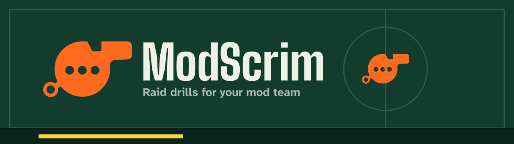
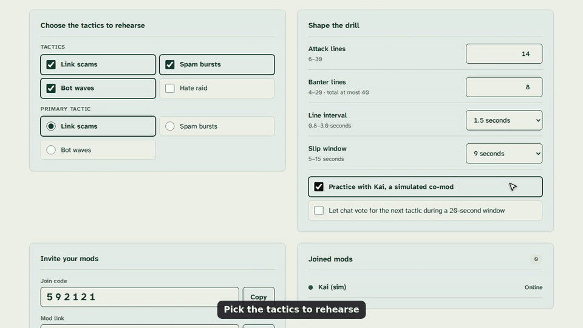
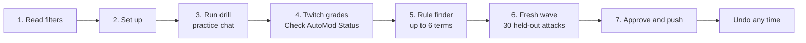
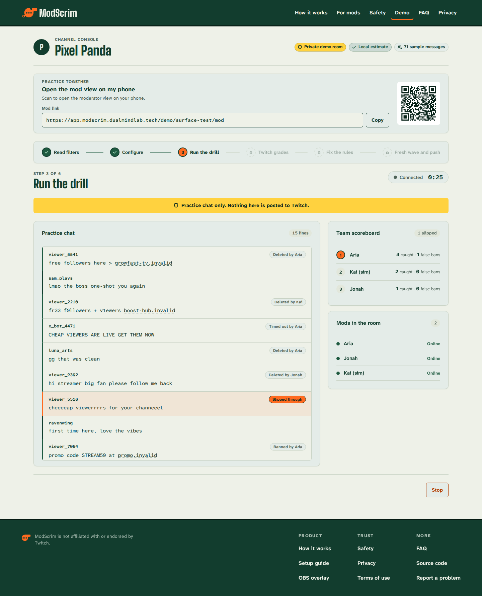
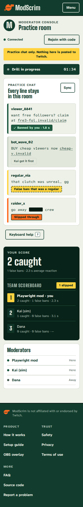
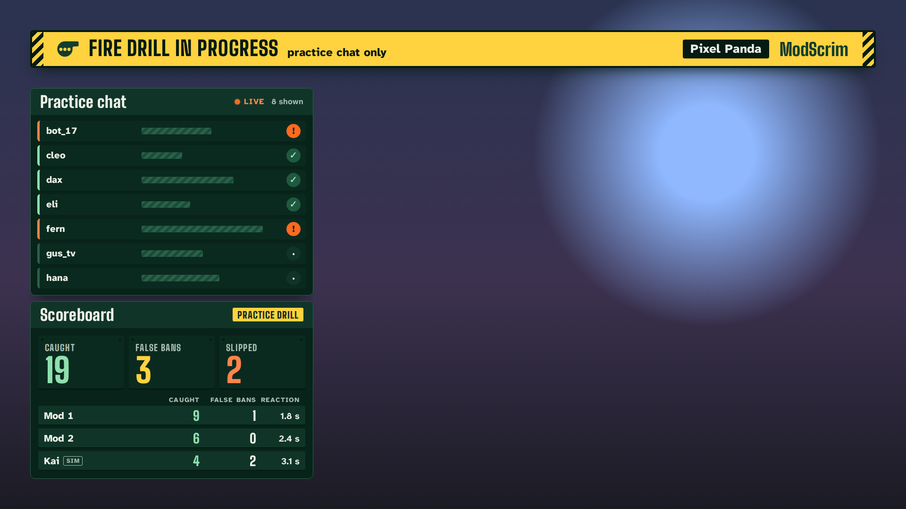
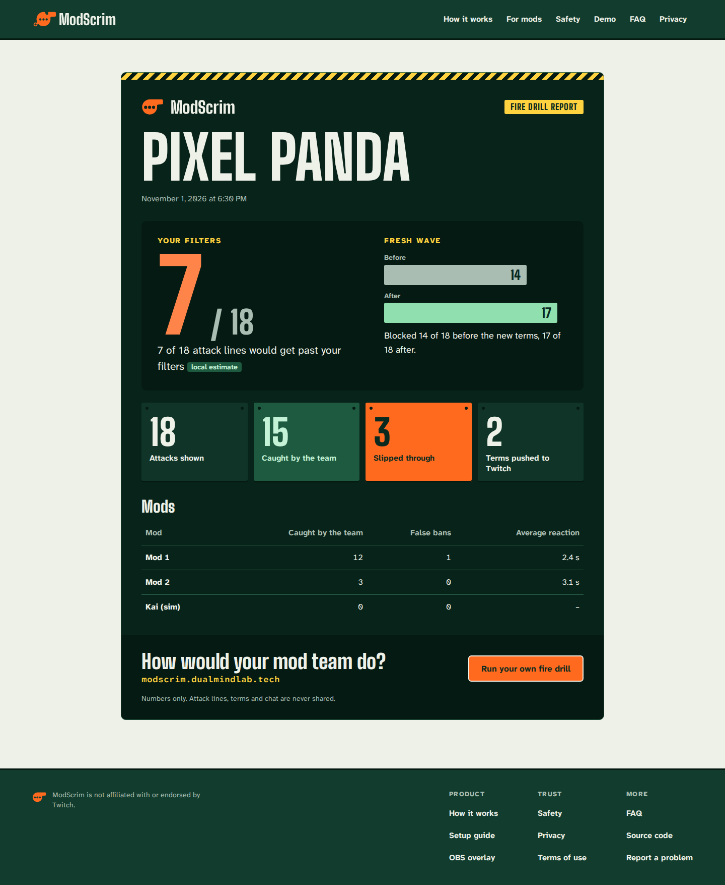
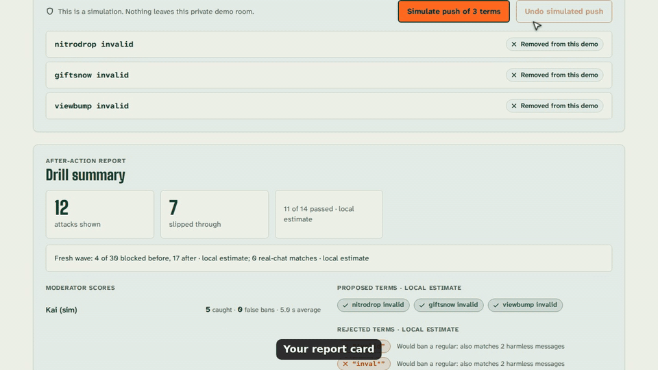
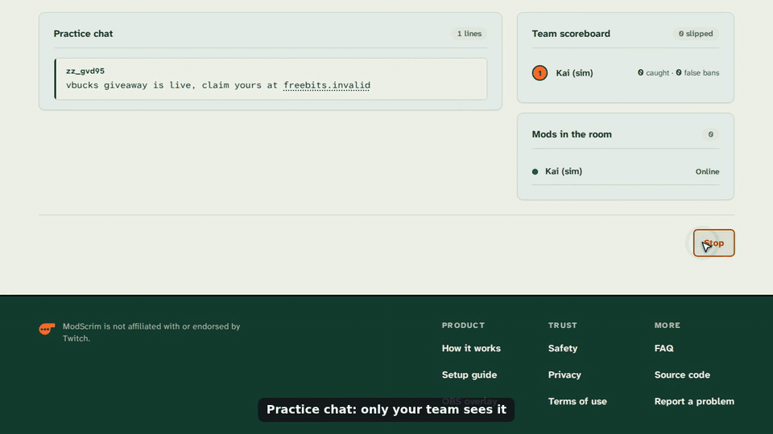
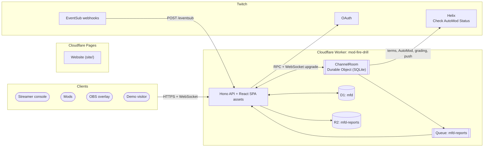

<p align="center">
  
</p>

<p align="center">
  <a href="https://github.com/harshbhx/modscrim/actions/workflows/ci.yml"></a>
  <a href="https://github.com/harshbhx/modscrim/actions/workflows/e2e.yml"></a>
  <a href="LICENSE"></a>
  <a href="https://twitchcon-codex.devpost.com"></a>
  
  
  
</p>

<h3 align="center">Raid drills for your mod team.</h3>

<p align="center">
  ModScrim floods a practice chat that only your team can see with spam built to slip past your channel's own filters.<br>
  Your mods race to clear it. Then Twitch grades your filters, and the blocked terms that close the gaps go live<br>
  when you approve them, with one-click undo.
</p>

<p align="center">
  <a href="https://app.modscrim.dualmindlab.tech/demo"><b>Try the live demo</b></a> (no Twitch account needed)
  &nbsp;|&nbsp;
  <a href="https://modscrim.dualmindlab.tech">Website</a>
  &nbsp;|&nbsp;
  <a href="docs/README.md">Documentation</a>
  &nbsp;|&nbsp;
  <a href="https://twitchcon-codex.devpost.com">Hackathon</a>
</p>

<!-- GIF hero: delete this comment wrapper when docs/assets/gifs/hero.gif exists.
<p align="center">
  
</p>
-->

**The three actions**

| Action | What happens | Where |
|---|---|---|
| **Try the demo** | A private practice room with a fake channel, a simulated co-mod (Kai) and the full loop. No account. Grading in demo rooms is a labelled local estimate. | [`/demo`](https://app.modscrim.dualmindlab.tech/demo) |
| **Sign in with Twitch** | Reads your public blocked terms and AutoMod levels so the drill is aimed at your own filters. | [`/auth/login`](https://app.modscrim.dualmindlab.tech) |
| **Start a drill** | Run it with your mods from the console; mods join with a link and a six-digit code, and OBS shows a redacted overlay. | [`/console`](https://app.modscrim.dualmindlab.tech/console) |

## Contents

- [What it does](#what-it-does)
- [How it works](#how-it-works)
- [Screenshots](#screenshots)
- [Features](#features)
- [How it stays safe](#how-it-stays-safe)
- [Architecture](#architecture)
- [Tech stack](#tech-stack)
- [Repository structure](#repository-structure)
- [Quick start](#quick-start)
- [Testing and CI](#testing-and-ci)
- [Deployment](#deployment)
- [Documentation](#documentation)
- [Built with Codex](#built-with-codex)
- [Roadmap and known limits](#roadmap-and-known-limits)
- [Licence](#licence)
- [Credits](#credits)

## What it does

Twitch moderators rarely get to practise a raid. ModScrim gives a mod team a rehearsal: a fake raid lands in a practice chat that only the team sees, the mods clear it against the clock, and the filters that would have stopped it are measured and improved.

A drill has seven steps:

1. **Read your filters.** ModScrim reads the channel's public blocked terms and AutoMod levels from Twitch and starts a 7-day chat log used for one thing: checking that new rules will not ban regulars.
2. **Set up the drill.** Pick tactics, the number of attack and banter lines, the speed and the slip window. Share the mod link and the six-digit join code, and add the overlay to OBS as a browser source.
3. **Run the drill.** The practice chat fills with attacks written to slip past the channel's filters, mixed with harmless banter. Mods delete, time out or ban from any device. The first action wins; a line nobody touches within the slip window slips through.
4. **Twitch grades your filters.** Every attack line goes to Twitch's Check AutoMod Status. When the channel's hourly limit runs out, ModScrim falls back to its own matcher and labels every number "local estimate".
5. **Find better rules.** The rule finder proposes up to six blocked terms that catch what got past. A term that would match the last 7 days of real chat, or a harmless banter line, is rejected and shown with the line it would have hit.
6. **Prove them on a fresh wave.** A second wave of 30 attacks, built from a new seed and tricks the rule finder never saw, shows how many are blocked before and after. Push stays disabled unless real-chat matches are zero.
7. **Approve, push and undo.** The streamer approves the terms, ModScrim adds them to the channel's blocked terms on Twitch, and one click removes exactly the terms that drill added.

> The website's [How it works](https://modscrim.dualmindlab.tech/how-it-works.html) page describes the same seven steps. The streamer console groups them into six screens: Read filters, Configure, Run the drill, Twitch grades, Fix the rules, and Fresh wave and push.

<!-- GIF how-it-works: delete this comment wrapper when docs/assets/gifs/how-it-works.gif exists.
<p align="center">
  
</p>
-->

## How it works



Read more in [How it works](docs/how-it-works.md).

## Screenshots

<!-- Screenshots: add each image under docs/assets/screenshots/ and delete the comment wrapper.
| Streamer console | Mod view |
|---|---|
|  |  |
| **OBS overlay** | **After-action report** |
|  |  |
-->

Screenshots of the console, mod view, OBS overlay and report are coming. Until then, the [live demo](https://app.modscrim.dualmindlab.tech/demo) shows all of them, and CI uploads light and dark screenshots of every surface at 375, 768 and 1440 px as the `screenshots-<run id>` artifact of the [End-to-end workflow](.github/workflows/e2e.yml).

## Features

- **Practice chat, never real chat.** Attacks exist only inside the drill's own room.
- **Aimed at your filters.** The generated lines are built to slip past this channel's public blocked terms, using tricks such as spacing, dotted letters, leetspeak, look-alike letters and zero-width characters.
- **Four tactics.** Fake giveaway links, viewer and follower spam, promo bots, and a placeholder hate raid that is off by default and shown with a content warning.
- **Mods on any device.** A join link plus a six-digit code; the mod view works from 360 px wide, with keyboard shortcuts (D, T and B act on the focused line).
- **Kai (sim).** A simulated co-mod for rehearsing alone, always labelled and scored separately.
- **Honest grading.** Every grade names its engine: "graded by Twitch" or "local estimate".
- **Rules proven before they ship.** Up to six proposed terms, checked against real chat and a fresh, held-out wave.
- **Approve, push, undo.** Nothing reaches Twitch without the streamer's approval, and every push can be undone.
- **A redacted OBS overlay.** Viewers see an alarm bar, a scoreboard and a practice chat whose text is blurred into bars.
- **After-action report.** Per-mod scores, grades, proposed, rejected and pushed terms, and the fresh-wave result, with numbers-only share links.
- **Deterministic.** The same seed gives the same wave, so a drill can be replayed and tested.

<!-- GIF end: delete this comment wrapper when docs/assets/gifs/end.gif exists.
<p align="center">
  
</p>
-->

## How it stays safe

Each rule below is enforced in code and covered by tests; the full list is in [Safety](docs/safety.md).

| Promise | How it is enforced |
|---|---|
| **Practice chat only.** | Attack lines are never sent to Twitch chat. The one message the app can send is a fixed announcement behind the `ANNOUNCE_ENABLED` flag, which is `false` in `app/wrangler.jsonc`; the extra chat-write scope is only requested when the flag is on. |
| **Every link ends in `.invalid`.** | The link tricks in [`packages/core/src/tricks.ts`](packages/core/src/tricks.ts) always append `.invalid`, and the `safety.links` Playwright spec checks rendered lines. |
| **Slurs are placeholders.** | Only the placeholders `slurx` and `slury` exist, drawn as solid blocks. No real slur list is in the repository. |
| **Redacted overlay.** | Overlay sockets receive only `{ lineId, user, len }` per line, no reveal and no terms. The overlay message schema is strict, so a readable field fails to build, and a Worker test checks every overlay frame of a full drill. |
| **One-click undo.** | Pushes store the term IDs Twitch returns; Undo removes only the terms that drill added, never terms that already existed. |
| **AutoMod is read-only.** | The app reads AutoMod settings and never calls Twitch's update endpoint. |
| **Demo rooms stay local.** | Demo rooms never call Twitch, D1, R2 or the report queue, and delete themselves after two idle hours. |
| **Data is minimal.** | Public chat is kept for 7 days for the false-ban check, can be paused or deleted, and is removed on sign-out. Reports carry counts, not attack text or chat text. |

<!-- GIF safety: delete this comment wrapper when docs/assets/gifs/safety.gif exists.
<p align="center">
  
</p>
-->

## Architecture



One `ChannelRoom` Durable Object owns everything about one channel: the drill clock (a single alarm multiplexed through a `schedule` table), hibernating WebSockets for the console, mods and overlay, the chat log, grades and reports. D1 holds only small global records such as users, sealed tokens and the audit log. The Queue and R2 bucket carry the report-export pipeline in production only. Details are in [Architecture](docs/architecture.md).

## Tech stack

| Layer | Choice |
|---|---|
| Language | TypeScript 5, `strict`, `noUncheckedIndexedAccess`, npm workspaces |
| Runtime | Cloudflare Workers with Durable Objects (SQLite), D1, Queues and R2 |
| Worker | Hono, zod at every boundary |
| Web app | React 19, React Router 7, plain CSS with custom properties, Vite with the Cloudflare plugin |
| Core engine | `@mfd/core`: a pure, seeded TypeScript package that runs unchanged in Node, browsers and `workerd` |
| Twitch | OAuth, Helix, EventSub webhooks (chat), Check AutoMod Status |
| Tests | Vitest (Node and `workerd` pools), Playwright |
| Design | Big Shoulders, Atkinson Hyperlegible Next and Mono, self-hosted; tokens in `design/` |
| No paid AI at runtime | The attack engine, rule finder and scoring are deterministic code |

The full list with versions is in [`docs/for-agents/tech-stack.md`](docs/for-agents/tech-stack.md).

## Repository structure

```text
modscrim/
├── app/                  Worker + React SPA (deployed to app.modscrim.dualmindlab.tech)
│   ├── worker/           Hono routes, auth, Twitch clients, ChannelRoom modules, jobs
│   ├── src/              React routes, components, styles, copy deck
│   ├── migrations/       D1 schema (0001_init.sql)
│   ├── test/             Worker tests (Vitest in workerd)
│   ├── e2e/              Playwright specs and fixtures
│   └── wrangler.jsonc    Worker, Durable Object, D1, Queue, R2 and preview config
├── packages/core/        @mfd/core: pure engine (matcher, tricks, waves, rule finder, proof, scoring)
├── site/                 Static website (Cloudflare Pages, modscrim.dualmindlab.tech)
├── brand/                Brand kit: DESIGN.md, logos, social images, OBS assets, fonts
├── design/               Design tokens (tokens.css, tokens.json, palette.json, overrides)
├── scripts/              Contrast gate, token sync, static server, load and Twitch helpers
├── docs/                 Documentation (start at docs/README.md); specs in docs/for-agents/
├── .github/workflows/    CI, end-to-end, deploy, preview, site, Lighthouse and demo checks
└── AGENTS.md             Rules for every AI coding agent working in the repo
```

## Quick start

Requirements: Node.js 22 or newer and npm. Demo rooms run locally and need no Twitch credentials.

```sh
git clone https://github.com/harshbhx/modscrim.git
cd modscrim
npm ci
```

Create `app/.dev.vars` with local-only values. This file is git-ignored; never commit it and never reuse these values in production.

```dotenv
PUBLIC_BASE_URL=http://localhost:5173
SESSION_HMAC_KEY=local-session-key-change-me
TOKEN_ENC_KEY=AAECAwQFBgcICQoLDA0ODxAREhMUFRYXGBkaGxwdHh8
EVENTSUB_SECRET=local-eventsub-secret
TWITCH_CLIENT_ID=local-client-id
TWITCH_CLIENT_SECRET=local-client-secret
```

```sh
npm run dev
```

Open <http://localhost:5173/demo>. Demo rooms use fixtures and never call Twitch, D1, R2 or the report queue. Twitch sign-in is tested on the deployed app because Twitch only accepts HTTPS redirect URIs. More in [Getting started](docs/getting-started.md).

## Testing and CI

```sh
npm test            # core tests (Node) + Worker tests (Vitest in workerd)
npm run typecheck   # tsc -b across workspaces
npm run e2e         # Playwright against the local dev server
npm run contrast:check
npm run site:tokens:check
```

The same checks, plus the browser suites, run in GitHub Actions on every pull request.

| Workflow | What it checks |
|---|---|
| [`ci.yml`](.github/workflows/ci.yml) | Contrast gate and action-border lint, site token sync, site colours; then secret scan, typecheck, core tests with coverage, Worker tests, build, and a 250 KiB gzip budget for initial JavaScript |
| [`e2e.yml`](.github/workflows/e2e.yml) | Playwright surface projects against the branch's build, then the setup, smoke, safety, console and mod projects against the deployed app |
| [`site.yml`](.github/workflows/site.yml) | The static site's Playwright project, with light and dark screenshots at 375, 768 and 1440 px |
| [`demo-e2e.yml`](.github/workflows/demo-e2e.yml) | A nightly run of the full demo loop against production |
| [`preview-app.yml`](.github/workflows/preview-app.yml) | Pull requests to `main` get a preview Worker with its own database |

Playwright projects: `setup`, `landing`, `shell-surface`, `console-surface`, `report-surface`, `mod-surface`, `overlay-surface`, `shared-states`, `site`, `smoke`, `safety`, `console`, `mod` and `demo`. See [Testing](docs/testing.md).

## Deployment

The app and the website deploy separately.

- **App Worker** (`mod-fire-drill`, `app/`): [`deploy-app.yml`](.github/workflows/deploy-app.yml) runs on pushes to `main` that touch the app. It typechecks, tests, applies D1 migrations, runs `npm run deploy` and health-checks `/api/health` on `https://app.modscrim.dualmindlab.tech`.
- **Website** (`site/`): a Git-connected Cloudflare Pages project serves `https://modscrim.dualmindlab.tech`.

Secrets (`PUBLIC_BASE_URL`, `TWITCH_CLIENT_SECRET`, `EVENTSUB_SECRET`, `SESSION_HMAC_KEY`, `TOKEN_ENC_KEY`) are set with `wrangler secret put` and are never in the repository. See [Deployment](docs/deployment.md).

## Documentation

| Page | Read it for |
|---|---|
| [Docs index](docs/README.md) | Everything below, in one table |
| [Getting started](docs/getting-started.md) | Try the demo, run locally, set up Twitch |
| [How it works](docs/how-it-works.md) | The drill, step by step |
| [Safety](docs/safety.md) | What ModScrim will and will not do |
| [Architecture](docs/architecture.md) | Worker, Durable Object, D1, Queue, R2 and Twitch |
| [Deployment](docs/deployment.md) | Workers, Pages and the workflows |
| [Testing](docs/testing.md) | Suites, Playwright projects and the CI gates |
| [Design system](docs/design-system.md) | Tokens, contrast gate and brand kit |
| [Troubleshooting](docs/troubleshooting.md), [FAQ](docs/faq.md), [Glossary](docs/glossary.md), [Contributing](docs/contributing.md) | Help and reference |
| [Specs for agents](docs/for-agents/INDEX.md) | The PRD, the SRS and their digests |

## Built with Codex

The project is an entry in the Codex x TwitchCon hackathon, which requires the work to be built with OpenAI Codex. The team's process, as recorded in the repository:

- **Specs first.** The [PRD](docs/for-agents/PRD.md) and [SRS](docs/for-agents/SRS.md) are the source of truth for scope, copy, safety and implementation. [`AGENTS.md`](AGENTS.md) tells every coding agent which spec wins, what it must never break, and that it may not add a feature, endpoint, dependency or table the specs do not list.
- **Tickets, tests first.** Work is split into numbered tickets on the project board. Agents write the tests the SRS names, watch them fail, then implement; `npm test` and `npm run typecheck` must pass.
- **Humans review and decide.** The PRD describes the builder as Codex writing most of the code from SRS tickets, with humans reviewing, testing and deciding. Commits are authored by the human builders.
- **A written trail.** [`docs/LOG.md`](docs/LOG.md) records decisions, day-0 results and a note per working session.
- **Claude Code for the design and documentation pass.** The brand kit's colour tokens were generated with a Claude Code skill checked in under [`.claude/skills/artistic-color-palettes/`](.claude/skills/artistic-color-palettes/), and the UI v2 and documentation work was done with Claude Code agents under the owner's direction. The runtime uses no AI service by default.

The Codex session ID for the submission is provided in the Devpost entry.

## Roadmap and known limits

Stated up front so the numbers mean what they say.

- **The day-0 Twitch validation is not complete.** The live test-channel run that measures the grading quota and Twitch's matching behaviour has not been recorded, so this README makes no claim of measured improvement on a real channel. The only recorded result is a fixture-only dry run, labelled as such in [`docs/LOG.md`](docs/LOG.md).
- **Demo grading is a local estimate**, not a Twitch grade.
- **Only public blocked terms are visible.** Twitch does not return private terms to apps.
- **Two engines can disagree.** Twitch's check also applies AutoMod categories and permitted terms, which the local matcher does not model.
- **Some tricks need a bot.** Blocked terms cannot express spaced or dotted letters, zero-width characters, emoji inside a word or look-alike letters. ModScrim labels those "needs a bot rule".
- **It is not a moderation bot.** It never acts on real chat.
- **Open questions** such as whether mod teams would schedule drills without a hackathon reason (Q-01) are tracked in [`docs/for-agents/open-questions.md`](docs/for-agents/open-questions.md).

Ticket status lives on the [project board](https://github.com/users/harshbhx/projects/3) and in [`docs/for-agents/build-plan.md`](docs/for-agents/build-plan.md).

## Licence

MIT. See [`LICENSE`](LICENSE). ModScrim is an independent project and is not affiliated with or endorsed by Twitch.

## Credits

- Built by Harsh Bhanushali and Dhairya Patel for the Codex x TwitchCon hackathon, 2026.
- Fonts: Big Shoulders (Patric King, Chicago Design System) and Atkinson Hyperlegible Next and Mono (Braille Institute), under the SIL Open Font License; the licence files ship next to the fonts in [`brand/fonts/`](brand/fonts/).
- Palette data: the colour-token skill uses data from [The Dictionary of Color Combinations](https://colorcombinations.org/) (Caslon Media, CC BY 4.0), with Sanzo Wada's plates digitised by Matt DesLauriers (MIT). The kasane palettes use base colours after Wikipedia's "Traditional colors of Japan" (CC BY-SA 4.0). Full attributions are in [`NOTICE.md`](.claude/skills/artistic-color-palettes/NOTICE.md).
- Design references: hand-turned ballpark scoreboards, coaches' tactics boards, the Acme Thunderer whistle and Braille Institute's Atkinson Hyperlegible family. See [`brand/DESIGN.md`](brand/DESIGN.md).
