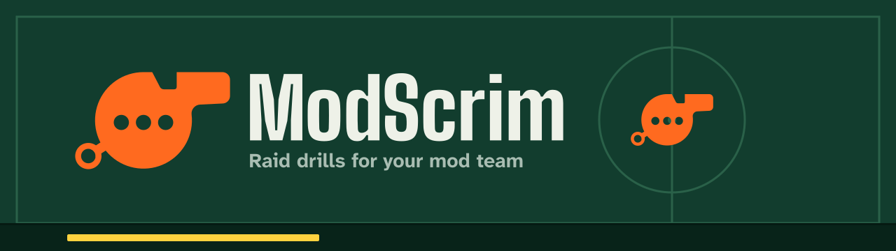

  

<h1 align="center">ModScrim documentation</h1>

  <b>Everything about ModScrim in one place:</b> what a drill does, why it is safe, how it is built, 
  and how to run, test, deploy and grow it.

  
  
  

  <a href="#-streamers">Streamers</a> ·
  <a href="#-mods">Mods</a> ·
  <a href="#-developers">Developers</a> ·
  <a href="#-judges">Judges</a> ·
  <a href="#-specifications-and-records">Specs and records</a> ·
  <a href="#-conventions">Conventions</a>

[Repository](../README.md) / Docs

> [!TIP]
> **New here?** Read [Getting started](getting-started.md), then [How it works](how-it-works.md). Or skip the reading and run a drill in the [live demo](https://app.modscrim.dualmindlab.tech/demo): it needs no account and sends nothing to Twitch.

## Pick your path

<table>
  <tr>
    <td width="25%" valign="top" align="center"><h3>🎤 Streamers</h3>Rehearse your team and fix your filters without banning regulars.  <a href="#-streamers"><b>Start here ↓</b></a></td>
    <td width="25%" valign="top" align="center"><h3>🧹 Mods</h3>Join a drill, learn the keys and see how you are scored.  <a href="#-mods"><b>Start here ↓</b></a></td>
    <td width="25%" valign="top" align="center"><h3>💻 Developers</h3>Run it locally, read the architecture and make a change.  <a href="#-developers"><b>Start here ↓</b></a></td>
    <td width="25%" valign="top" align="center"><h3>🏆 Judges</h3>See the loop working in two minutes, then check the evidence.  <a href="#-judges"><b>Start here ↓</b></a></td>
  </tr>
</table>

## 🎤 Streamers

| Page | Read it when you want to |
|---|---|
| [Getting started](getting-started.md) | Try the demo, connect Twitch and run a drill with your team |
| [How it works](how-it-works.md) | Follow a drill from the first read of your filters to push and undo |
| [Safety](safety.md) | Check what ModScrim will never do and how each promise is enforced |
| [Troubleshooting](troubleshooting.md) | Fix a stuck grade, a blank overlay or a 429 |
| [FAQ](faq.md#for-streamers) | Get quick answers about filters, data and grading |
| [Business plan](business.md) | See where ModScrim could go: tiers, costs and risks, all marked as assumptions |

On the website: [quick start](https://modscrim.dualmindlab.tech/docs/streamer/quick-start.html) · [connect Twitch](https://modscrim.dualmindlab.tech/docs/streamer/connect-twitch.html) · [console walkthrough](https://modscrim.dualmindlab.tech/docs/streamer/console-walkthrough.html) · [grades and report](https://modscrim.dualmindlab.tech/docs/streamer/grades-and-report.html) · [push and undo](https://modscrim.dualmindlab.tech/docs/streamer/push-and-undo.html)

<a href="#docs-top">Back to top ↑</a>

## 🧹 Mods

| Page | Read it when you want to |
|---|---|
| [How it works](how-it-works.md) | See the drill from start to report, including the slip window |
| [FAQ](faq.md#for-mods) | Get quick answers about joining, keys and scoring |
| [Glossary](glossary.md) | Look up a term: slipped, wave B, engine, sealed |
| [Safety](safety.md) | Know that the practice chat never reaches real chat or viewers |

On the website: [join a drill](https://modscrim.dualmindlab.tech/docs/mods/join.html) · [the practice chat](https://modscrim.dualmindlab.tech/docs/mods/practice-chat.html) · [keyboard shortcuts](https://modscrim.dualmindlab.tech/docs/mods/keyboard.html) · [scoring](https://modscrim.dualmindlab.tech/docs/mods/scoring.html) · [Kai, the simulated co-mod](https://modscrim.dualmindlab.tech/docs/mods/simulated.html)

<a href="#docs-top">Back to top ↑</a>

## 💻 Developers

| Page | Read it when you want to |
|---|---|
| [Getting started](getting-started.md#2-run-it-locally) | Run the app locally with demo rooms and no Twitch credentials |
| [Architecture](architecture.md) | See how the Worker, the `ChannelRoom` Durable Object, D1, R2, the Queue and Twitch fit together |
| [Testing](testing.md) | Run the suites and understand the CI gates |
| [Deployment](deployment.md) | Ship the Worker and the website, and read the workflows |
| [Design system](design-system.md) | Use the tokens, the contrast gate and the brand kit |
| [Contributing](contributing.md) | Make a change the way this repository expects (summary: [`CONTRIBUTING.md`](../CONTRIBUTING.md)) |
| [Troubleshooting](troubleshooting.md#for-people-running-the-app) | Fix local and deployment problems |

> [!IMPORTANT]
> Before writing code, read [`AGENTS.md`](../AGENTS.md). It holds the safety rules that never bend and says which spec wins when they disagree.

<a href="#docs-top">Back to top ↑</a>

## 🏆 Judges

| Look at | What it shows |
|---|---|
| [Live demo](https://app.modscrim.dualmindlab.tech/demo) | The full loop in a private practice room, in about two minutes, with no account |
| [Demo video](https://www.youtube.com/watch?v=r7xsUjA51F0) | The project video on YouTube |
| [How it works](how-it-works.md) | The seven steps, scoring and the limits worth knowing |
| [Safety](safety.md) | Each safety promise and the code or test that enforces it |
| [Research and references](references.md) | The papers, articles and Twitch and Cloudflare docs the project rests on |
| [Build log](LOG.md) | Decisions, day-0 results, Codex sessions and a note per working session |
| [FAQ for judges](faq.md#for-judges) | Where to start, what the hard part is, and what is not proven yet |
| [Business plan](business.md) | How ModScrim could become a business, with every number marked as an assumption |

> [!NOTE]
> Grades in demo rooms are a labelled **local estimate**, not a Twitch grade. The live day-0 run on a test channel is not yet recorded, so no measured improvement on a real channel is claimed anywhere in these docs.

<a href="#docs-top">Back to top ↑</a>

## 📐 Specifications and records

| Path | Read by | Contents |
|---|---|---|
| [`for-agents/`](for-agents/INDEX.md) | AI coding agents and reviewers | The [PRD](for-agents/PRD.md) (what and why), the [SRS](for-agents/SRS.md) (how), and digests: [`architecture`](for-agents/architecture.md), [`tech-stack`](for-agents/tech-stack.md), [`interfaces`](for-agents/interfaces.md), [`twitch`](for-agents/twitch.md), [`safety-security-privacy`](for-agents/safety-security-privacy.md), [`build-plan`](for-agents/build-plan.md), [`testing`](for-agents/testing.md), [`glossary`](for-agents/glossary.md), [`open-questions`](for-agents/open-questions.md) |
| [`for-humans/`](for-humans/) | Judges, teammates, reviewers | [`PRD.pdf`](for-humans/PRD.pdf), [`SRS.pdf`](for-humans/SRS.pdf) |
| [`LOG.md`](LOG.md) | Everyone | Decisions, day-0 results and a note per working session |
| [`assets/`](assets/README.md) | Doc authors | The banner, GIFs and screenshots used by the README and these pages |

The guides above are written for people and link into the digests for detail. When the Markdown and PDF specs disagree, the Markdown is the source; fix it first, then regenerate the PDF.

<b>Community files</b>

 

| File | What it covers |
|---|---|
| [`CONTRIBUTING.md`](../CONTRIBUTING.md) | Branches, tests first, commit naming, safety rules, no secrets |
| [`CODE_OF_CONDUCT.md`](../CODE_OF_CONDUCT.md) | Contributor Covenant 2.1 |
| [`SECURITY.md`](../SECURITY.md) | How to report a vulnerability privately, and what is in scope |
| [`SUPPORT.md`](../SUPPORT.md) | Where to ask for help |

## 📏 Conventions

- Every page starts with a breadcrumb and a one-paragraph summary and ends with **Next** links.
- Commands are the real npm scripts from the root [`package.json`](../package.json). Nothing here needs a secret; secret names appear, values never do.
- Where a number or behaviour is unconfirmed (for example the live Twitch grading quota), the page says so.
- Some website pages are built from these Markdown files. After editing one, run `npm run site:docs`.

**Next:** [Getting started](getting-started.md)
