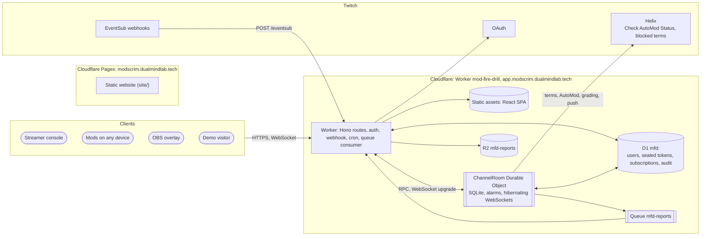

# Architecture

[Docs](README.md) / Architecture

> One Cloudflare Worker serves the React app and the API, one `ChannelRoom` Durable Object per channel owns the drill, D1 keeps small global records, and Twitch is reached through OAuth, Helix and EventSub webhooks. This page is the overview; the deep digest is [`for-agents/architecture.md`](for-agents/architecture.md) and the normative text is the [SRS](for-agents/SRS.md).

## System context

The website and the app are separate deployments. The website (`site/`) is static and never calls the app's API; its buttons link to the app host. The app (`app/`) is one Worker: the SPA is served as static assets and the Worker runs first only for `/api/*`, `/auth/*`, `/ws/*` and `/eventsub`.

## Components

| Component | Location | Responsibility |
|---|---|---|
| Core engine | [`packages/core`](../packages/core/src) (`@mfd/core`) | Pure TypeScript: seeded PRNG, matcher, tricks, templates, wave builder, rule finder, clean index, proof, scoring, Kai (sim), pacing, coach note, schemas. No I/O, no clock, no `Math.random()` |
| Worker entry | [`app/worker/index.ts`](../app/worker/index.ts) | Hono app; exports `ChannelRoom`; `fetch`, `scheduled` (hourly cron) and `queue` handlers |
| Routes | [`app/worker/routes/`](../app/worker/routes) | `auth`, `api`, `mod`, `demo`, `eventsub`, `reports`, `ws` |
| Auth | [`app/worker/auth/`](../app/worker/auth) | Token sealing, signed sessions, cookies, origin check, deletion |
| Twitch | [`app/worker/twitch/`](../app/worker/twitch) | OAuth, Helix client, webhook signature verification |
| Room | [`app/worker/room/`](../app/worker/room) | `ChannelRoom` split into scheduler, hub (sockets), drill, chat log, grading, rules, push, report, demo, tokens and tickets |
| Jobs | [`app/worker/jobs/`](../app/worker/jobs) | Hourly token validation, purges and subscription health; report export |
| Web app | [`app/src/`](../app/src) | React routes: landing, console, mod, overlay, demo, report, privacy |

## The `ChannelRoom` Durable Object

- **One room per channel.** Live rooms are `ch:<broadcasterId>`, demo rooms `demo:<uuid>`. Everything about a channel lives in its room, so rooms never coordinate with each other.
- **One alarm, many jobs.** A `schedule` table holds `(due_at, kind, key, payload, attempts)` with a unique `(kind, key)`. The single alarm fires the earliest due job; jobs are idempotent because alarms can fire more than once, and failures retry with backoff.
- **Atomic changes.** First action wins, slip marking and push bookkeeping run inside `transactionSync()` with no `await` between read and write.
- **Hibernating WebSockets.** Console, mod and overlay sockets use the Hibernation API, so the room can sleep while sockets stay open. Each broadcast builds one payload per role, so overlays only ever get redacted data.
- **Drift-free clock.** Line `n` is due at `startedAt + n x interval`, never "now plus interval".
- **Lifecycle.** Live rooms last while the streamer is signed in; `destroy()` deletes all storage. Demo rooms delete themselves after two idle hours.

## Where data lives

| Store | Holds |
|---|---|
| Room SQLite (one per channel or demo) | Channel meta, cached filters, chat log, drills, wave lines, line states, participants, grades, rule runs, proofs, pushes, reports, schedule, ticket nonces |
| D1 `mfd` | Users, sealed OAuth tokens, channel index, EventSub subscriptions, audit log, report summaries (schema in [`0001_init.sql`](../app/migrations/0001_init.sql)) |
| R2 `mfd-reports` (production only) | Exported report JSON and Markdown |
| Queue `mfd-reports` (production only) | Report-export jobs carrying IDs only |
| Browser | Session cookies; a mod's participant token in `sessionStorage` |

D1 is never written per chat message. The Queue, R2 and AI bindings are optional in the Worker's types and every use is guarded, so the core product deploys without them; the preview environment sets R2 and the Queue empty.

## Key flows

**Sign-in.** `/auth/login` goes to Twitch consent, `/auth/callback` checks `state` and exchanges the code, tokens are sealed into D1, the room is bootstrapped (reading terms and AutoMod), the chat subscription is created with the app token, a session is set and the browser lands on `/console`. A failed subscription does not fail sign-in.

**Chat ingest.** Twitch POSTs to `/eventsub`. The Worker verifies the HMAC on the raw body, checks the timestamp, and hands the message to the room, which dedupes by message ID, ignores shared-chat messages from other channels, tokenises and stores it. The Worker answers 204, or 500 if the room call fails so Twitch retries.

**Drill, grade, rules, proof, push.** The console starts a drill; `line.emit` alarms broadcast each line per role; mods send actions; `drill.end` scores and saves a report; grading sends paced Check AutoMod Status batches; the rule finder runs; the fresh-wave proof runs; push adds terms one at a time; undo removes only what that drill added.

## Cloudflare configuration at a glance

| Item | Value (from [`app/wrangler.jsonc`](../app/wrangler.jsonc)) |
|---|---|
| Worker | `mod-fire-drill`, custom domain `app.modscrim.dualmindlab.tech`, `workers.dev` enabled |
| Durable Object | `ROOM` bound to `ChannelRoom`, SQLite migration tag `v1` |
| D1 | `DB` bound to database `mfd`, migrations in `app/migrations` |
| Cron | `7 * * * *` (hourly) |
| Rate limiters | `JOIN_LIMITER` 10 per 60 s, `DEMO_LIMITER` 5 per 60 s, `AUTH_LIMITER` 20 per 60 s |
| Reports | R2 bucket and Queue both named `mfd-reports`; consumer batch 10, timeout 5 s, 3 retries |
| Preview environment | Separate Worker and database, no cron, R2 or Queue, local grading |

**Next:** [Deployment](deployment.md) | [Testing](testing.md) | [Glossary](glossary.md)
