## Your mods have never practised a raid. Now they can.

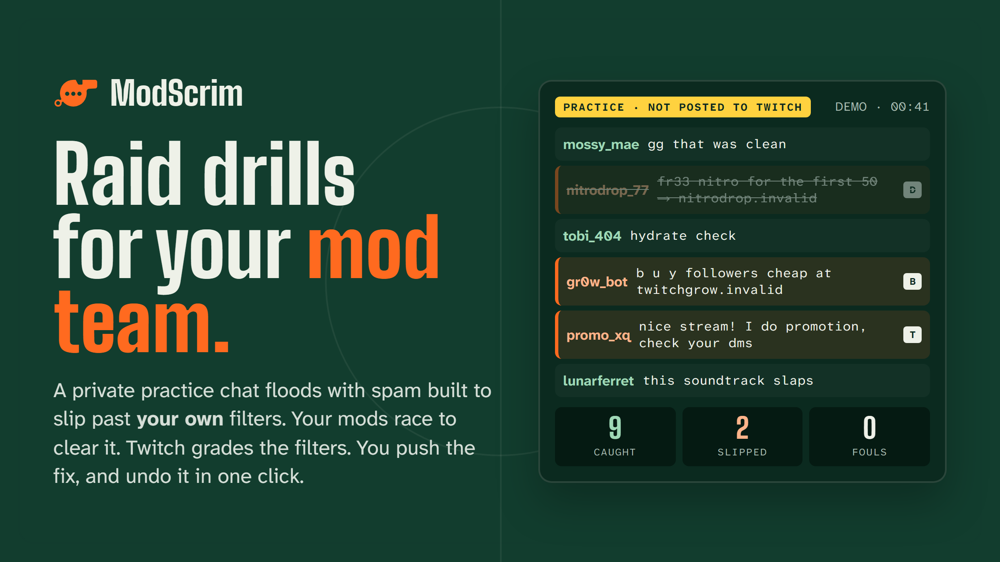

**ModScrim runs fire drills for a Twitch channel's moderators.** A private practice chat floods with spam built to slip past *this channel's own* blocked terms. The mods race to clear it. Then Twitch grades the filters, a rule finder proposes the blocked terms that close the gaps, the terms are proven on a fresh wave of spam they have never seen, and the streamer pushes them with one click and can undo with another.

> **Try it in 60 seconds, no account needed:** [app.modscrim.dualmindlab.tech/demo](https://app.modscrim.dualmindlab.tech/demo)
> The demo sends nothing to Twitch.
>
> **Watch the video:** [youtube.com/watch?v=r7xsUjA51F0](https://www.youtube.com/watch?v=r7xsUjA51F0)

**In the demo:** start a drill, clear lines with **D** (delete), **T** (timeout) and **B** (ban), then follow the console through the grade, the proposed terms and the fresh-wave proof. Approve the terms, undo them, and open the overlay to see what viewers would see: blurred bars, never readable attacks.

---

## The problem

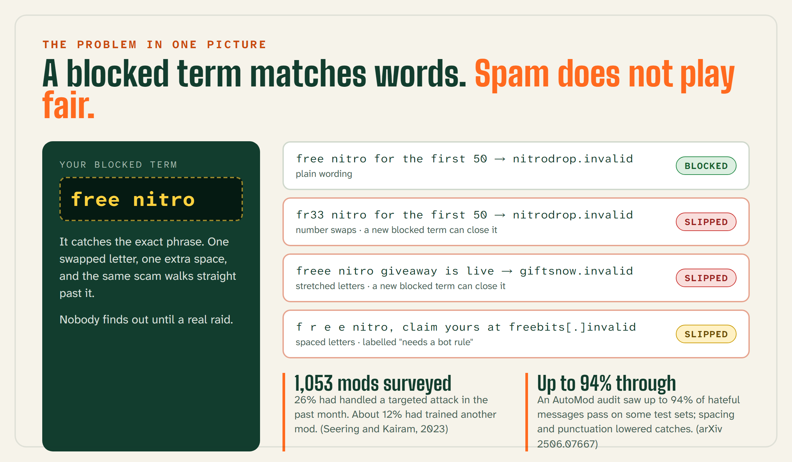

Twitch mod teams are volunteers, and **the only practice most of them get is a real raid**, with real harm and an audience watching. Streamers tune their filters by guesswork: a new blocked term might ban a regular, and nobody can see that risk until the term is live.

- **Mods learn on the job.** In a survey of **1,053 Twitch moderators**, about 12% had trained another mod in the past month, and 26% had handled a targeted attack in that month. Mods learn mostly from streamers (76%) and other mods (69%), more than from Twitch's tutorials (49%). ([Seering and Kairam, 2023](https://joseph.seering.org/papers/Seering_and_Kairam_2023_Who_Moderates_Twitch_What_Do_They_Do.pdf))
- **Filters leak, and they leak both ways.** An audit of AutoMod let through **up to 94% of hateful messages** on some test sets and blocked up to 89.5% of harmless messages that used sensitive words. Spacing and punctuation changes lowered what it caught. ([arXiv 2506.07667](https://arxiv.org/abs/2506.07667))

A blocked term matches words. Spam does not play fair. ModScrim lets a team find that out in a drill, not in a raid.

---

## How it works: Drill, Grade, Fix

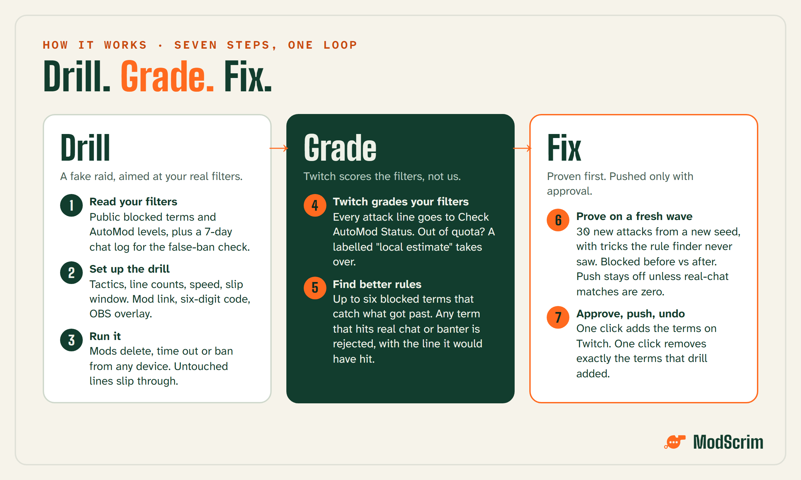

### Drill

1. **Read your filters.** ModScrim reads the channel's public blocked terms and AutoMod levels from Twitch and starts a 7-day chat log used for one thing: checking that new rules will not ban regulars.
2. **Set up the drill.** Pick tactics, the number of attack and banter lines, the speed and the slip window. Share the mod link and six-digit join code, and add the overlay to OBS as a browser source.
3. **Run the drill.** The practice chat fills with attacks written to slip past the channel's filters, mixed with harmless banter. Mods delete, time out or ban from any device. The first action wins; a line nobody touches within the slip window slips through.

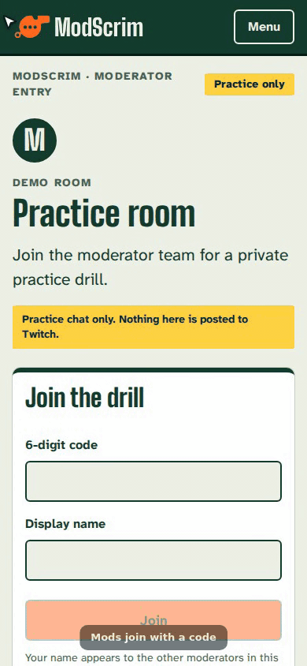

### Grade

4. **Twitch grades your filters.** Every attack line goes to Twitch's **Check AutoMod Status**. When the channel's hourly limit runs out, ModScrim falls back to its own matcher and labels every number "local estimate".
5. **Find better rules.** The rule finder proposes **up to six** blocked terms that catch what got past. A term that would match the last 7 days of real chat, or a harmless banter line, is rejected and shown with the line it would have hit.

### Fix

6. **Prove them on a fresh wave.** A second wave of **30 attacks**, built from a new seed and with tricks the rule finder never saw, shows how many are blocked before and after. **Push stays disabled unless real-chat matches are zero.**
7. **Approve, push and undo.** The streamer approves the terms, ModScrim adds them to the channel's blocked terms on Twitch, and one click removes exactly the terms that drill added.

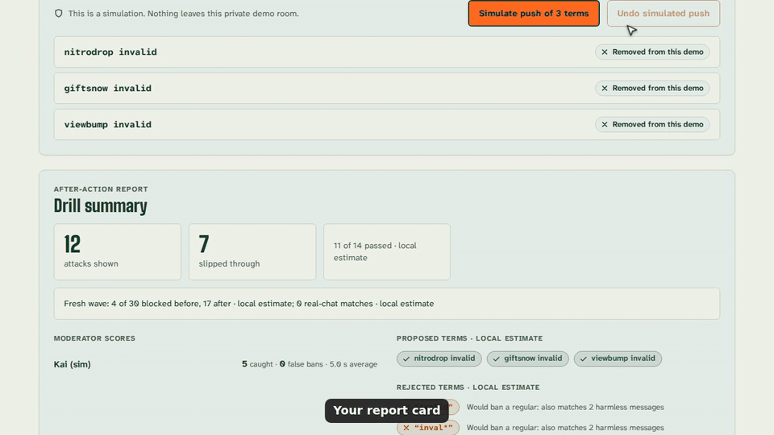

---

## What makes it different

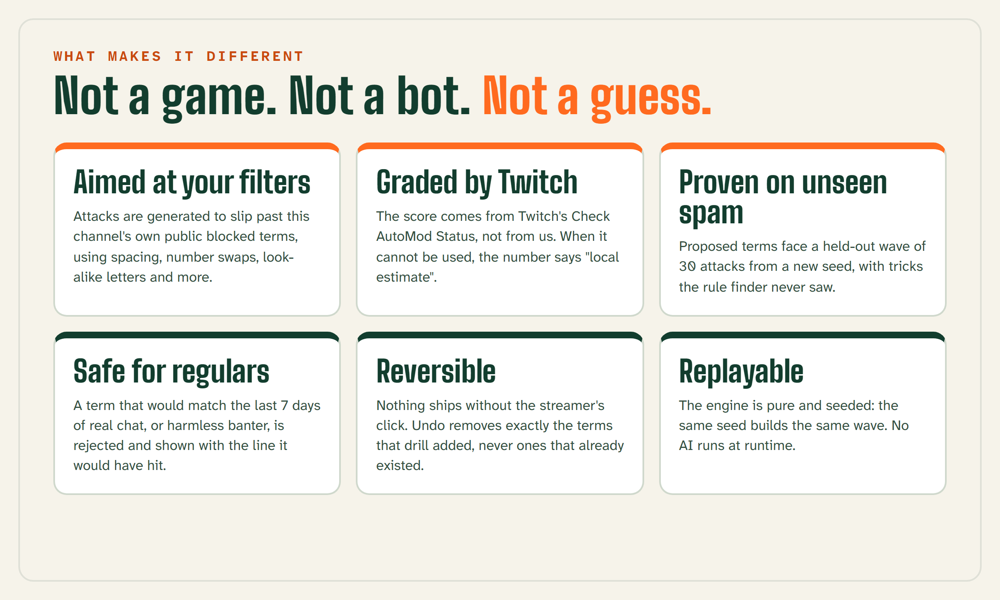

- **It trains people and tunes filters in the same loop.** The drill is fake and contained; the grading, the proposed rules and the false-ban check use the channel's real filters and real chat.
- **The attacks are aimed, not random.** The engine rewrites scam, spam and bot lines with spacing, dotted letters, number swaps, stretched letters, look-alike letters, emoji inside words and zero-width characters, so they get past *your* list.
- **A rule has to earn its place.** It must catch held-out spam it was not trained on and match zero lines of the channel's real chat before the push button unlocks.
- **It is honest about what a blocked term cannot do.** Spaced or dotted letters, zero-width characters and look-alike letters cannot be expressed as blocked terms, so ModScrim labels those "needs a bot rule" instead of pretending.
- **It is not a moderation bot.** It never acts on real chat.

---

## How it uses Twitch

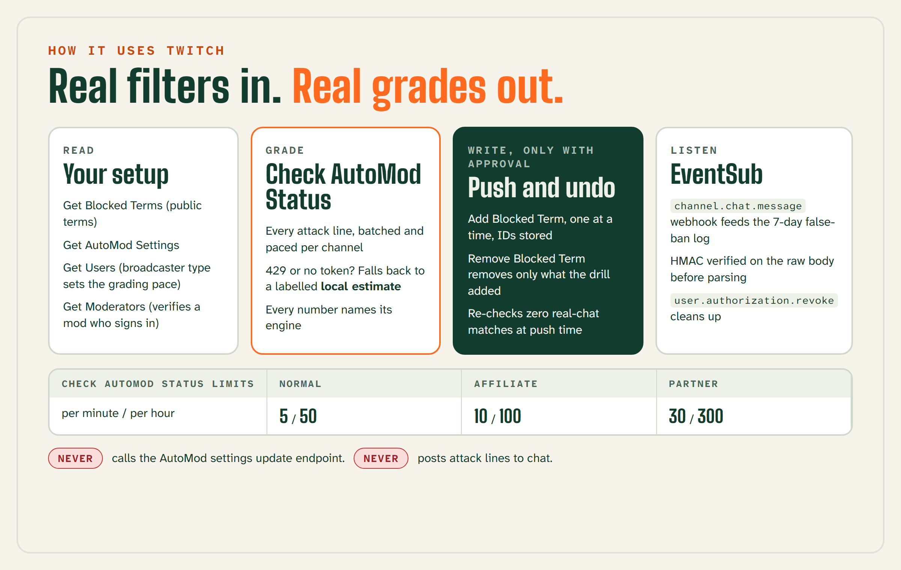

| Job | Twitch API |
|---|---|
| **Sign in** | OAuth authorization code flow, token refresh, hourly `/oauth2/validate` |
| **Read the setup** | Get Blocked Terms, Get AutoMod Settings, Get Users, Get Moderators |
| **Grade** | Check AutoMod Status (`POST /helix/moderation/enforcements/status`), paced per channel |
| **Push and undo** | Add Blocked Term (one at a time, IDs stored), Remove Blocked Term |
| **Listen** | EventSub webhooks: `channel.chat.message` for the 7-day log, `user.authorization.revoke` |

**Grading respects Twitch's limits.** Check AutoMod Status has a per-channel limit of 5 a minute and 50 an hour for normal channels, 10 and 100 for affiliates, and 30 and 300 for partners. ModScrim paces against those limits, reads `Ratelimit-*` headers, and after repeated 429s grades the rest locally and says so on screen.

**Webhooks are verified before they are read.** The HMAC-SHA256 signature is checked on the raw body with a constant-time compare before any `JSON.parse`, and stale timestamps are rejected.

**AutoMod is read-only.** ModScrim never calls Twitch's AutoMod settings update endpoint.

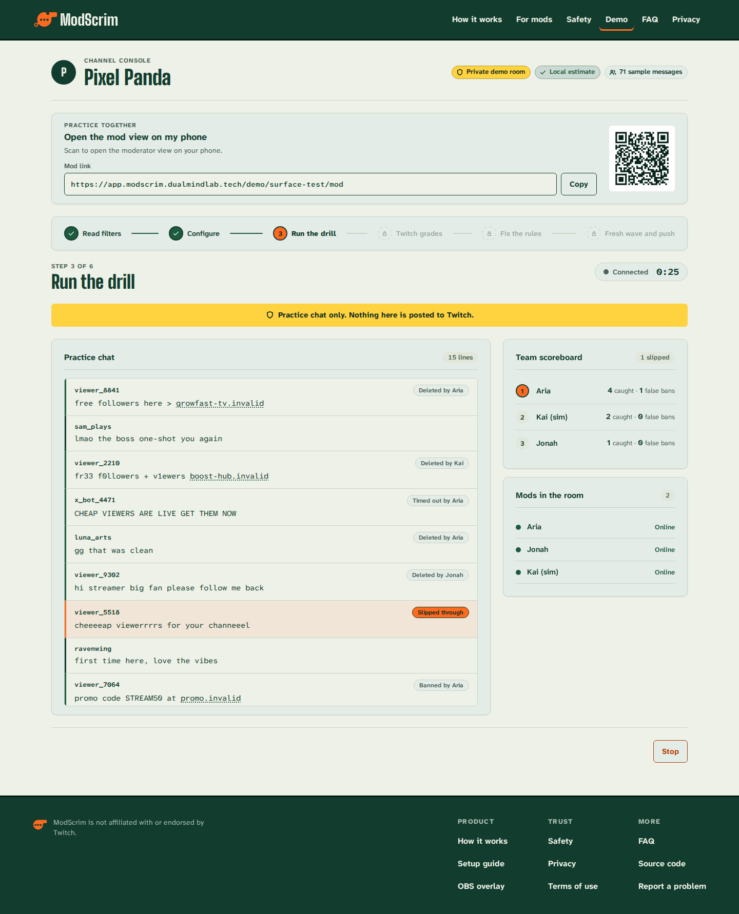

---

## How it runs on Cloudflare

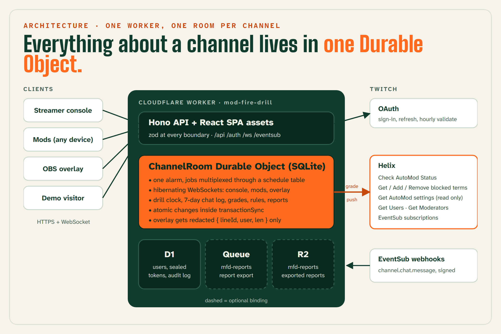

**One Worker, one room per channel.** A single Cloudflare Worker serves the Hono API and the React app. Each channel gets one **`ChannelRoom` Durable Object** with its own SQLite database, which owns everything about that channel:

- **The drill clock.** Durable Objects get one alarm each, so every job runs through a `schedule` table behind that single alarm. Alarms can fire more than once, so every job is idempotent.
- **Live sockets.** The console, mods and the OBS overlay connect over hibernating WebSockets, routed by role.
- **Atomic state.** Changes run inside `transactionSync`, so two mods hitting the same line at once still give one winner.
- **Small global data in D1:** users, sealed tokens (AES-256-GCM) and the audit log.
- **Reports** go through a Queue to R2 in production. Both are optional bindings, so the core product deploys without them.

**No paid AI at runtime.** The attack engine, rule finder and scoring are deterministic TypeScript in `@mfd/core`, a pure, seeded package that runs unchanged in Node, browsers and `workerd`.

---

## How we built it with OpenAI Codex

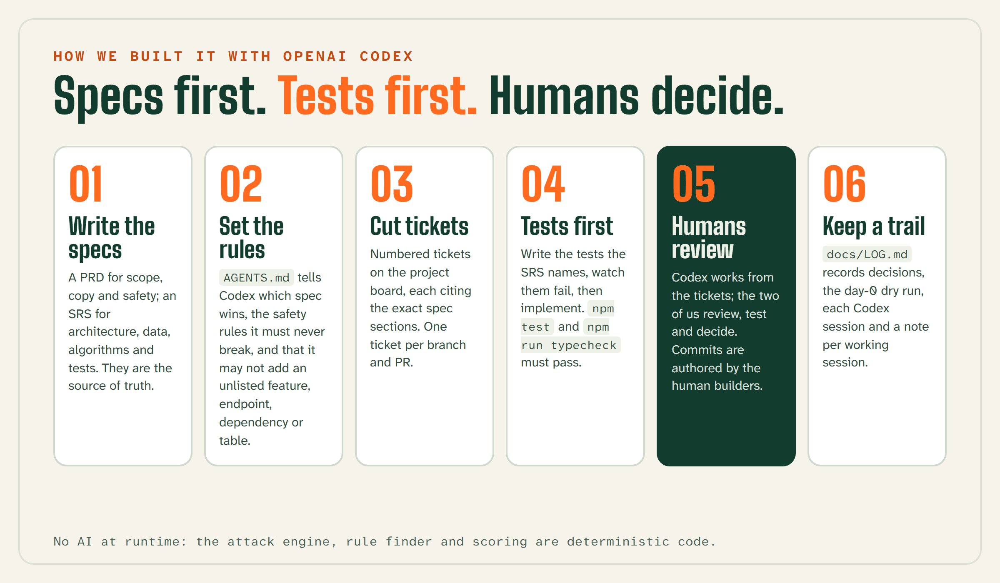

We treated Codex as a teammate that needs a precise brief, so we wrote the brief first.

- **Specs first.** A PRD sets scope, copy and safety; an SRS sets the architecture, data, interfaces, algorithms and tests. Both are the source of truth.
- **Rules for the agent.** `AGENTS.md` tells Codex which spec wins when they disagree, the safety rules it must never break, and that it may not add a feature, endpoint, dependency or table the specs do not list. When something is unclear it writes a `TODO(question)` and stops.
- **Tickets, tests first.** Work is split into numbered tickets on the project board. Codex writes the tests the SRS names, watches them fail, then implements; `npm test` and `npm run typecheck` must pass.
- **Humans review and decide.** We review, test and decide. Commits are authored by the human builders.
- **A written trail.** `docs/LOG.md` records decisions, the day-0 dry run, Codex sessions and a note per working session, with its test evidence.

**Codex session IDs:** `01a1892d-f9b6-7203-bfdb-f73490bfd6c0` (Harsh) and `01a18b5a-38f1-7830-be12-4fc7454e1390` (Dhairya).

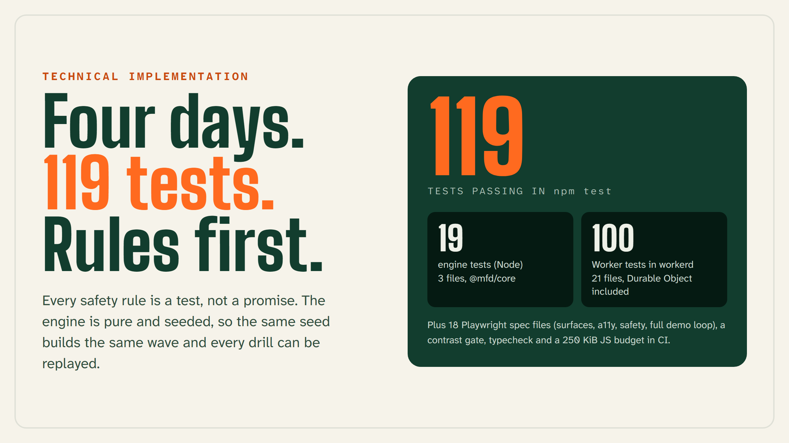

**`npm test` runs 119 tests:** 19 engine tests in Node and 100 Worker tests inside `workerd`, Durable Object included. On top of that, 18 Playwright spec files cover the app's surfaces, accessibility, the safety rules and the full demo loop, and CI adds a contrast gate, typecheck and a 250 KiB budget for initial JavaScript.

---

## Safety

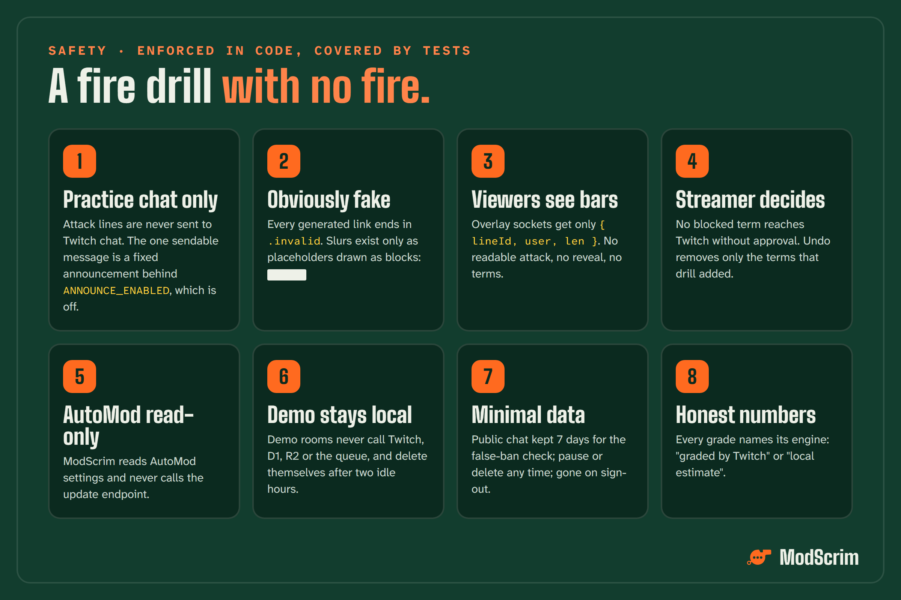

A fire drill should have no fire. Each of these is enforced in code and covered by tests:

- **Practice chat only.** Attack lines are never sent to Twitch chat.
- **Obviously fake.** Every generated link ends in `.invalid`. Slurs exist only as the placeholders `slurx` and `slury`, drawn as solid blocks; no real slur list is in the repository.
- **Viewers see nothing readable.** Overlay sockets receive only `{ lineId, user, len }` per line. A Worker test checks every overlay frame of a full drill.
- **The streamer decides.** No blocked term reaches Twitch without approval, and undo removes only the terms that drill added.
- **Demo rooms stay local** and never call Twitch, D1, R2 or the queue.
- **Data is minimal.** Public chat is kept 7 days for the false-ban check, can be paused or deleted, and is removed on sign-out.

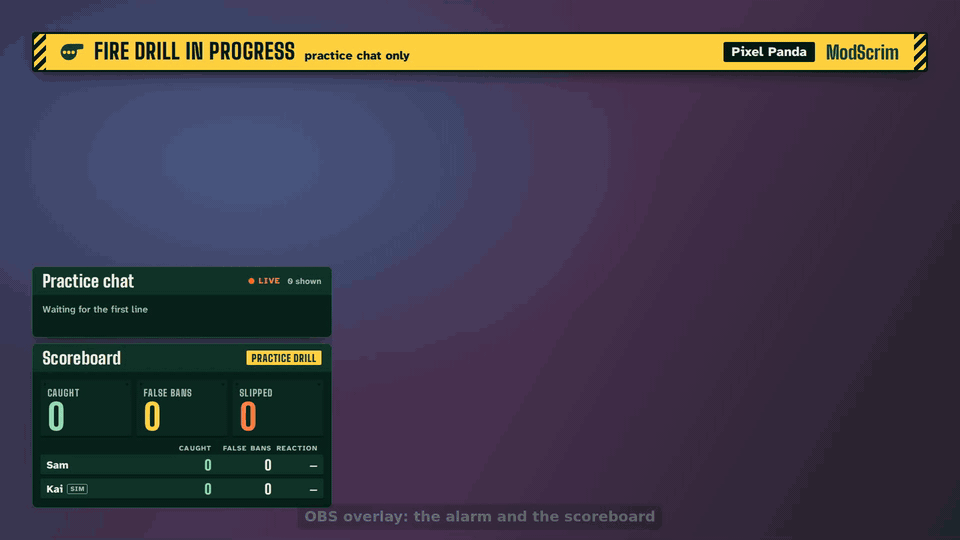

---

## Design

**It looks like a training ground, not a dashboard.** The brand borrows from ballpark scoreboards, coaches' tactics boards and the referee's whistle: wall green, chalk and one whistle-orange action colour. Type is **Big Shoulders** for scoreboard numbers and **Atkinson Hyperlegible Next and Mono** for everything you have to read fast. A contrast gate in CI checks the colour tokens.

- **The mod view works from 360 px wide**, with keyboard shortcuts on the focused line.
- **Every grade names its engine:** "graded by Twitch" or "local estimate".
- **The share card is numbers only**: no chat text, no attack text.

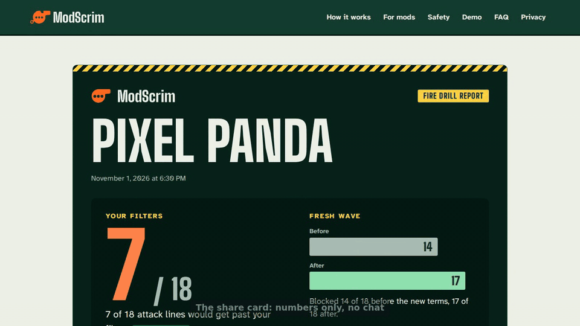

*Numbers in the share card above come from a demo room: demo, local estimate.*

---

## Challenges

- **Twitch said "slow down" while our counter said "go".** In production, Check AutoMod Status answered 429 for a channel while our quota counter still showed room, and the console sat on "0 of 14 checked". We now count 429s per phase, fall back to a labelled local estimate after three in a row, and tell the streamer that Twitch is limiting grading.
- **One alarm per Durable Object.** A drill needs a line clock, grading ticks, report jobs and clean-up. We multiplexed them all through one `schedule` table and made every job safe to run twice.
- **Redaction had to be structural.** "Do not show attack text on stream" is easy to break by accident, so the overlay message schema is strict and anything readable fails to build.
- **Proving a rule without overfitting it.** Testing proposed terms on the same lines they were learned from would flatter them, so the proof uses a held-out wave with a different seed and different tricks.

## What we learned

- **Specs are the best prompt.** A precise PRD, SRS and `AGENTS.md` kept Codex inside scope and made every review a check against a written rule.
- **Tests first pays off most for safety rules.** Redaction, `.invalid` links and undo are things you want proven, not remembered.
- **Honest labels build trust.** Saying "local estimate" or "needs a bot rule" is more useful to a streamer than a confident wrong number.

## Honest scope

- **The live day-0 Twitch validation is not complete.** The run that measures the grading quota and Twitch's matching on a real test channel has not been recorded, so **we make no claim of measured improvement on a real channel.** The only recorded result is a fixture-only dry run.
- **Demo grading is a local estimate**, not a Twitch grade.
- **Only public blocked terms are visible.** Twitch does not return private terms to apps.
- **Two engines can disagree.** Twitch also applies AutoMod categories and permitted terms, which the local matcher does not model.
- **Some tricks need a bot.** Blocked terms cannot express spaced or dotted letters, zero-width characters, emoji inside a word or look-alike letters; ModScrim labels those "needs a bot rule".

---

## Practise the raid before it is real

Your mods should not meet their first raid live on stream. With ModScrim they meet it in a practice chat nobody else can see, Twitch tells you which filters held, and the fix is proven, approved and one click from undone.

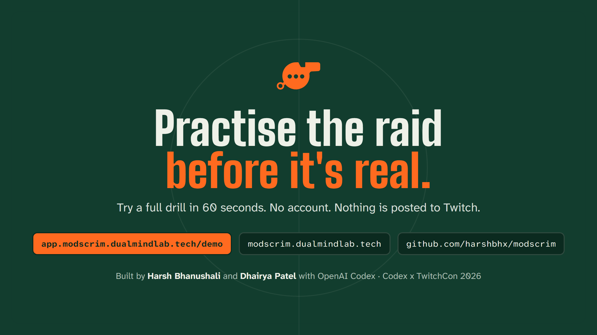

- **Live demo, no account:** [app.modscrim.dualmindlab.tech/demo](https://app.modscrim.dualmindlab.tech/demo)
- **Video:** [youtube.com/watch?v=r7xsUjA51F0](https://www.youtube.com/watch?v=r7xsUjA51F0)
- **Code (MIT):** [github.com/harshbhx/modscrim](https://github.com/harshbhx/modscrim)
- **Website:** [modscrim.dualmindlab.tech](https://modscrim.dualmindlab.tech)

**Built by Harsh Bhanushali** (Cloudflare: Worker, Durable Objects, D1, Queues, R2, deploy, and the website) **and Dhairya Patel** (the core engine, the Twitch integration, the web app, all testing, CI and the launch), with OpenAI Codex, for the Codex x TwitchCon hackathon, 2026.

ModScrim is an independent project and is not affiliated with or endorsed by Twitch.

**Blow the whistle before the raiders do.**
