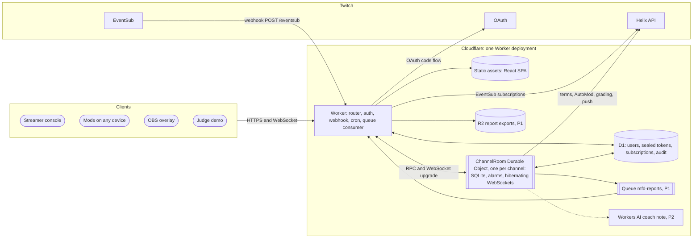

# Mod Fire Drill — Product Requirements Document

**Version 2.0 · 29 October 2026 · Status: approved for build**

| Field | Value |
|---|---|
| Product | Mod Fire Drill: fire drills for a Twitch channel's moderators |
| Document | Product Requirements Document (PRD): the what and the why |
| Companion | Software Requirements Specification (SRS) v2.0: the how |
| Owners | Builder A (platform: Cloudflare, Twitch) and Builder B (engine and experience) |
| Event | Codex x TwitchCon hackathon on Devpost |
| Hard deadline | Mon 2 Nov 2026, 2:00 PM PT, which is Tue 3 Nov 2026, 03:30 IST |
| Target submit | Mon 2 Nov 2026, 20:00 IST (a 7.5-hour buffer) |
| Supersedes | "Mod Fire Drill — PRD & SRS" v1 (single document, Node.js on a laptop with a tunnel) |

---

## How to use this document

This PRD says what Mod Fire Drill is, who it is for, what it must do and how we will know it worked. The SRS says how to build it on Cloudflare and Twitch. Read them as a pair.

- **Humans:** read sections 1 to 4 for the pitch and the problem, section 8 for the feature list and section 12 for the schedule.
- **AI coding agents (Codex):** treat this PRD as the source of truth for scope, priority, copy and safety. Treat the SRS as the source of truth for architecture, data, interfaces and code. If they disagree about scope or safety, this PRD wins; if they disagree about implementation, the SRS wins. Never add a feature that is not listed here.
- **IDs.** `F-xx` is a product feature (this document). `FR-xx` and `NFR-xx` are software requirements (SRS). `S-xx` is a safety requirement, `M-xx` a metric, `R-xx` a risk, `A-xx` an assumption and `Q-xx` an open question.
- **Priorities.** `P0` must ship for the submission. `P1` should ship. `P2` ships only if the team is ahead of schedule at the feature freeze.
- **Requirement words.** MUST, SHOULD and MAY follow RFC 2119.
- **`[verify]`** marks a Twitch or Cloudflare behaviour that is undocumented, ambiguous or not yet measured. Test it on the test channel or the deployed Worker; never guess.

---

## 1. Executive summary

Twitch moderators are unpaid volunteers who learn their job in the middle of real attacks, and the filters they rely on are tuned by guesswork. Mod Fire Drill gives a channel a safe rehearsal. A sandboxed practice chat floods with scam, spam and bot lines that the attack engine writes specifically to slip past **this channel's own filters**. The mods race to clean it up live on stream. Then **Twitch itself grades the filters** through its Check AutoMod Status API, the rule finder proposes new blocked terms in Twitch's own syntax, the new terms are **proven on a fresh wave they have never seen** with **zero matches against the channel's real chat**, and the streamer pushes them to Twitch with one click and can undo it with another.

**The loop, in seven beats**

1. Read the channel's real filters (public blocked terms and AutoMod levels) and its recent chat.
2. Run a short drill (30 seconds to 3 minutes): generated attacks mixed with harmless banter, in a practice chat only the app shows.
3. Score every mod: caught, false bans, reaction time; count what slipped through.
4. Let Twitch grade every attack line against the live filters: "9 of 14 would get past your filters, graded by Twitch."
5. Propose up to six blocked terms that catch what got through and match none of last week's real chat.
6. Prove them on a held-out wave built with tricks the rule finder never saw.
7. Push on approval, re-grade with Twitch, save an after-action report, undo any time.

**Why it can win**

- **It is the only entry in its lane.** Of 57 visible submissions, none does moderation training; about 15 are chat boss and quest games and 9 are "chat builds a world" overlays (section 4).
- **Twitch is the referee.** The headline numbers come from Twitch's own API, not from our code grading itself.
- **The hard part is visible.** Rules must survive an unseen wave and a real-chat false-ban check, and the screen shows the rules that were rejected because they would have banned a regular.
- **It is safe to show live.** Nothing is ever posted to real chat, links end in `.invalid`, slurs are placeholders, and the overlay never receives readable attack text.

**Why Cloudflare.** The whole product runs as one Cloudflare Worker with one Durable Object per channel. That object owns the drill clock, decides which mod acted first, holds every live WebSocket (and hibernates between drills), paces Twitch grading with alarms and keeps the 7-day chat log in its own SQLite database. Twitch delivers chat to a public HTTPS webhook on the Worker, so there is no laptop server and no tunnel. OBS loads the overlay from a stable URL, mods join from any device, and judges can open a public demo room that needs no Twitch account. It all fits the Workers Free plan; the $5 Workers Paid plan only adds headroom (section 2.4).

**What it is not.** It is not a moderation bot, it never touches real chat, it does not replace AutoMod or Sery_bot, and it makes no paid AI calls at runtime.

---

## 2. Context and constraints

### 2.1 Hackathon facts

| Item | Value |
|---|---|
| Event | Codex x TwitchCon on Devpost (https://twitchcon-codex.devpost.com) |
| Must | Be built with OpenAI Codex; connect to Twitch; be new work started after 23 Oct 2026 |
| Submit | Public code repository; public YouTube video under 3 minutes that shows the project working on Twitch and how Codex was used; text description; the Codex session ID (from `/status` in Codex) |
| Judging | Innovation, Potential Impact, Technological Implementation (including how well Codex is used), Design. Equal weights. Ties are broken by Innovation |
| Deadline | Mon 2 Nov 2026, 2:00 PM PT (US daylight saving time ends on 1 Nov, so this is 22:00 UTC, or 03:30 IST on 3 Nov) |
| Extensions | A Twitch Extension needs 5 to 14 days of review, so it is out of scope |

### 2.2 Team and time budget

| Item | Value |
|---|---|
| People | 2 builders |
| Hours | About 10 hours a day each, from the evening of Thu 29 Oct to the evening of Mon 2 Nov: about 90 person-hours |
| Builder A: platform | Cloudflare Worker, Durable Object, D1, Twitch OAuth, EventSub webhooks, Helix calls, grading queue, push and undo, deployment |
| Builder B: engine and experience | `packages/core` (matcher, attack engine, rule finder, scoring), the web app (console, mod console, overlay, demo page), copy, the video |
| Builder | OpenAI Codex writes most of the code from the SRS tickets; humans review, test and decide |

### 2.3 Hard constraints

| ID | Constraint | Consequence |
|---|---|---|
| C-01 | No OpenAI API credits | No paid AI calls at runtime. Every runtime decision is deterministic code that Codex wrote and the tests cover. Codex is the build tool, not a runtime dependency |
| C-02 | Must connect to Twitch | OAuth, Helix moderation APIs, EventSub and Check AutoMod Status are core, not decoration |
| C-03 | Five days, two people | Strict P0 list, a cut order, and a feature freeze on Sun 1 Nov at 22:00 IST |
| C-04 | Live on a real channel | Safety rules S-01 to S-12 are hard requirements |
| C-05 | Free to run | Design for the Cloudflare Workers Free plan; the $5 per month Workers Paid plan is optional headroom for the live recording |
| C-06 | Judges may not have Twitch accounts | A public demo room must run the whole loop with fixtures (F-16) |

### 2.4 Platform decision: why Cloudflare

Version 1 of this plan ran a Node.js server on the streamer's PC, exposed to mods through a quick tunnel. Version 2 moves everything to Cloudflare because each Cloudflare primitive removes a real risk from the demo.

| Need | v1 (Node on a laptop) | v2 (Cloudflare) |
|---|---|---|
| Receive Twitch chat | EventSub WebSocket client that must reconnect and resubscribe within 10 s | EventSub **webhooks** to a public HTTPS Worker URL; Twitch retries delivery; signatures verified with HMAC-SHA256 |
| One authoritative drill clock | In-process timers that die with the laptop | A **Durable Object** per channel with **alarms** stored in its own database; a restart resumes or ends the drill cleanly |
| First action wins when two mods click at once | Careful locking | A Durable Object handles one event at a time, so first-action-wins is a plain conditional write |
| Live updates to mods and OBS | Socket server plus tunnel | **Hibernating WebSockets** on the Durable Object: idle connections stay open and cost nothing between drills |
| Overlay in OBS | `localhost` only; remote mods need a tunnel | One stable `workers.dev` URL for the console, mods and OBS |
| Chat log with 7-day retention | A SQLite file on the laptop | **SQLite inside the Durable Object**, purged by alarms and an hourly **Cron Trigger** |
| Tokens and secrets | `.env` on the laptop | **Workers secrets**; tokens encrypted with AES-256-GCM (Web Crypto) in **D1** |
| Judges trying it | Clone, install, configure | Open the **public demo room**: an isolated Durable Object per visitor, cleaned up after two hours |
| Cost | Free, but fragile | Fits the Workers Free plan (100,000 requests a day, Durable Objects with SQLite, D1, Cron Triggers, Queues and R2 free tiers) |

The SRS (section 3) lists every Cloudflare feature used, the job it does, its plan availability and the ones we considered and rejected.

**System context: clients, the Worker, one Durable Object per channel, D1 and Twitch**

---

## 3. Problem

### 3.1 Problem statement

Twitch mod teams are volunteers who are never trained for the attacks they face, and streamers change their filters by guesswork because nothing lets them test a filter against the attacks they will see or against their own regulars' chat before the change goes live.

### 3.2 Evidence

| Finding | Source |
|---|---|
| In a survey of 1,053 Twitch moderators, about 12% had trained another mod in the past month. Mods learn mostly from streamers (76%) and other mods (69%), more than from Twitch's tutorials (49%). 26% had handled a targeted attack in the past month. | [Seering and Kairam, 2023](https://joseph.seering.org/papers/Seering_and_Kairam_2023_Who_Moderates_Twitch_What_Do_They_Do.pdf) |
| An audit of AutoMod let through up to 94% of hateful messages on some test sets and blocked up to 89.5% of harmless messages that used sensitive words. Spacing and punctuation changes lowered what it caught. | [arXiv 2506.07667](https://arxiv.org/html/2506.07667v1) |
| In 2026 spam bots vary wording, characters and spacing to slip past filters; mods ban accounts by hand and report burnout. | [GamingHQ, May 2026](https://gaminghq.eu/2026/05/09/twitch-communities-struggle-with-spam-bots-and-fake-view-activity/) |
| Defences against hate raids are reactive: the harm lands before the tools act. | [arXiv 2305.16248](https://arxiv.org/abs/2305.16248) |
| Twitch's AutoMod testing tool (August 2025) checks one typed phrase at a time against the channel's settings. It does not train people and does not test a rule change against real chat. | [Gaming Careers summary](https://gaming-careers.pages.dev/newsletters/twitch-gets-smart-about-moderation-three-new-tools) |
| Twitch announced more moderation features at TwitchCon Rotterdam 2026, so moderation is a current platform priority. | [Twitch blog, May 2026](https://blog.twitch.com/en/2026/05/30/everything-we-announced-at-twitchcon-rotterdam-2026/) |

### 3.3 Root causes

1. **No safe place to practise.** The only practice a mod gets is a real raid, with real harm and an audience.
2. **Filters are tuned blind.** Adding a blocked term risks banning regulars, and nobody can see that risk before the term goes live.
3. **No feedback loop.** After an attack there is no record of what got through, why, or whether the fix would catch the next variant.

### 3.4 Jobs to be done

| Who | When | They want to | So that |
|---|---|---|---|
| Streamer | Before a raid or a growth spike | Rehearse the mod team on realistic attacks | The team reacts in seconds, not minutes, when it is real |
| Streamer | After a drill | Tighten the filters without banning regulars | Fewer attacks reach chat and no regular gets caught |
| Mod | Between streams | Practise without real stakes and see a score | They get faster and more confident, and are recognised for it |
| Viewer | During the stream | Watch a fun, clearly fake moment | They enjoy it and do not learn working evasions |

### 3.5 What we do not know yet

Demand for scheduled drills is not proven. Mods in the 2026 article asked for faster ban syncing and better link detection, not for drills. The product answers that with the filter loop: even a streamer who never trains mods gets a filter test against their own chat. Section 15 tracks this as Q-01.

---

## 4. Landscape and differentiation

### 4.1 The hackathon field (Devpost index, 29 Oct 2026)

| Lane | Entries | Examples |
|---|---|---|
| Chat boss fights, quests, dares and co-op games | about 15 | challenge-chat, quest-director, raidshifty, heist |
| Chat builds a world or an ambient overlay | 9 | chat-reef, chatgrove, raidline |
| Predictions and polls | 8 | chat-bets, call-it |
| Codex writes code from chat | 4 to 5 | chat-ships-it, codexchaos-engine |
| Stream recaps | 3 | previously-on, catch-up-clerk |
| Screen reading | 3 | audio-description-of-the-stream |
| Question triage | 2 | missed-questions |
| Collaboration | 1 | crossframe |
| **Moderation training** | **0** | none |

The full list of 57 entries with links is in the shortlist page published earlier in this project.

### 4.2 Existing tools

| Tool | What it does | What it does not do |
|---|---|---|
| AutoMod | Holds or blocks messages by category level (0 to 4) | Train people; tell a streamer which attack variants get through |
| AutoMod testing tool (Twitch, Aug 2025) | Tests one typed phrase against the channel's settings | Generate attacks, batch-test, test a rule change against real chat, train mods |
| Blocked terms dashboard | Lets a streamer add and remove terms | Show what a new term would catch or wrongly catch |
| Sery_bot, Fossabot, Nightbot | Live moderation bots with link, spam and raid protection | Rehearsal, scoring, rule proofs on held-out attacks |
| Twitch Mod Simulator (itch.io) | A satirical mod game | Connect to a real channel, its filters or its mods |

### 4.3 Our position

Mod Fire Drill is the only tool that does all four of these together:

1. generates attacks aimed at **this channel's own filters**;
2. trains and scores **the channel's real mods** in a live sandbox;
3. has **Twitch grade** the filters through its own API;
4. proposes Twitch-syntax fixes and **proves them on a held-out wave** with **zero matches against the channel's real chat** before anything is pushed.

### 4.4 Honest limits we state up front

- Blocked terms cannot express spaced letters, dotted letters, zero-width characters, emoji inside a word or look-alike letters. The product says "needs a bot rule" for those instead of pretending.
- Check AutoMod Status also applies AutoMod's categories and the channel's permitted terms, which our local matcher does not model, so the two engines can disagree. Every number is labelled with the engine that produced it.
- The rule finder only sees public blocked terms; Twitch does not return private terms to apps.

---

## 5. Product principles

| ID | Principle | What it means in practice |
|---|---|---|
| P-1 | Safety before spectacle | Nothing generated ever reaches real chat. Links never resolve. Slurs are placeholders. Viewers never see readable evasion text |
| P-2 | Twitch is the referee | Headline numbers come from Check AutoMod Status whenever the quota allows; local estimates are always labelled |
| P-3 | The human approves every change | No term reaches Twitch without the streamer pressing Approve; every push has an Undo |
| P-4 | Honest numbers | Show the results the run produced, including bad ones and what still gets through |
| P-5 | Deterministic and replayable | Every wave comes from a seed; a drill can be replayed exactly; tests pin the behaviour |
| P-6 | Keyboard first for mods | Every mod action works from the keyboard with visible focus |
| P-7 | Privacy by default | The chat log is kept 7 days, used only for the false-ban check, never shown on stream, deletable at any time and deleted on sign-out or revoke |
| P-8 | Zero install | Streamer, mods, OBS and judges all use URLs; nothing to download |

---

## 6. Users and personas

| Persona | Who | Goals | Pains | Success moment |
|---|---|---|---|---|
| **Streamer** (primary buyer and operator) | Small to mid-size streamer, 50 to 2,000 viewers, 1 to 6 mods, streams 3 to 5 times a week | A ready mod team; filters that work without banning regulars | Raids arrive without warning; new terms sometimes ban regulars; no time to research filter syntax | "Twitch says my filters now block 24 of 30 new attacks and none of my regulars, and I pushed it in one click" |
| **Moderator** (primary user) | Volunteer, often moderates two or more channels, mostly on desktop, sometimes on a phone | Practise without stakes; get faster; be recognised | Learns mid-attack; mistakes are public; nobody measures their work | Sees "11 caught · 0 false bans · 2.4 s average" next to their name on stream |
| **Viewer** (audience) | Watches the stream | A fun, clearly fake moment | Real raids are upsetting | The alarm, the blurred chat racing past, the scoreboard, the after-action card |
| **Judge** (evaluator) | Watches the 3-minute video, may open the repository and the demo URL | See the Twitch connection, the Codex use and the hard part working | Many entries look alike; setup is slow | Opens the demo link, runs a drill and sees rules proven on a fresh wave within two minutes, without an account |

---

## 7. User journeys

### 7.1 Streamer first run (target: under 3 minutes)

| Step | Streamer does | Streamer sees | System does |
|---|---|---|---|
| 1 | Opens the app URL and clicks **Sign in with Twitch** | Twitch consent screen listing the scopes and why each is needed | Starts the OAuth authorization code flow with a signed `state` cookie |
| 2 | Approves | Console with channel name, avatar and "Connected" | Stores encrypted tokens in D1, creates the channel's Durable Object, subscribes to chat through an EventSub webhook, reads blocked terms and AutoMod levels |
| 3 | Reads the **Read filters** step | Blocked terms as chips, AutoMod levels, "Chat log: 0 messages, collecting since 14:02" | Logs chat as it arrives, kept 7 days |
| 4 | Copies the **mod link** and the **overlay URL** | Copy buttons with a confirmation | The overlay URL carries a random 32-character key |
| 5 | Adds a Browser Source in OBS with the overlay URL (1920 by 1080) | A transparent overlay, idle | The overlay connects by WebSocket and waits |

### 7.2 The live drill (target: under 6 minutes from start to report)

| Step | Who | What they see | What the system does | Cloudflare part |
|---|---|---|---|---|
| 1. Configure | Streamer | Tactic checkboxes, length, speed, slip window, join code, joined mods | Validates the configuration; builds wave A from a seed | Durable Object RPC |
| 2. Join | Mods | Join screen: code and display name, or Sign in with Twitch (P1) | Checks the code (rate-limited) and creates participants | Rate Limiting binding, Durable Object |
| 3. Alarm | Everyone | Overlay: hazard-striped "FIRE DRILL IN PROGRESS · practice chat only" | Broadcasts `drill.started` | Hibernating WebSockets |
| 4. Flood | Mods, viewers | A line every 1.5 s; mods press Delete, Timeout or Ban; overlay shows blurred lines | Emits lines on alarms; first action wins; lines with no action for 9 s slip through | Alarms, single-threaded writes |
| 5. Score | Everyone | Live scoreboard; at the end, the reveal of attacks, regulars and tricks (console and mods only) | Computes per-mod scores from server timestamps | Durable Object SQLite |
| 6. Grade | Streamer | "9 of 14 attack lines would get past your filters · graded by Twitch" and a line-by-line table | Sends attack lines to Check AutoMod Status, paced by the per-channel limit; falls back to the labelled local matcher | Alarms pace the queue |
| 7. Fix | Streamer | Up to 6 proposed terms with "catches N" and "0 real-chat matches"; rejected terms with the real line they would have hit; "needs a bot rule" groups | Runs the rule finder on lines that got past the filters, checked against last week's chat plus the banter pool | In-object compute over the chat log |
| 8. Prove | Streamer | Fresh wave: blocked before and after, real-chat matches (must be 0), what still gets through | Builds wave B with held-out tricks and a new seed | Pure core code |
| 9. Push | Streamer | **Approve and push**; per-term results; **Undo** | Adds each term with Add Blocked Term; Twitch re-grades the fresh wave (P1) | Helix calls from the Durable Object; audit row in D1 |
| 10. Report | Everyone | After-action card on the overlay; full report in the console; share link (P1) | Saves the report; exports JSON and Markdown to R2 through a Queue (P1) | Queues, R2 |

### 7.3 Mod journey

1. Opens `/mod/<channel>` on any device, types the 6-digit code and a display name (or signs in with Twitch, P1).
2. Sees "You're in. Remove attacks, leave regulars alone." until the drill starts.
3. Acts on lines with buttons or the keyboard (D, T, B on the focused line; arrow keys move focus).
4. Gets instant feedback: "Banned by you · 2.1 s", "False ban: that was a regular" in red, "Slipped through" in amber, "Sam got it first" when another mod won the race.
5. Sees their own score, the team scoreboard and the reveal at the end.

### 7.4 Viewer journey

Viewers see only the overlay: the alarm banner, a blurred practice chat with readable usernames and outcome icons, the live scoreboard and the after-action card. They never see attack text in a readable form (S-05). With P2 chat votes, they pick the next tactic by typing `!attack spam` and similar commands; they never write attack text.

### 7.5 Judge journey (public demo)

1. Opens `/demo` from the README or the Devpost page and clicks **Start a demo drill**.
2. Gets an isolated demo room for the fixture channel `pixelpanda_tv` with a simulated co-mod, "Kai (sim)".
3. Plays mod in one tab, or opens the mod link on a phone, and watches the console in another.
4. Walks through grading (labelled "local estimate", because demo rooms never call Twitch), rules, fresh wave and a simulated push.
5. The demo room deletes itself two hours after its last activity.

### 7.6 Undo and rollback

- **Undo** removes every term pushed by that drill, shows per-term results and records it in the audit log.
- If a push partly fails, the console lists which terms were added; Undo removes only those.
- A pushed term that turns out to ban a regular can be removed with that drill's **Undo** or from the Twitch dashboard; the next refresh shows the change.

### 7.7 Leaving

- **Sign out and delete my data** removes tokens, the chat log, drills, reports and the chat subscription, then confirms.
- If the streamer revokes the app on Twitch, the app deletes the same data automatically when Twitch tells it (P1, F-21).

---

## 8. Feature requirements

### 8.1 Feature list

| ID | Feature | Priority | User-visible acceptance | SRS |
|---|---|---|---|---|
| F-01 | Streamer signs in with Twitch | P0 | After consent the console shows the channel name, avatar and "Connected"; tokens never reach the browser; sign-out deletes everything | FR-01 to FR-05 |
| F-02 | Read the channel's filters | P0 | Public blocked terms and AutoMod levels shown; count matches the Twitch dashboard; a note explains that private terms are not visible | FR-06, FR-07 |
| F-03 | Chat log for the false-ban check | P0 | A message typed in the channel appears in the log count within 5 s; kept 7 days; **Delete chat log** and **Pause logging** work | FR-08 to FR-10, FR-43 |
| F-04 | Attack engine | P0 | Same seed gives the same wave; every link ends in `.invalid`; banter comes only from the curated pool | FR-13 to FR-15 |
| F-05 | Live practice chat across console, mod console and overlay | P0 | Two mod screens and the overlay show each line within 300 ms of each other at the 95th percentile; every mod action works from the keyboard | FR-16 to FR-21, FR-24 |
| F-06 | Mods join with a 6-digit code | P0 | Wrong codes are rejected; repeated guessing is rate-limited | FR-22 |
| F-07 | Mods sign in with Twitch and must be moderators | P1 | A non-moderator sees "Only this channel's mods can join" | FR-23 |
| F-08 | Scoring and reveal | P0 | Per-mod caught, false bans and average reaction time; team slipped count; reveal on console and mod screens only | FR-25, FR-26 |
| F-09 | Hosted OBS overlay | P0 | Transparent 1920 by 1080 page at a stable URL; alarm, blurred chat, scoreboard, after-action card; no readable attack text in the page | FR-37 |
| F-10 | Twitch grades the filters | P0 | "x of y would get past your filters · graded by Twitch"; the queue respects the per-channel limit | FR-28 |
| F-11 | Labelled local fallback | P0 | "Local estimate" label whenever the local matcher produced a number | FR-29 |
| F-12 | Rule finder with real-chat check | P0 | Up to 6 terms, each with catches and "0 real-chat matches"; rejected terms with their real example line; "needs a bot rule" groups | FR-31, FR-32 |
| F-13 | Proof on a fresh wave | P0 | Before and after bars; push disabled unless real-chat matches are 0 | FR-33 |
| F-14 | Push with undo | P0 | Pushed terms appear in the Twitch dashboard; Undo removes them; both recorded in the audit log | FR-34, FR-35, FR-45 |
| F-15 | Twitch re-grade after push | P1 | "After, graded by Twitch" appears next to the local after number; agreement between Twitch and the local matcher is shown | FR-30, FR-36 |
| F-16 | Public demo rooms | P0 | `/demo` runs the full loop with no Twitch account; each visitor gets an isolated room; rooms expire | FR-38 |
| F-17 | Several mods on one scoreboard | P0 | Up to 10 mods race; ties go to whoever reached the server first; every screen agrees | FR-18, FR-25 |
| F-18 | Simulated co-mod "Kai (sim)" | P0 in demo, P1 live | Acts on about 60% of attacks after 2.6 to 6.8 s and occasionally on tempting banter; scored separately; always labelled "(sim)" | FR-39 |
| F-19 | After-action report in the console | P0 | Per-mod scores, slipped count, Twitch grade, proposed, rejected and pushed terms, fresh-wave before and after | FR-27 |
| F-20 | Report export and share link | P1 | JSON and Markdown download; a read-only share link with numbers only, no attack text | FR-27 |
| F-21 | Automatic deletion on revoke | P1 | Revoking the app on Twitch deletes the channel's data within a minute | FR-12 |
| F-22 | Connection status panel | P1 | Console shows token status, chat subscription status, grading quota left and last chat message time; broken chat subscriptions are repaired hourly | FR-11, FR-44 |
| F-23 | Hate-raid tactic with placeholder slurs | P2 | Off by default; content warning; placeholders render as solid blocks | FR-13, FR-14 |
| F-24 | Chat votes the next tactic | P2 | During a 20 s window, `!attack linkscam`, `!attack spam`, `!attack botwave` or `!attack hateraid` counts one vote per user; overlay shows live bars | FR-40 |
| F-25 | One drill announcement in real chat | P2 | Exactly one message per drill: "Mod fire drill starting. Practice chat only, nothing here is real." Never any attack text | FR-41 |
| F-26 | Coach's note | P2 | Two plain sentences of advice generated from the score numbers with Workers AI's free allocation, with a fixed template fallback; labelled "AI-written" | FR-42 |
| F-27 | Mod history | P2 | A mod's results across drills on this channel | FR-27 |
| F-28 | Hide mod names on the overlay | P1 | A console toggle shows "Mod 1", "Mod 2" on the overlay instead of names | FR-46 |

### 8.2 The minimum product (P0)

F-01 to F-06, F-08 to F-14, F-16 to F-19. Together they are the loop judges must see: read filters, drill, score, grade, find rules, prove on a fresh wave, push and undo, plus the public demo.

### 8.3 Cut order if the schedule slips

Cut from the top: F-26, F-24, F-25, F-23, F-27, F-28, F-20, F-22, F-21, F-15, F-07. Never cut a P0. If a P0 is at risk at the freeze, use the fallback ladder in section 14.2.

### 8.4 Out of scope

| Out | Why |
|---|---|
| Acting on real chat (deleting, timing out, banning) | Safety and trust; this is a rehearsal tool |
| Replacing AutoMod or live bots | Different job |
| Runtime calls to paid AI models | C-01 |
| A Twitch Extension | 5 to 14 days of review |
| Accounts, billing, multi-tenant admin | Not needed for the hackathon; the architecture already isolates channels |
| Real slur lists or real phishing links | S-02, S-03 |
| Writing AutoMod settings | The API's update call overwrites every field; read only |

---

## 9. Experience specification

### 9.1 Routes

| Route | Who | Purpose |
|---|---|---|
| `/` | Everyone | Landing page: one-line pitch, Sign in with Twitch, Try the demo |
| `/console` | Streamer | The six-step stepper (section 9.2) |
| `/mod/:channel` | Mods | Join, practice chat, results |
| `/overlay/:channel?key=…` | OBS | Viewer-safe overlay |
| `/demo` | Judges, visitors | Creates a demo room and opens its console |
| `/demo/:room` | Demo visitors | The console for one demo room |
| `/demo/:room/mod` | Demo visitors | Mod view for a demo room |
| `/r/:reportId` | Anyone with the link (P1) | Read-only report card: numbers only |
| `/privacy` | Everyone | What is stored, for how long, and how to delete it |

### 9.2 Streamer console: the six steps

A stepper runs across the top: **Read filters → Configure → Run the drill → Twitch grades → Fix the rules → Fresh wave and push**. Later steps unlock as earlier ones finish; earlier steps stay clickable. A status strip on the right shows Twitch connection, chat log count and grading quota (F-22).

| Step | Shows | Primary action | Empty and error states |
|---|---|---|---|
| 1. Read filters | Blocked terms as chips; AutoMod levels per category; chat log count and oldest date; six sample logged lines (blurred until hovered); **Delete chat log**; **Pause logging** | Refresh from Twitch | No terms: "Your channel has no public blocked terms yet. The drill will show what that lets through." Log empty: "Collecting chat. The false-ban check gets better as your chat log grows; the banter pool is used meanwhile." |
| 2. Configure | The draft drill is created when this step opens, so the join code works while settings change. Tactic checkboxes and the primary tactic (hate raid off, with a content warning); attack lines (6 to 30) and banter lines (4 to 20), at most 40 in total; speed (interval 0.8 to 3.0 s); slip window (5 to 15 s); Kai (sim) toggle; join code and mod link with copy; overlay URL with copy and **Rotate key**; joined mods list | Start drill | No mods joined: "No mods yet. Share the mod link, or turn on Kai (sim) to rehearse alone." |
| 3. Run the drill | Practice chat (same as the mod view, read-only by default); live scoreboard; elapsed time; **Stop** | Stop drill | Mod disconnected: their name greys out with "reconnecting" |
| 4. Twitch grades | Big number "x of y attack lines would get past your filters"; engine label; per-line table: line, tactic, trick, result | Find better rules | Quota spent: "Twitch's grading limit for this hour is used up. Showing a local estimate; Twitch grading resumes at 15:07." |
| 5. Fix the rules | Proposed terms with checkboxes, "catches N", "0 real-chat matches" and an example; rejected terms with the real line they would hit (blurred until hovered); "needs a bot rule" groups by trick; manual term input with validation | Test on a fresh wave | Nothing proposed: "No safe rule found: every candidate would also match real chat. The tricks below need a bot rule." |
| 6. Fresh wave and push | Before and after bars; real-chat matches (must be 0); what still gets through, by trick; **Approve and push N terms**; per-term results; **Undo**; Twitch re-grade (P1); after-action report card | Approve and push | Push error per term: "Twitch rejected '{term}': {error}" with a retry |

### 9.3 Mod console

- **Join:** channel name and avatar, 6-digit code, display name, **Join**. P1 adds **Sign in with Twitch**.
- **Waiting:** "You're in. Remove attacks, leave regulars alone." plus the list of other mods.
- **Practice chat:** each line shows a fake username, the text (links underlined with dots, placeholder slurs as ▇ blocks) and **Delete**, **Timeout**, **Ban**. Keyboard: arrow keys move focus; D, T and B act on the focused line.
- **Feedback on each line:** struck through with "Banned by you · 2.1 s"; red "False ban: that was a regular"; amber "Slipped through"; grey "Sam got it first".
- **End:** own score, team scoreboard, the reveal (attack or regular, trick tags).
- **Phone:** works from 360 px width; buttons at least 44 px tall.

### 9.4 OBS overlay

- 1920 by 1080, transparent background, safe area 64 px from every edge.
- Alarm banner with hazard stripes: "FIRE DRILL IN PROGRESS · practice chat only".
- Practice chat panel in the right third: usernames readable, message bodies drawn as blurred bars whose length matches the line; outcome icons.
- Scoreboard bottom-left: per mod caught, false bans, average reaction time; team slipped.
- After the drill: an after-action card with the Twitch grade, the number of terms pushed and fresh-wave before and after; it appears for 20 s each time the report updates.
- P2: vote bars during the vote window.
- A wrong or rotated key shows nothing at all.

### 9.5 Demo page

"Try Mod Fire Drill without a Twitch account. You'll get a private practice room with a fake channel, a simulated co-mod and the full loop. Grading in demo rooms is a local estimate; on a real channel, Twitch does the grading." Buttons: **Start a demo drill** and **Open the mod view on my phone** (shows a QR code).

### 9.6 Copy deck (exact strings)

| Key | String |
|---|---|
| banner.practice | Practice chat only. Nothing here is posted to Twitch. |
| overlay.alarm | FIRE DRILL IN PROGRESS · practice chat only |
| mod.waiting | You're in. Remove attacks, leave regulars alone. |
| mod.falseBan | False ban: that was a regular |
| mod.slipped | Slipped through |
| grade.headline | {n} of {total} attack lines would get past your filters |
| grade.engine.twitch | graded by Twitch |
| grade.engine.local | local estimate |
| rules.zeroMatches | 0 real-chat matches |
| rules.rejected | Would catch {hits}, but also matches "{example}" |
| rules.botRule | needs a bot rule |
| fresh.realChat | New rules matched {n} of {total} real and harmless messages |
| push.button | Approve and push {n} terms to Twitch |
| push.undo | Undo this push |
| hate.warning | This tactic uses placeholder slurs shown as solid blocks. Turn it on only if your community is comfortable with the theme. |
| privacy.short | We keep your chat log for 7 days only to check that new rules don't ban your regulars. Delete it any time. |
| announce.chat | Mod fire drill starting. Practice chat only, nothing here is real. |

#### Console microcopy (T-130, T-131)

Labels, helper text, empty states and status wording on the streamer console that sit outside the exact deck above. Approved by Harsh on 1 Nov 2026 (explicit override of AGENTS.md rule 11, microcopy only). The strings live in `app/src/copy.ts` as `consoleCopy`. Safety copy (`banner.practice`, `hate.warning`, `privacy.short`, S-08 blur) and every key of the deck above are unchanged. Headings, button names and ARIA labels that the e2e specs select by are unchanged too.

| Where | Was | Now |
|---|---|---|
| Step label above each step title | Step 1 | Step 1 of 6 |
| Step 1 intro (new line under the title) | (none) | Your drill is written to slip past these filters, so start by reading them. |
| Step 1, live console, under blocked terms | Private terms are not visible to apps. | Twitch does not share private terms with apps, so they are not listed. |
| Demo header chip | 71 fixture messages | 71 sample messages |
| Step 1 chat log date, demo | Curated demo fixture | Curated demo sample |
| Step 1 chat log date, no history yet | Collecting since now | Collecting from now on |
| Step 1 chat log hint (new, under the blurred samples) | (none) | Hover or focus a message to reveal it. |
| Step 2 simulated co-mod checkbox | Kai (sim) | Practice with Kai, a simulated co-mod |
| Step 2 empty joined-mods list | No mods yet. Share the mod link, or turn on Kai (sim) to rehearse alone. | No mods yet. Share the mod link, or turn on Kai to rehearse alone. |
| Step 2 share panel heading (new) | (none) | Invite your mods |
| Joined mods and room lists, online state | (dot only) | Online |
| Joined mods and room lists, offline state | reconnecting | Reconnecting |
| Step 5 rejected terms hint (new) | (none) | Hover or focus a line to reveal it. |
| Step 6 note above the push button, live (new) | (none) | Nothing is sent to Twitch until you approve it, and every push can be undone. |
| Step 6 note above the push button, demo (new) | (none) | This is a simulation. Nothing leaves this private demo room. |
| Report, moderator history | Drill 1: ... \| Drill 2: ... on one line | One line per drill, no separator |
| Report, proposed and rejected terms | a comma-separated sentence | one chip per term |
| Connection status heading chip, healthy (new) | (none) | All systems working |
| Connection status heading chip, unhealthy (new) | (none) | Needs attention |
| Twitch connection value | Ok | Connected |
| Chat subscription value | Enabled | Active |
| Chat subscription value, pending | Webhook Callback Verification Pending | Verifying |
| Chat subscription value, any other state | the raw state, title-cased | Needs repair |
| Grading quota label, minute | Grading quota · minute | Grading quota, per minute |
| Grading quota label, hour | Grading quota · hour | Grading quota, per hour |

### 9.7 Visual language

- Colour tokens with light and dark themes for the console and mod screens; the overlay is always dark.
- One alarm colour (orange-red) for the drill banner and destructive buttons; safety-yellow hazard stripes; green for caught, red for false bans, amber for slipped. Every state also has text, never colour alone.
- Fonts from Google Fonts: Archivo for headings, Source Sans 3 for body, JetBrains Mono for numbers, terms and tags.
- Motion: lines slide in over 150 ms; respect `prefers-reduced-motion`.

### 9.8 Accessibility

- Every mod action works from the keyboard; focus is always visible.
- Live regions announce "line slipped" and score changes politely.
- Contrast at least 4.5:1 for text in both themes.
- The overlay is visual only by design; the console carries the same information in text.

---

## 10. Safety, trust and policy requirements

| ID | Requirement |
|---|---|
| S-01 | Nothing the attack engine generates is ever sent to real Twitch chat. The only message the app may ever send is the fixed announcement in F-25 |
| S-02 | Every generated link uses the `.invalid` top-level domain, which can never resolve |
| S-03 | Slurs are placeholder tokens (`slurx`, `slury`) rendered as solid blocks; no real slur list exists anywhere in the code |
| S-04 | Banter lines come only from a curated harmless pool, never from real viewers' messages |
| S-05 | The overlay never receives readable attack text; the server sends it only length placeholders |
| S-06 | Evasion lists are never published, exported or shown in share links; reports carry tactic and trick counts, not attack text |
| S-07 | The hate-raid tactic is off by default and shows a content warning |
| S-08 | The chat log is used only for the false-ban check, kept 7 days by default, never shown on the overlay, shown in the console only blurred until hovered, deletable at any time, and deleted on sign-out or revoke |
| S-09 | No term reaches Twitch without the streamer's explicit approval; every push can be undone |
| S-10 | Tokens never reach the browser and are encrypted at rest |
| S-11 | The practice chat is opt-in for mods and always carries the "practice only" banner |
| S-12 | The app follows the Twitch Developer Agreement and Terms of Service: no spam, no public chat database, honour deletion requests |

---

## 11. Success metrics

### 11.1 Hackathon success criteria

| ID | Metric | Target |
|---|---|---|
| M-01 | One end-to-end drill on a real Twitch channel with at least one real mod | Done by Sun 1 Nov, 18:00 IST |
| M-02 | Fresh-wave block rate after the proposed terms | At least +20 percentage points over before (day-0 gate, section 12.1). A local simulation on the fixture channel already gives a median of +30 points (10th percentile +16.7) over 200 seeds; the day-0 test must confirm it with Twitch |
| M-03 | Real-chat matches of pushed terms | 0 |
| M-04 | Twitch-graded numbers in the video | At least one |
| M-05 | Public demo: time from opening `/demo` to a finished report | Under 2 minutes |
| M-06 | Repository quick start for a local run | Under 5 minutes from a fresh clone |
| M-07 | Video length | Under 3:00 |
| M-08 | Automated tests passing at submission | 100%, with at least 80% line coverage of `packages/core` |

### 11.2 Product metrics (after the hackathon)

| ID | Metric | Why |
|---|---|---|
| M-10 | **North star:** drills per week that end with at least one pushed term that passed the fresh-wave proof | Captures both jobs: training and better filters |
| M-11 | Median mod reaction time across a channel's drills, drill over drill | Training effect |
| M-12 | False bans per drill, drill over drill | Training quality |
| M-13 | Share of pushed terms undone within 7 days | Rule quality; should stay under 10% |
| M-14 | Agreement rate between the local matcher and Twitch grading | Model accuracy; target at least 90% |

### 11.3 Guardrails

- Real-chat matches of pushed terms stay at 0.
- No generated text is ever sent to Twitch chat (checked by test and by log audit).
- Zero readable attack text in overlay payloads (checked by test).

### 11.4 Instrumentation

Structured log events (SRS section 14) for: sign-in, chat subscription created or revoked, drill created, started and ended, action, slip, grade request and result, rules proposed, fresh wave computed, push and undo, report saved, demo room created and expired. Metrics come from Workers Logs during the hackathon.

---

## 12. Release plan

### 12.1 Milestones and gates

| ID | Milestone | When (IST) | Exit criteria |
|---|---|---|---|
| M0 | Day-0 kill test | Thu 29 Oct, 23:59 | Decision recorded using the table below |
| M1 | Walking skeleton deployed | Fri 30 Oct, 14:00 | Worker on `workers.dev`, Durable Object with a hibernating WebSocket echo, D1 migrated, SPA served |
| M2 | Loop on fixtures | Sat 31 Oct, 13:00 | Full loop in a demo room: drill, score, local grade, rules, fresh wave, simulated push |
| M3 | Loop on Twitch | Sat 31 Oct, 23:00 | Real sign-in, chat webhook, Twitch grading, real push and undo on the test channel |
| M4 | Feature freeze | Sun 1 Nov, 22:00 | Only fixes and copy after this point |
| M5 | Video recorded | Mon 2 Nov, 13:00 | Uncut live loop captured with real numbers |
| M6 | Submitted | Mon 2 Nov, 20:00 | All checklist items in section 13.6 done |

**Day-0 decision table** (details in SRS section 13.3)

| Result on the test channel | Decision |
|---|---|
| Fresh-wave improvement at least +20 points and 0 real-chat matches | Keep the full pitch |
| Improvement between +10 and +20 points | Keep it; present the numbers plainly |
| Improvement under +10 points | Lead with mod training; rules become a secondary feature |
| Check AutoMod Status too limited for 14 lines per drill | Grade a 5-line sample with Twitch, the rest locally, and label both |
| Twitch and the local matcher agree on less than 90% of lines | Fix the matcher model from observed behaviour before building on it |
| Alarm jitter above 250 ms at the 95th percentile | Drive the running drill with in-object timers and keep alarms as the recovery backstop |

### 12.2 Day-by-day plan

| Day | Builder A: platform | Builder B: engine and experience | End-of-day check |
|---|---|---|---|
| **Thu 29 Oct (evening, about 5 h each)** | Register the Twitch app; create the Cloudflare account; `npm create cloudflare` with the React and Vite template; deploy hello world; create D1; get a broadcaster token with the Twitch CLI | Port the matcher, PRNG, tricks and templates from the prototype into `packages/core` with tests; write `scripts/day0.ts` | Day-0 kill test run; decision written in the README |
| **Fri 30 Oct (10 h each)** | OAuth sign-in, sessions, token encryption, D1 schema; EventSub webhook with signature checks; chat ingest into the Durable Object; `ChannelRoom` skeleton with alarms and the WebSocket hub | Waves A and B, scoring, rule finder with the fast index and property tests; console stepper skeleton; mod console with keyboard actions | M1 met; a typed chat message lands in the log |
| **Sat 31 Oct (10 h each)** | Drill engine (emit, act, slip, end); grading queue with Check AutoMod Status; push and undo; blocked terms and AutoMod read | Overlay with redaction; console steps 4 to 6; demo room with fixtures and Kai (sim); copy deck | M2 by early afternoon; M3 by night |
| **Sun 1 Nov (10 h each)** | P1s: Twitch re-grade, revoke handling, status panel, report export through Queues and R2; cron jobs; hardening and rate limits | P1s: mod Twitch sign-in UI, report page, polish, accessibility pass; README; rehearsal drill with real mods at 18:00 | M1 to M3 still green; freeze at 22:00 |
| **Mon 2 Nov (until 20:00)** | Record the live loop at 10:00; fix anything the recording exposed | Edit the video; write the Devpost text; screenshots | M5 by 13:00; M6 by 20:00 |

### 12.3 Definition of done (per feature)

- Acceptance criteria in the SRS pass, with automated tests where the SRS lists them.
- Works in the deployed Worker, not only locally.
- Copy matches the copy deck; keyboard and screen-reader basics checked.
- No safety requirement weakened; no secret in the repository.

### 12.4 Working rhythm

- Start each day with a 10-minute plan; end it with a deploy, the end-of-day check and a short note in `docs/LOG.md`.
- One Codex thread per area (core, worker, web), each started from the matching SRS tickets; record the session IDs.
- Every commit message names the FR or F it serves.

---

## 13. Demo, video and submission

### 13.1 Demo strategy

- **Primary:** an uncut live loop on the team's test channel with one real mod (the second builder) and Kai (sim), recorded from OBS and the console.
- **Backup:** the same loop in a public demo room, clearly labelled as demo.
- **Never** fake a Twitch number. If Twitch grading fails during the recording, show the local estimate with its label and say so.

### 13.2 Video script (under 3:00)

| Time | On screen | Voice-over |
|---|---|---|
| 0:00–0:12 | Live stream; the alarm fires; practice chat floods | "This is a fire drill for a Twitch mod team." |
| 0:12–0:26 | Two facts: about 12% of mods train other mods; spam mutates past filters | "Mods are volunteers who learn mid-attack, and filters are tuned by guesswork." |
| 0:26–1:10 | Uncut drill with a timer: a real mod removes attacks, a false ban flashes red, Kai races, the scoreboard updates | "Our engine writes attacks aimed at this channel's own filters, mixed with harmless lines, and mods race to clean it up." |
| 1:10–1:30 | "9 of 14 would get past your filters · graded by Twitch" | "Then Twitch itself grades the filters." |
| 1:30–2:05 | Proposed terms; a rejected term with the line it would hit (a fixture line or a team member's own message, never a viewer's); fresh wave before and after; push; the Twitch dashboard showing the new terms; Undo | "New rules must catch a wave they've never seen and match none of last week's real chat. One click pushes them. One click undoes them." |
| 2:05–2:20 | Architecture card: Twitch webhook → Worker → one Durable Object per channel → mods, console, OBS | "It runs on Cloudflare: one Durable Object per channel owns the clock, the race and the chat log, so there's nothing to install." |
| 2:20–2:45 | Codex session: writing the matcher and its property tests, the webhook verifier; the session ID on screen | "We built it with Codex from a spec, test first." |
| 2:45–2:58 | Scope line and the demo URL | "Sandbox only. Nothing posted to real chat. Practise before the raid." |

Rules: real numbers from the run, whatever they are; no copyrighted music or game footage without permission; English captions; uploaded to YouTube as public.

### 13.3 Recording setup

- OBS scene: game capture or a static game scene, the overlay browser source on top, a webcam optional.
- Second monitor: the console. Phone: the mod view for the second builder.
- Record OBS output and the console screen separately at 1080p60 for editing.
- Rehearse twice on Sun 1 Nov; record on Mon 2 Nov at 10:00 IST.

### 13.4 How it maps to the judging criteria

| Criterion | What the judges see |
|---|---|
| Innovation | The only moderation-training entry; attacks generated against the channel's own filters; rules proven on a held-out wave with a real-chat false-ban check |
| Potential impact | Every channel with mods; trains people and fixes filters in one session; aligned with Twitch's current moderation push |
| Technological implementation | EventSub webhooks with signature checks; Helix moderation APIs; Check AutoMod Status grading under a per-channel quota; a tested matcher and indexed rule finder; a realtime multi-client drill on Durable Objects with alarms and hibernating WebSockets; built with Codex from a spec, test first |
| Design | One loop: drill, scoreboard, receipt. A viewer-safe overlay. A keyboard-first mod console. Zero install |

### 13.5 Devpost description outline

1. One-line pitch and the 20-second explanation.
2. The problem with two cited facts.
3. How it works: the seven-beat loop with one screenshot each.
4. How it uses Twitch: OAuth, EventSub webhooks, blocked terms, AutoMod settings, Check AutoMod Status.
5. How it runs on Cloudflare: Worker, Durable Objects, D1, alarms, Cron, Queues, R2.
6. How we used Codex: spec-driven tickets, AGENTS.md, tests first, the session ID.
7. Safety and privacy.
8. Honest scope: what is simulated in demo rooms, what blocked terms cannot express.
9. What's next.

### 13.6 Submission checklist

- [ ] Public GitHub repository with all source, `README.md`, `AGENTS.md`, `docs/PRD.md`, `docs/SRS.md`, a licence and no secrets
- [ ] README: what it is, the demo URL, local quick start, Twitch app setup, Cloudflare deploy, privacy, how Codex was used, known limits
- [ ] Deployed Worker URL works; `/demo` works in a private browser window
- [ ] Video under 3:00, public on YouTube, shows it working on Twitch and how Codex was used
- [ ] Devpost text complete, with screenshots of the console, the mod console and the overlay in OBS
- [ ] Codex session ID(s) from `/status`
- [ ] "Built with" tags: OpenAI Codex, Twitch API, EventSub, Cloudflare Workers, Durable Objects, D1, TypeScript, React
- [ ] Submitted by Mon 2 Nov 20:00 IST

---

## 14. Risks

| ID | Risk | Likelihood | Impact | Mitigation | Owner |
|---|---|---|---|---|---|
| R-01 | Check AutoMod Status quota (5 per minute and 50 per hour for normal channels) is too small, or one "check" counts per line | Medium | High | Day-0 measurement of the quota unit; the grading queue counts its own sends and backs off on 429; sample-grade 5 lines with Twitch and the rest locally, labelled | A |
| R-02 | Twitch's blocked-term matching differs from our model (case, word order, Unicode) | Medium | High | Day-0 agreement test; fix the model before building on it; label engines | B |
| R-03 | Fresh-wave improvement is small | Medium | Medium | Reframe per the day-0 table; show what still gets through honestly | B |
| R-04 | EventSub webhook subscription fails or is revoked (for example for slow responses) | Low | High | Respond fast after signature checks; status panel; hourly cron re-creates failed subscriptions; banter pool still protects the false-ban check | A |
| R-05 | Durable Object alarm timing is too coarse for a 1.5 s cadence | Low | Medium | Day-0 jitter test; fall back to in-object timers during a running drill | A |
| R-06 | Free-plan limits (CPU per invocation, daily requests, SQLite rows written) are hit by a busy chat or a big rule-finder run | Low | Medium | Store pre-tokenized chat; cap the clean set at the latest 20,000 lines; measure CPU on day 0; upgrade to Workers Paid ($5) for the recording if needed | A |
| R-07 | Token expiry or revocation in the middle of the recording | Low | High | Refresh before expiry; hourly validation; status panel; record a backup take in a demo room | A |
| R-08 | Time overrun | Medium | High | Strict P0 list and cut order; freeze on Sun 22:00; Codex tickets sized under 2 hours | Both |
| R-09 | Live demo network failure | Low | High | Record early on Mon; demo-room backup; keep the hotspot ready | Both |
| R-10 | Policy concern from showing attacks | Low | High | S-01 to S-12; placeholders and `.invalid`; overlay redaction | Both |
| R-11 | Mods find the drill stressful or embarrassing | Medium | Medium | Opt-in; friendly copy; scores framed as practice; streamer can hide names on the overlay | B |
| R-12 | Judges cannot run it | Low | High | Public demo rooms; README quick start; a short "for judges" section | B |
| R-13 | Codex produces code that drifts from the spec | Medium | Medium | AGENTS.md rules; tickets cite FR IDs; tests written first; review every diff | Both |
| R-14 | Another entry ships a similar idea late | Low | Medium | Our proof loop (held-out wave plus real-chat check plus Twitch grading) is hard to copy in days | Both |
| R-15 | Twitch rejects a term on push (duplicate, length) | Medium | Low | Validate before push; show per-term errors; treat "already exists" as success | A |
| R-16 | Cloudflare account limits or billing setup block R2 or Queues | Low | Low | Both are P1; the P0 loop does not depend on them | A |

### 14.1 Early warning signs

- Day-0 agreement under 90% or improvement under +10 points.
- More than 2 hours spent on any single ticket.
- The live loop not working on Twitch by Sat 23:00.

### 14.2 Fallback ladder for the live demo

1. Full live loop with Twitch grading and a real push.
2. Live loop with sample Twitch grading (5 lines) and local for the rest, labelled.
3. Live drill on Twitch, with grading and rules shown in a demo room, labelled.
4. Entire loop in a demo room, labelled, with a separate clip proving the Twitch connection (sign-in, chat log, a real push in the Twitch dashboard).

---

## 15. Assumptions and open questions

| ID | Assumption or question | How we resolve it | Owner | By |
|---|---|---|---|---|
| A-01 | Blocked terms match case-insensitively, all words in any order, with no Unicode normalisation `[verify]`. This is the most important assumption: on the fixture, the best proposed rules are two-word pairs such as `nitrodrop invalid` | Day-0 agreement test with Add Blocked Term and Check AutoMod Status, including two-word terms | B | Thu |
| A-02 | Check AutoMod Status accepts up to 100 lines per request `[verify]` and counts quota per request or per line `[verify]`; Twitch does not report the remaining per-channel quota in headers, so a 429 is the only signal | Day-0 measurement: send requests until a 429 (SRS section 13.3, step 5) | A | Thu |
| A-03 | `channel.chat.message` over webhooks works with an app access token when the broadcaster grants `user:read:chat`, `user:bot` and `channel:bot`, using the broadcaster as the chatting user `[verify]` | First sign-in on the test channel | A | Fri |
| A-04 | Twitch's `user.authorization.revoke` subscription is available to our app over webhooks `[verify]` | Create it on deploy; check the subscription list | A | Sun |
| A-05 | Durable Object alarms are precise enough for a 1.5 s cadence `[verify]` | Day-0 jitter test | A | Thu |
| A-06 | The rule finder fits the Free plan's per-invocation CPU budget for a 20,000-line log `[verify]` | Day-0 CPU measurement in Workers Logs | A | Thu |
| Q-01 | Will mod teams schedule drills without a hackathon reason? | Ask the 2 to 3 mods who join the rehearsal; note answers in the README's "What's next" | B | Sun |
| Q-02 | Should mod names on the overlay be optional? | Default on, with a console toggle to hide names (P1 if cheap) | B | Sat |
| Q-03 | Should rules be suggested per tactic rather than per drill? | Out of scope for the hackathon; note as next step | Both | After |

---

## 16. Glossary

| Term | Meaning |
|---|---|
| Streamer, broadcaster | Owner of the Twitch channel |
| Mod | Volunteer moderator of the channel |
| Blocked terms | The channel's list of banned words and phrases in Twitch; terms are 2 to 500 characters and `*` may appear only at the start or end of a word |
| AutoMod | Twitch's automatic filter with category levels 0 to 4 |
| Check AutoMod Status | Twitch API that says whether each message would be allowed by the channel's current AutoMod settings and blocked terms |
| EventSub | Twitch's event system; this product receives chat messages through EventSub webhooks |
| Helix | Twitch's REST API |
| Drill | One practice session: a wave of lines played into the practice chat |
| Wave A | The drill wave: 14 attack lines and 8 banter lines by default |
| Wave B, fresh wave, held-out wave | 30 attack lines built from a new seed and a held-out trick pool the rule finder never saw |
| Attack line | A generated scam, spam, bot or placeholder-hate line that mods should remove |
| Banter line | A harmless line from the curated pool that mods should leave alone |
| Trick | A transformation that helps an attack evade filters, such as number swaps or spaced letters |
| Slipped | An attack line no mod removed within the slip window |
| Got past the filters | An attack line that Twitch (or the local matcher) says the current filters would permit |
| False ban | A mod action on a banter line |
| Rule finder | Code that proposes blocked terms from lines that got past the filters |
| Clean set | The channel's logged chat from the last 7 days plus the banter pool; a proposed term must match none of it |
| Practice chat | The sandboxed chat the app shows; never posted to Twitch |
| Overlay | The viewer-safe page loaded in OBS as a browser source |
| Push | Adding approved terms to the channel's real blocked terms on Twitch |
| Channel room | The Durable Object that owns one channel's drills, sockets, chat log and grading queue |
| Demo room | A temporary channel room filled with fixtures, used without a Twitch account |

---

## 17. References

**Hackathon and Codex**

- Codex x TwitchCon hackathon: https://twitchcon-codex.devpost.com
- Shortlist and field map of all 57 entries (published earlier in this project)

**Problem evidence**

- Seering and Kairam, 2023, "Who Moderates on Twitch and What Do They Do?": https://joseph.seering.org/papers/Seering_and_Kairam_2023_Who_Moderates_Twitch_What_Do_They_Do.pdf
- AutoMod audit: https://arxiv.org/html/2506.07667v1
- Hate raids: https://arxiv.org/abs/2305.16248
- Spam bots in 2026: https://gaminghq.eu/2026/05/09/twitch-communities-struggle-with-spam-bots-and-fake-view-activity/
- AutoMod testing tool: https://gaming-careers.pages.dev/newsletters/twitch-gets-smart-about-moderation-three-new-tools
- TwitchCon Rotterdam 2026 announcements: https://blog.twitch.com/en/2026/05/30/everything-we-announced-at-twitchcon-rotterdam-2026/
- Twitch Mod Simulator (prior art): https://adamziadi.itch.io/twitch-mod-simulator

**Twitch platform**

- Moderation APIs: https://dev.twitch.tv/docs/api/moderation
- API reference (Check AutoMod Status, blocked terms, AutoMod settings): https://dev.twitch.tv/docs/api/reference
- Handling EventSub webhook events: https://dev.twitch.tv/docs/eventsub/handling-webhook-events
- Chat authentication for EventSub: https://dev.twitch.tv/docs/chat/authenticating/
- EventSub subscription types: https://dev.twitch.tv/docs/eventsub/eventsub-subscription-types/
- Validating tokens: https://dev.twitch.tv/docs/authentication/validate-tokens/

**Cloudflare platform**

- Durable Objects WebSocket hibernation: https://developers.cloudflare.com/durable-objects/best-practices/websockets/
- Durable Objects alarms: https://developers.cloudflare.com/durable-objects/api/alarms/
- Durable Objects SQLite storage: https://developers.cloudflare.com/durable-objects/api/sqlite-storage-api/
- Durable Objects pricing and free plan: https://developers.cloudflare.com/durable-objects/platform/pricing/
- Workers limits: https://developers.cloudflare.com/workers/platform/limits/
- Workers pricing (D1, Queues, R2, KV): https://developers.cloudflare.com/workers/platform/pricing/
- Static assets and single-page apps: https://developers.cloudflare.com/workers/static-assets/routing/single-page-application/
- Cron Triggers: https://developers.cloudflare.com/workers/configuration/cron-triggers/
- Rate Limiting binding: https://developers.cloudflare.com/workers/runtime-apis/bindings/rate-limit/
- Workers AI pricing: https://developers.cloudflare.com/workers-ai/platform/pricing/

---

## Appendix A. Changes from v1

| Area | v1 | v2 |
|---|---|---|
| Hosting | Node.js 20 and Fastify on the streamer's PC, quick tunnel for mods | One Cloudflare Worker with static assets, one Durable Object per channel |
| Chat ingest | EventSub WebSocket client | EventSub webhooks with HMAC verification |
| Storage | One SQLite file | Durable Object SQLite per channel plus D1 for global records |
| Timers | In-process timers | Durable Object alarms with a schedule table |
| Overlay | `localhost` | Stable hosted URL with a rotatable key |
| Demo | `npm run demo` locally | Public demo rooms plus a local run |
| New features | — | F-16 public demo rooms, F-20 report share link, F-21 deletion on revoke, F-22 status panel, F-26 coach's note |
| Rule finder input | "Slipped lines" (ambiguous) | Wave-A attack lines that got past the filters, as graded |

## Appendix B. Judge FAQ

- **Does it post anything to my chat?** No. The only optional message is a one-line announcement that a drill is starting (P2).
- **Is the grading real?** On a real channel, yes: Twitch's Check AutoMod Status grades every line it can within the per-channel quota. Demo rooms use the labelled local estimate.
- **Why not use an AI model to write attacks?** Deterministic templates and tricks are safer, reproducible and free. Codex wrote and tested that code.
- **What can't blocked terms catch?** Spaced or dotted letters, zero-width characters, emoji inside words and look-alike letters. The product labels those "needs a bot rule".
- **What happens to my chat data?** It stays in your channel's own storage for 7 days, is used only for the false-ban check, and is deleted when you ask, sign out or revoke the app.
