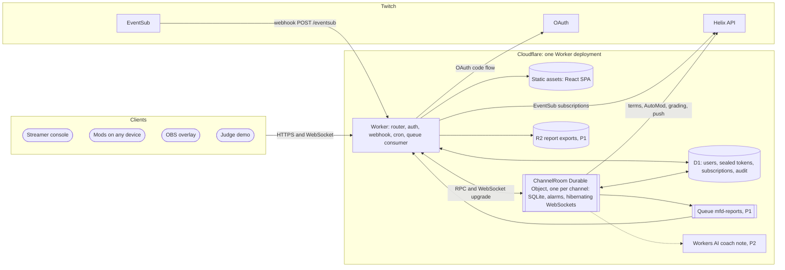
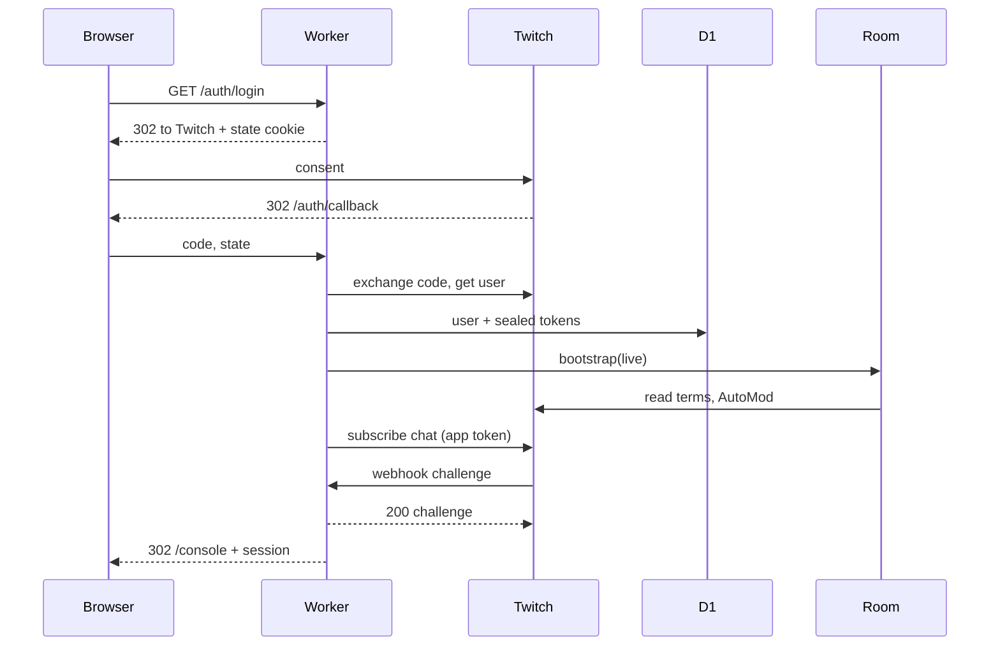
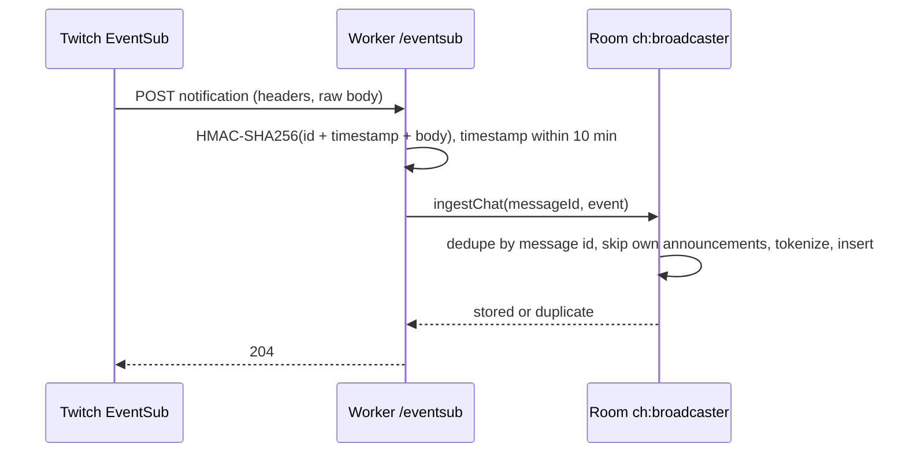
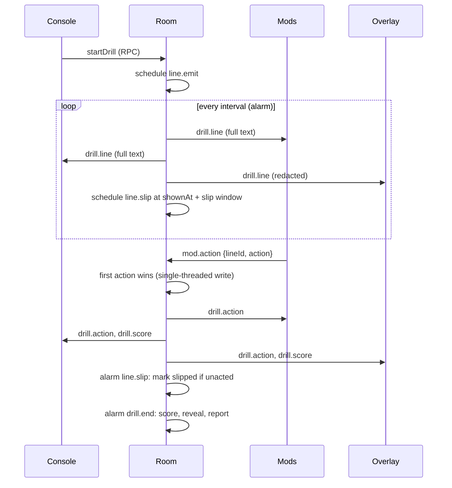
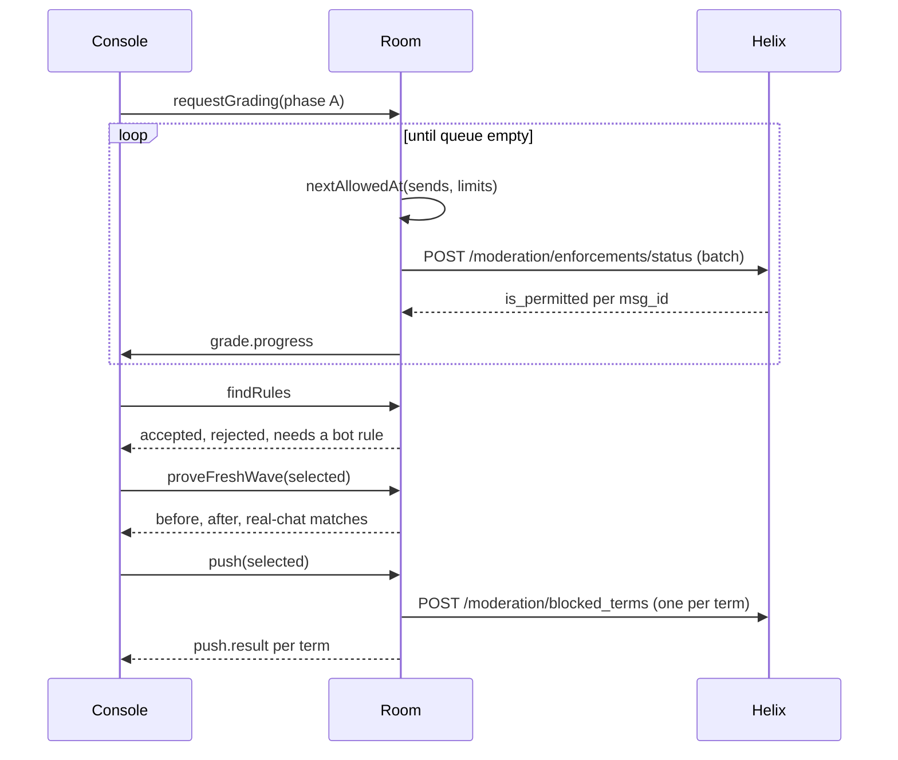

# Mod Fire Drill — Software Requirements Specification

**Version 2.0 · 29 October 2026 · Status: approved for build**

| Field | Value |
|---|---|
| Product | Mod Fire Drill |
| Document | Software Requirements Specification (SRS): the how |
| Companion | Product Requirements Document (PRD) v2.0: the what and the why |
| Platform | Cloudflare Workers (static assets, Durable Objects with SQLite, D1, alarms, Cron Triggers, Rate Limiting, Queues, R2, Workers AI) and Twitch (OAuth, Helix, EventSub webhooks) |
| Language | TypeScript 5 in strict mode, end to end |
| Builders | Two people and OpenAI Codex |
| Facts checked | Cloudflare documentation and Twitch developer documentation, 29 Oct 2026. Anything not confirmed is marked `[verify]` |

---

## 1. Introduction

### 1.1 Purpose

This SRS specifies everything needed to build Mod Fire Drill: architecture, every functional and non-functional requirement with an acceptance test, the core algorithms as working TypeScript, the Twitch integration, the data model, every interface, configuration, deployment, testing, operations and the instructions for Codex. An engineer or an AI coding agent should be able to build the product from this document and the PRD alone.

### 1.2 Scope

In scope: one Cloudflare Worker that serves a React single-page app and an API, one Durable Object class (`ChannelRoom`) holding each channel's live state, one D1 database for global records, EventSub webhooks for chat, Helix calls for filters, grading and pushes, and optional Queues, R2 and Workers AI features. Out of scope: everything listed in PRD section 8.4.

### 1.3 Conventions

- `FR-xx` functional requirement, `NFR-xx` non-functional requirement, `T-xx` build ticket for Codex. PRD IDs (`F-xx`, `S-xx`) are referenced where they apply.
- MUST, SHOULD and MAY follow RFC 2119.
- `[verify]` marks a behaviour to confirm on the test channel or the deployed Worker before relying on it.
- Times are milliseconds since the Unix epoch unless stated. Durations are milliseconds.
- Code blocks are normative unless marked "sketch". Where code and prose disagree, fix the prose, keep the tests.

### 1.4 Definitions

The glossary is in PRD section 16. Additional terms:

| Term | Meaning |
|---|---|
| Room | A `ChannelRoom` Durable Object instance. Live rooms are named `ch:<broadcasterId>`; demo rooms are named `demo:<uuid>` |
| Phase | A grading pass: `A` (wave A attacks against current filters), `B-before` (wave B against current filters), `B-after` (wave B after a push) |
| Engine | Who produced a grade: `twitch` (Check AutoMod Status) or `local` (our matcher) |
| Passed | A line the engine says the filters would permit (`is_permitted = true`) |
| Clean set | Logged chat of the last 7 days (latest 20,000 lines at most) plus the 40-line banter pool |
| Ticket | A short-lived, single-use, HMAC-signed token that authorises one WebSocket connection |

---

## 2. Overall description

### 2.1 Product perspective



### 2.2 Users and access

| Actor | Authenticates with | Can |
|---|---|---|
| Streamer | Twitch OAuth, then a signed session cookie | Everything for their own channel's room |
| Mod | Join code (P0) or Twitch sign-in plus moderator check (P1); then a participant ticket | Act on lines in the current drill; see their own results and the reveal |
| Overlay | The channel's 32-character overlay key | Receive redacted live events |
| Demo visitor | A signed demo cookie bound to one demo room | Everything inside that demo room only |
| Twitch | HMAC-SHA256 signature on each webhook | Deliver chat and revocation events |
| Cron | Cloudflare scheduler | Run hourly maintenance |

### 2.3 Operating environment

- Cloudflare Workers runtime with a compatibility date of `2026-10-28` (or the build day's date).
- Browsers: current Chrome, Edge, Firefox and Safari; the overlay in OBS 30 or later (Chromium browser source).
- Twitch production APIs; the Twitch CLI for local mocks.

### 2.4 Design constraints

| Constraint | Source | Effect on design |
|---|---|---|
| Workers Free: 100,000 requests a day, 10 ms CPU per HTTP request, 50 external subrequests per invocation | [Workers limits](https://developers.cloudflare.com/workers/platform/limits/) | Keep heavy work out of the stateless Worker; do it in the Durable Object; requests to static assets are free and unlimited |
| Durable Objects Free: SQLite backend only; 100,000 requests and 13,000 GB-s a day; SQLite 5 million rows read and 100,000 rows written a day, 5 GB stored | [Durable Objects pricing](https://developers.cloudflare.com/durable-objects/platform/pricing/) | Store pre-tokenised chat once; avoid per-token rows; hibernate sockets between drills |
| One alarm per Durable Object; alarms can fire more than once | [Alarms](https://developers.cloudflare.com/durable-objects/api/alarms/), [Rules of Durable Objects](https://developers.cloudflare.com/durable-objects/best-practices/rules-of-durable-objects/) | A `schedule` table multiplexes jobs onto the single alarm; every job is idempotent |
| WebSocket attachment at most 16,384 bytes; at most 10 tags per socket | [WebSockets](https://developers.cloudflare.com/durable-objects/best-practices/websockets/), [State API](https://developers.cloudflare.com/durable-objects/api/state/) | Attachments carry only role, participant ID and name |
| D1 Free: 5 million rows read and 100,000 rows written a day, 500 MB per database, 50 queries per invocation | [Workers pricing](https://developers.cloudflare.com/workers/platform/pricing/), [D1 limits](https://developers.cloudflare.com/d1/platform/limits/) | D1 holds only small global records |
| EventSub webhooks need HTTPS on port 443 and a reply within a few seconds; the secret is 10 to 100 ASCII characters | [Handling webhook events](https://dev.twitch.tv/docs/eventsub/handling-webhook-events) | Verify, hand to the room, reply 204; `workers.dev` satisfies HTTPS on 443 |
| Webhook chat subscriptions use an app access token; the chatting user grants `user:read:chat` and `user:bot`; the broadcaster grants `channel:bot` | [Chat authentication](https://dev.twitch.tv/docs/chat/authenticating/) | The broadcaster is both the chatting user and the broadcaster, and grants all three at sign-in |
| Check AutoMod Status: broadcaster's own token; per-channel limit 5 a minute and 50 an hour (normal), 10 and 100 (affiliate), 30 and 300 (partner); remaining quota not reported in headers `[verify]` | [API reference](https://dev.twitch.tv/docs/api/reference), [Twitch announcement](https://discuss.dev.twitch.com/t/upcoming-changes-to-the-check-automod-status-api-endpoint/38512) | Grading runs through a paced queue that counts its own sends, with a labelled local fallback |
| Apps that keep OAuth sessions must validate tokens hourly | [Validating tokens](https://dev.twitch.tv/docs/authentication/validate-tokens/) | Hourly Cron Trigger validates every stored token |
| In Workers, `Date.now()` advances only between I/O events | Workers runtime behaviour | Take timestamps at event boundaries (message arrival, alarm start); never time CPU loops with it |

### 2.5 Assumptions and dependencies

The PRD's A-01 to A-06 apply. Additionally: the Twitch application is registered under the team's account; one Cloudflare account hosts everything; the test channel has at least one second Twitch account to act as a mod.

---

## 3. Architecture

### 3.1 Cloudflare feature map

Every Cloudflare feature in this design has a job. Priorities follow the PRD.

| Feature | Job in Mod Fire Drill | Plan | Priority |
|---|---|---|---|
| **Workers** (one Worker, Hono router) | OAuth, REST API, EventSub webhook receiver, WebSocket upgrade router, Cron and Queue handlers | Free and Paid | P0 |
| **Static assets** with `not_found_handling: "single-page-application"` and `run_worker_first` | Serves the React SPA (console, mod, overlay, demo); only `/api/*`, `/auth/*`, `/ws/*` and `/eventsub` invoke the Worker; asset requests are free | Free and Paid | P0 |
| **Durable Objects, SQLite backend** (`ChannelRoom`) | One object per channel or demo room: drill state, chat log, grading queue, rule runs, pushes, reports | Free and Paid | P0 |
| **WebSocket Hibernation API** | Console, mods and overlay stay connected; the object sleeps between drills without dropping them; tags route messages by role; `ping` auto-response without waking | Free and Paid | P0 |
| **Durable Object alarms** | Drill clock (line emits, slip deadlines, drill end), simulated mod actions, grading pacing, demo-room cleanup, chat-log purge | Free and Paid | P0 |
| **Durable Object RPC** | Typed calls from the Worker into the room (`stub.createDrill(...)`) | Free and Paid | P0 |
| **D1** | Global records: users, sealed OAuth tokens, app token, EventSub subscriptions, audit log, report summaries | Free and Paid | P0 |
| **Cron Triggers** | Hourly: validate tokens (Twitch rule), purge old chat, check subscription health | Free (5 per account) and Paid | P0 |
| **Secrets** with `secrets.required` | Twitch client secret, EventSub secret, HMAC and AES keys; deploy fails if one is missing | Free and Paid | P0 |
| **Web Crypto** | HMAC-SHA256 for webhooks, sessions and tickets; AES-256-GCM for tokens; `getRandomValues` for codes and keys | Free and Paid | P0 |
| **Rate Limiting binding** | Throttles join-code guesses, demo-room creation and sign-in starts | Free and Paid | P0 |
| **Workers Logs / observability** | Structured event logs, CPU time per invocation, error tracking during the build and the demo | Free and Paid | P0 |
| **`@cloudflare/vite-plugin`** | One Vite dev server runs the SPA, the Worker, the Durable Object and local D1 together | Tooling | P0 |
| **`@cloudflare/vitest-plugin`** | Tests run inside `workerd`, including `runInDurableObject` and `runDurableObjectAlarm` | Tooling | P0 |
| **Queues** (`mfd-reports`) | After a drill ends, a message triggers the report pipeline: write JSON and Markdown to R2, a summary row to D1 | Free (10,000 operations a day) and Paid | P1 |
| **R2** (`mfd-reports`) | Stores report exports; read-only share links at `/r/:reportId` read a shared summary through `GET /api/public/reports/:reportId` | Free tier (10 GB-month) and Paid | P1 |
| **Workers AI** | Coach's note: two sentences of advice from the score numbers only, with a template fallback | Free (10,000 Neurons a day) and Paid | P2 |
| **Custom domain** | Optional nicer URL than `workers.dev` | Free | P2 |

**Considered and not used**

| Feature | Why not |
|---|---|
| Workflows | Durable Object alarms already give durable timers next to the state they change; a Workflow would have to call back into the room for every broadcast |
| Workers KV | Eventually consistent; sessions and OAuth state are stateless signed cookies, and everything else needs strong consistency (D1 or the room) |
| Agents SDK | Adds an abstraction over Durable Objects we do not need; raw `DurableObject` keeps the code Codex writes small and testable |
| Pages | Workers static assets now cover the SPA with one deployable |
| EventSub WebSocket transport | Needs a long-lived outbound socket; outbound sockets do not hibernate and would keep the object in memory |
| Analytics Engine | Workers Logs is enough for a hackathon; revisit after |
| Containers, Vectorize, Browser Run | No job for them |

### 3.2 Components

| Component | Location | Responsibility |
|---|---|---|
| `packages/core` | Pure TypeScript, no I/O | PRNG, tokenizer and matcher, tricks, templates, wave builder, rule finder, clean-set index, proof, scoring, simulated mod, validation schemas, shared types |
| Worker entry | `app/worker/index.ts` | Hono app; exports `ChannelRoom`; `fetch`, `scheduled` and `queue` handlers |
| Auth | `app/worker/auth/*` | OAuth flow, sessions, tickets, sealing |
| Twitch | `app/worker/twitch/*` | Helix client, OAuth token calls, EventSub subscription management, webhook verification |
| Room | `app/worker/room/*` | `ChannelRoom` class split into modules: schema, scheduler, hub, drill, chatlog, grading, rules, push, report, demo |
| Web app | `app/src/*` | React routes for console, mod, overlay, demo, report, privacy |

### 3.3 Key flows

**Sign-in**



**Chat ingest**



**Drill and mod action**



**Grading, rules, proof and push**



### 3.4 Durable Object design: `ChannelRoom`

**Identity.** `env.ROOM.getByName('ch:' + broadcasterId)` for live rooms and `env.ROOM.getByName('demo:' + uuid)` for demo rooms. One room owns everything about one channel, so no cross-room coordination is ever needed.

**Concurrency.** A Durable Object processes one event at a time. Every state change that must be atomic (first action wins, slip marking, push bookkeeping) runs synchronously inside `ctx.storage.transactionSync()` with no `await` in between. Cursors from `sql.exec()` are fully consumed with `.toArray()` or `.one()` before any `await`.

**Initialisation.** The constructor runs schema migrations inside `ctx.blockConcurrencyWhile()` only if the room was bootstrapped before (a `meta` table exists in `sqlite_master`); `bootstrap()` runs them the first time. Every RPC method and `fetch` except `bootstrap()` answers `ignored` or 404 on a room that was never bootstrapped, so stray requests (a mistyped WebSocket URL, a chat retry arriving after sign-out) never create stored data `[verify that a read-only query leaves no stored data]`. The constructor also restores the in-memory socket map from `ctx.getWebSockets()` and each socket's attachment. It also sets `ctx.setWebSocketAutoResponse(new WebSocketRequestResponsePair('ping', 'pong'))` so keepalives never wake the object.

**WebSockets.** The room accepts sockets with `ctx.acceptWebSocket(server, tags)`. Tags: the role (`console`, `mod`, `overlay`) and `p:<participantId>` for mods. Attachments (`serializeAttachment`) hold `{ role, pid?, name? }`, well under 16 KB. Broadcast helpers select sockets with `ctx.getWebSockets(tag)` and build one payload per role so overlay sockets only ever receive redacted data.

**Scheduler.** One alarm, many jobs. The `schedule` table holds `(due_at, kind, key, payload, attempts)` with `UNIQUE(kind, key)`. `schedule()` upserts a job and re-arms the alarm to the earliest `due_at`. `alarm()` runs every job that is due, deletes each after it succeeds unless the job rescheduled itself (the delete matches the `due_at` it read, so a job that moved its own row survives), retries failures with backoff (up to 5 attempts) and re-arms. Jobs are idempotent because alarms can fire more than once. Within one pass, drill jobs (`line.emit`, `line.slip`, `sim.act`, `drill.end`) run first; every Helix call made from a job uses `AbortSignal.timeout(4000)`; and while any drill is `running`, `grade.tick` moves itself to that drill's end instead of calling Helix, so Twitch latency never holds back the drill clock.

| Job kind | Key | Does |
|---|---|---|
| `line.emit` | `<drillId>:<idx>` | Shows line `idx` if the drill is running and the line is not shown; schedules its slip, the simulated mod's action and the next emit |
| `line.slip` | `<lineId>` | Marks an unacted attack line slipped |
| `sim.act` | `<lineId>` | Applies Kai (sim)'s action if the line is still open |
| `drill.end` | `<drillId>` | Scheduled by the last `line.emit` at its `shownAt + slipWindowMs`. Marks remaining shown attacks slipped, scores, reveals, saves the first version of the report |
| `grade.tick` | `<phase>` | Sends the next Check AutoMod Status batch when the quota allows |
| `vote.close` | `<drillId>` | Closes the chat vote and sets the primary tactic (P2) |
| `chatlog.purge` | `daily` | Deletes chat older than the retention period; reschedules itself 24 h later |
| `room.gc` | `demo` | Demo rooms only: deletes all storage if idle for 2 hours |
| `report.export` | `<drillId>` | Live rooms with the P1 bindings only: sends the latest report to the Queue 60 s after its last update |

**Drift-free clock.** Line `idx` is due at `startedAt + idx × intervalMs`, not "now plus interval", so alarm latency never accumulates.

**Participants.** Participants belong to the room, not to one drill. A mod joins once with a drill's code; when the streamer creates the next draft, every mod with an open socket is added to it through `drill_participants`, so only new mods need a code. A mod action counts only if the mod belongs to the line's drill.

**Reports.** The room rebuilds and upserts a drill's report after `drill.end`, every `grade.done`, `findRules`, `proveFreshWave`, `push` and `undo`, then broadcasts `report.ready`. Live rooms with the P1 bindings (re)schedule `report.export` 60 s after the latest update. Demo rooms never write to D1, R2 or the Queue.

**Lifecycle.** Live rooms live as long as the streamer is signed in; `destroy()` deletes all storage (`ctx.storage.deleteAll()`, which also deletes the alarm on compatibility dates from 2026-02-24). Demo rooms schedule `room.gc` two hours after their last activity and delete themselves.

### 3.5 Request budget per drill

| Item | Count per default drill | Billed as |
|---|---|---|
| WebSocket connects (console, 2 mods, overlay) | 4 | Worker requests and Durable Object requests |
| Alarm invocations (22 emits, up to 14 slips, sim actions, end) | about 50 | Durable Object requests |
| Mod actions (incoming WebSocket messages) | about 20 | Durable Object requests at a 20:1 ratio |
| RPC calls from the console (create, start, grade, rules, prove, push, report) | about 10 | Worker and Durable Object requests |
| Check AutoMod Status calls | 1 to 3 if batching works, up to 74 if it does not `[verify]` | Twitch quota |
| SQLite rows written (lines, states, grades, schedule, report) | about 250 | Durable Object rows written |

A drill costs a few hundred requests and rows. On the Free plan the binding limit is chat ingest: each chat message is one Worker request, one Durable Object request and about three rows written (the message plus its two index entries), and the 7-day purge writes as many again when it deletes them. The Free plan therefore fits channels up to roughly 15,000 chat messages a day (confirm on the usage dashboard). D1 is never written per chat message. Busier channels need the $5 Workers Paid plan.

---

## 4. Functional requirements

Each requirement has an acceptance criterion that a test or a manual check can decide. Priorities match the PRD features in the last column.

### 4.1 Authentication and sessions

| ID | Requirement | Acceptance criterion | Pri | PRD |
|---|---|---|---|---|
| FR-01 | `GET /auth/login` MUST start the OAuth authorization code flow with the broadcaster scopes in section 6.2, a random 32-byte `state` and a signed, HttpOnly, Secure, SameSite=Lax cookie `__Host-mfd_oauth` that expires in 10 minutes. `GET /auth/callback` MUST reject a missing or mismatched `state`, exchange the code, read the user, store the user and sealed tokens in D1, bootstrap the room, ensure chat subscriptions, set the session cookie and redirect to `/console`. Failing to create the chat subscription MUST NOT fail sign-in: record status `failed`, show it in the console and retry hourly (FR-11). When `PUBLIC_BASE_URL` is not HTTPS (local development), skip creation and test chat with the Twitch CLI (section 6.7) | A tampered `state` gives 400 and stores nothing. After consent the console shows the channel name and avatar | P0 | F-01 |
| FR-02 | Access and refresh tokens MUST be sealed with AES-256-GCM (section 5.10) using the user ID as additional authenticated data, stored only in D1 and never sent to a browser. The room MUST refresh the access token when it is within 5 minutes of expiry or after a 401, and MUST serialise refreshes (one in flight per room) | Forcing expiry in a test triggers exactly one refresh and the original call succeeds. No response body or log line contains a token | P0 | F-01 |
| FR-03 | An hourly Cron Trigger MUST call `GET https://id.twitch.tv/oauth2/validate` for every stored user token (through its room), record `validated_at`, mark invalid tokens and show "Reconnect Twitch" in the console | After revoking the app on Twitch, the next cron run marks the token invalid and the console shows the banner | P0 | F-01 |
| FR-04 | `POST /auth/logout` MUST revoke the tokens at Twitch (`POST /oauth2/revoke`), delete the channel's EventSub subscriptions, call the room's `destroy()`, delete the user's D1 rows (tokens, channel, subscriptions, audit, summaries), delete the channel's R2 objects and clear cookies | After logout no D1 row, R2 object or room storage for that user remains (test) | P0 | F-01 |
| FR-05 | Streamer sessions MUST be a cookie `__Host-mfd_s` holding `{uid, exp, ep}` signed with HMAC-SHA256; valid for 7 days; rejected if the user's `session_epoch` in D1 differs from `ep`. State-changing API calls MUST require `Content-Type: application/json` and an `Origin` equal to `PUBLIC_BASE_URL` | A forged or expired cookie gets 401; a cross-origin POST gets 403 | P0 | F-01 |

### 4.2 Twitch data

| ID | Requirement | Acceptance criterion | Pri | PRD |
|---|---|---|---|---|
| FR-06 | On bootstrap and on `POST /api/filters/refresh`, the room MUST read public blocked terms (Get Blocked Terms, `first=100`, following `pagination.cursor`) and AutoMod settings, cache them with `fetched_at`, and return them | The term count equals the Twitch dashboard's public terms. The console notes that private terms are not visible to apps | P0 | F-02 |
| FR-07 | The room MUST store the broadcaster type from Get Users (`partner`, `affiliate` or empty) and choose the Check AutoMod Status limits from it | A partner channel uses 30 a minute and 300 an hour; a normal channel 5 and 50 | P0 | F-10 |

### 4.3 Chat ingest

| ID | Requirement | Acceptance criterion | Pri | PRD |
|---|---|---|---|---|
| FR-08 | After sign-in the Worker MUST ensure one `channel.chat.message` v1 webhook subscription per channel, created with the app access token, condition `{broadcaster_user_id: B, user_id: B}` and the callback `PUBLIC_BASE_URL + '/eventsub'`, and record it in D1. A 409 conflict MUST be treated as "exists" and reconciled by listing subscriptions | A second sign-in does not create a duplicate subscription | P0 | F-03 |
| FR-09 | `POST /eventsub` MUST verify the signature over the raw body (section 5.11) before parsing JSON, reject timestamps more than 10 minutes from now, answer `webhook_callback_verification` with 200 and the raw challenge as `text/plain`, answer `revocation` with 204 after recording the status, route `notification` events to the right room and answer 204. If the room call fails it MUST answer 500 so Twitch retries | Bad signature gives 403 and touches no room. The challenge test from the Twitch CLI passes. A notification lands in the room within 2 s | P0 | F-03 |
| FR-10 | The room MUST store chat messages with message ID, chatter ID, login, text, pre-computed tokens and time; ignore duplicates by message ID; ignore messages whose `source_broadcaster_user_id` is set and differs from the channel (shared chat); ignore the app's own announcement text; and skip storage while logging is paused | Re-delivered events are stored once. A shared-chat message from another channel is not stored. Pause stops growth | P0 | F-03 |
| FR-11 | The hourly cron SHOULD list the app's subscriptions and re-create any channel's chat subscription whose status is not `enabled` (for example `notification_failures_exceeded`) | Deleting the subscription by hand is repaired within an hour | P1 | F-22 |
| FR-12 | The app SHOULD hold one app-level `user.authorization.revoke` webhook subscription (condition `client_id`) `[verify]`; on that event it MUST run the same deletion as FR-04 (without calling Twitch's revoke endpoint) | Revoking the app on Twitch deletes the channel's data within a minute | P1 | F-21 |

### 4.4 Drill engine

| ID | Requirement | Acceptance criterion | Pri | PRD |
|---|---|---|---|---|
| FR-13 | The attack engine MUST build waves deterministically from `(seed, tactics, primaryTactic, attackCount, banterCount, trick pools)` (section 5.4) | Same inputs give deep-equal waves (unit test) | P0 | F-04 |
| FR-14 | Every generated link MUST end in `.invalid` and every slur slot MUST use the placeholders `slurx` or `slury`, rendered as solid blocks | A test scans 10,000 generated lines: no other top-level domain; slur segments only contain placeholder letters | P0 | F-04, F-23 |
| FR-15 | Banter MUST come only from the curated 40-line pool in `packages/core` | A test confirms no logged chat line ever appears in a wave | P0 | F-04 |
| FR-16 | Drill configuration MUST be validated with zod (section 5.5): primary tactic among the selected; attack lines 6 to 30; banter lines 4 to 20; at most 40 lines in total; interval 800 to 3,000 ms; slip window 5,000 to 15,000 ms; seed a 32-bit unsigned integer (random if omitted) | Out-of-range input gives 400 with a field-level message | P0 | F-05 |
| FR-17 | The room MUST own the drill clock: on start it records `startedAt`, emits line `idx` at `startedAt + idx × intervalMs` through alarms, sends `drill.line` to every role (redacted for overlays) and schedules each attack line's slip at `shownAt + slipWindowMs` | Two mod screens and the overlay show each line within 300 ms of each other at the 95th percentile (NFR-01) | P0 | F-05 |
| FR-18 | The first valid `mod.action` on a shown, unacted, unslipped line in a running drill MUST win; later actions get `action.rejected` with the winner's name. The decision MUST be a single synchronous write | Two actions on one line in the same millisecond record exactly one; all screens agree | P0 | F-05, F-17 |
| FR-19 | An attack line with no action by its slip deadline MUST be marked slipped and broadcast; it can no longer be actioned. Banter lines never slip | After 9 s the line shows "Slipped through" everywhere | P0 | F-05 |
| FR-20 | A room has at most one drill in `draft` or `running`. The console creates the draft with default settings when step 2 opens; `POST /api/drills` returns the existing draft if there is one. `PATCH /api/drills/:id` replaces the configuration while the drill is a draft, rebuilds wave A and keeps the join code. `POST /api/drills/:id/cancel` moves `draft → cancelled`. Status moves only `draft → running → ended` or `draft → cancelled` (with FR-40, `draft → voting → running`). `stopDrill` ends a running drill immediately: remaining shown attacks become slipped and unshown lines are dropped from scoring | A second create returns the same draft; editing a draft keeps its code; a stopped drill scores only shown lines | P0 | F-05 |
| FR-21 | On connect and on `{type: "sync"}`, a socket MUST receive a `drill.state` snapshot appropriate to its role, so a refreshed or reconnected client continues seamlessly | Reloading a mod tab mid-drill restores the chat, states and score | P0 | F-05 |

### 4.5 Mods

| ID | Requirement | Acceptance criterion | Pri | PRD |
|---|---|---|---|---|
| FR-22 | `POST /api/mod/:login/join` with `{code, displayName}` MUST check the 6-digit code of the channel's current draft or running drill in constant time; count failed attempts per IP (`CF-Connecting-IP`) per minute in room SQLite and answer 429 after 5 failures (the approximate, per-location `JOIN_LIMITER` binding is only an outer guard); create a room participant (display name 1 to 24 characters, trimmed, made unique with a number suffix) and add it to the drill; and return the participant ID, a participant token (signed `{room, pid, exp}`, valid 12 hours) and a WebSocket ticket. Mods with an open socket are added to each new draft automatically | A wrong code gives 403; the 6th failed attempt from one IP within a minute gives 429; a mod from the previous drill is in the next draft without a code | P0 | F-06 |
| FR-23 | With Twitch sign-in (no scopes), the room MUST check the user is a moderator of the channel (Get Moderators with the broadcaster token and `user_id`; scope `moderation:read` `[verify]`) or the broadcaster, and use their Twitch display name | A non-moderator gets "Only this channel's mods can join" | P1 | F-07 |
| FR-24 | Actions MUST be available by keyboard: arrow keys move focus between open lines; D, T and B act on the focused line; Enter on a button acts | Keyboard-only test completes a drill | P0 | F-05 |

### 4.6 Scoring, reveal and reports

| ID | Requirement | Acceptance criterion | Pri | PRD |
|---|---|---|---|---|
| FR-25 | Scores MUST be computed by `scoreDrill` (section 5.9) from server timestamps only: per participant caught, false bans and average reaction time; team slipped and attacks shown | Unit tests on fixed action logs give the expected numbers | P0 | F-08 |
| FR-26 | At `drill.end` the console and mod sockets MUST receive the reveal (kind, tactic and trick tags per line); overlay sockets MUST NOT | The overlay's received messages contain no reveal and no line text (test) | P0 | F-08 |
| FR-27 | The room MUST save an after-action report per drill (section 7.4) and serve it to the console. P1: the `report.export` job sends a `ReportJob` (section 7.5) to `mfd-reports`; the consumer writes `reports/<broadcasterId>/<reportId>.json` and `.md` to R2 (numbers, tactic and trick counts, terms proposed, rejected and pushed; never attack text) and a summary row to D1; the SPA route `/r/:reportId` renders a read-only card (numbers only) from `GET /api/public/reports/:reportId`, which answers only if the streamer marked the report shared. P2: mod history across drills | The report shows every field in section 7.4. The share link returns 404 until shared | P0 / P1 / P2 | F-19, F-20, F-27 |

### 4.7 Grading

| ID | Requirement | Acceptance criterion | Pri | PRD |
|---|---|---|---|---|
| FR-28 | `requestGrading(drillId, phase)` MUST queue the phase's attack lines; `grade.tick` MUST send them to Check AutoMod Status with `msg_id` = line ID, in batches of at most `GRADING_BATCH_SIZE` lines (and at most the per-minute limit when `GRADING_QUOTA_UNIT` is `line`), never earlier than `nextAllowedAt` (section 5.12); record each call's units in `grade_sends`; on 429 wait 60 s, or until `Ratelimit-Reset` when `Ratelimit-Remaining` is 0 (the general Helix bucket is empty); refresh the token once on 401; store each result with engine `twitch`; and defer while a drill is running. Progress is broadcast to the console | Grading 14 lines shows "x of 14 would get past your filters · graded by Twitch". A mocked 429 pauses and resumes | P0 | F-10 |
| FR-29 | If the room is a demo room, has no valid broadcaster token, has `GRADING_ENGINE=local`, or the streamer presses **Use local estimate now**, the room MUST grade with `blockedBy(currentTerms, text)` and store engine `local`. Every number shown MUST carry its engine label | The label appears whenever a local number is shown | P0 | F-11 |
| FR-30 | When both engines graded the same lines, the room SHOULD store both and report the agreement rate | The console shows "Twitch and local agree on 13 of 14" | P1 | F-15 |

### 4.8 Rules, proof and push

| ID | Requirement | Acceptance criterion | Pri | PRD |
|---|---|---|---|---|
| FR-31 | `findRules(drillId)` MUST run the rule finder (section 5.6) on wave A attack lines that **passed** in phase A (Twitch grade if present, else local), against the clean set index (section 5.7), and return accepted (up to 6), rejected (up to 6, each with an example real line) and still-passing lines grouped by trick with a "needs a bot rule" flag | On the fixture drill, every accepted term matches 0 clean-set lines (property test over 200 seeds) | P0 | F-12 |
| FR-32 | The streamer MAY untick proposals and add manual terms; each term MUST pass `validateTerm` (2 to 500 characters; `*` only at the start or end of a word) | Invalid terms show the reason and cannot be selected | P0 | F-12 |
| FR-33 | `proveFreshWave(drillId, selected)` MUST build wave B (section 5.4) and return blocked before (current terms), blocked after (current plus selected), per-term real-chat matches over the clean set, and still-passing tags. Push MUST be allowed only when every selected term has 0 real-chat matches; the room re-checks this itself at push time | Push stays disabled and the API returns 409 if any selected term matches real chat | P0 | F-13 |
| FR-34 | `push(drillId, terms)` MUST re-read the channel's blocked terms (Get Blocked Terms) immediately before pushing; then call Add Blocked Term once per term with `moderator_id` = broadcaster, sequentially; store the returned term ID; mark a term `preexisting` if its text (case-insensitive) is in that fresh list or Twitch returns a `created_at` more than 60 s before the push started; broadcast a result per term to the console; and write an audit row to D1. A term whose row is `added` or `preexisting` is a no-op; a `failed` or `removed` term is pushed again. In demo rooms, push and undo edit the room's own `blocked_terms` table (IDs `demo-<n>`) and never call Twitch | Pushed terms appear in the Twitch dashboard; per-term errors are shown; a duplicate click adds nothing; a failed term can be retried; a term created by the push in the same second as the push started is not marked preexisting | P0 | F-14 |
| FR-35 | `undo(drillId)` MUST call Remove Blocked Term for every term this drill added that is not `preexisting` and not already removed; record results and an audit row | After undo the added terms are gone and pre-existing terms remain | P0 | F-14 |
| FR-36 | After a successful push the room SHOULD queue phase `B-after` with Twitch and show "after, graded by Twitch" beside the local number | Both numbers render with labels | P1 | F-15 |

### 4.9 Overlay, demo and extras

| ID | Requirement | Acceptance criterion | Pri | PRD |
|---|---|---|---|---|
| FR-37 | `/overlay/:login?key=…` MUST render a transparent 1920 by 1080 page that connects with the overlay key; the room MUST compare keys in constant time and send overlays only redacted payloads (section 8.3). `POST /api/overlay/rotate` MUST issue a new key and close existing overlay sockets | A wrong key renders nothing. The overlay DOM never contains attack text (test) | P0 | F-09 |
| FR-38 | `POST /api/demo` MUST be rate-limited per IP (5 a minute), create a demo room with fixtures (channel `pixelpanda_tv`, terms `free nitro`, `bit.ly`, `buy followers`, `slurx`, `freebits`, the 71-line curated chat log in `fixtures.ts` (section 5.16), Kai (sim) on), set a demo cookie bound to that room, and never call Twitch, D1, R2 or the Queue. The SPA route `/demo/:room` renders the streamer console against `/api/demo/:room`. Demo mod join and ticket routes need no cookie: they use the join code or the participant token. The room MUST delete itself 2 hours after its last activity | `/demo` completes a full loop with no Twitch account; a second visitor gets a separate room | P0 | F-16 |
| FR-39 | Kai (sim) MUST act deterministically from the drill seed (section 5.9): on about 60% of attack lines after 2.6 to 6.8 s with a random action, and on tempting banter (matching `scam`, `kill`, `free`, `link`, `menace`, `dm`) about 30% of the time with a timeout after 2.8 to 5.4 s. It is labelled "(sim)" and scored separately | Same seed gives the same Kai actions; Kai never acts on a line already taken | P0 demo / P1 live | F-18 |
| FR-40 | Chat votes: when enabled, a 20 s window before the drill counts `!attack <tactic>` messages from the chat webhook, one vote per chatter (last vote wins), and sets the primary tactic to the winner (ties: the configured primary) | Votes from the test channel move the overlay bars; duplicate votes count once | P2 | F-24 |
| FR-41 | When enabled, the room MUST send exactly one Send Chat Message per drill with the fixed announcement text (scope `user:write:chat`, requested only if this is enabled) and never any other text | Exactly one message per drill in the test channel | P2 | F-25 |
| FR-42 | Coach's note: the room MAY call Workers AI with only the numeric report fields and a fixed prompt; on any error or over the free allocation, use the template in section 5.14. Label it "AI-written" | Report shows a note in all cases; no line text is in the prompt (test) | P2 | F-26 |

### 4.10 Data lifecycle and operations

| ID | Requirement | Acceptance criterion | Pri | PRD |
|---|---|---|---|---|
| FR-43 | Chat older than `CHAT_LOG_RETENTION_DAYS` (default 7) MUST be deleted by the room's daily `chatlog.purge` job and by the hourly cron; **Delete chat log** MUST empty it immediately; drills older than 30 days, expired WebSocket nonces and join-attempt counters older than 2 minutes MUST be purged by the same job | Rows older than the retention are gone after the job | P0 | F-03 |
| FR-44 | `GET /api/status` SHOULD return token status, `validated_at`, chat subscription status, chat log count and last message time, grading quota used this minute and hour, and the next allowed grading time; `POST /api/subscription/repair` SHOULD re-create the chat subscription on demand | The console status strip renders these | P1 | F-22 |
| FR-45 | Every push, undo, sign-in, sign-out, revoke, chat-log deletion and overlay-key rotation in a live room MUST write an audit row to D1 | The audit list in the console shows them in order | P0 | F-14 |
| FR-46 | `POST /api/overlay/settings` with `{hideNames}` SHOULD make overlay payloads replace mod names with "Mod 1", "Mod 2" and so on, in join order | With the setting on, no mod display name reaches an overlay socket (test) | P1 | F-28 |

---

## 5. Core algorithms

Everything in sections 5.1 to 5.9 lives in `packages/core` as pure TypeScript: no I/O, no `Date.now()`, no `Math.random()`. Every result can be reproduced from its inputs and a seed. Sections 5.10 to 5.14 live in the Worker. A browser version of 5.1 to 5.6 already runs in the prototype page and was the starting point for this code.

### 5.1 Shared types (`packages/core/src/types.ts`)

```ts
export type Tactic = 'linkscam' | 'spam' | 'botwave' | 'hateraid';
export type Trick =
  | 'plain' | 'caps' | 'leet' | 'stretch' | 'emoji'
  | 'spaced' | 'dotted' | 'zerowidth' | 'lookalike';
export type LinkTrick = 'plain' | 'spaced' | 'bracket' | 'leet' | 'dotword';
export type ModAction = 'delete' | 'timeout' | 'ban';
export type WaveId = 'A' | 'B';
export type GradePhase = 'A' | 'B-before' | 'B-after';
export type Engine = 'twitch' | 'local';

export interface Segment { kind: 'text' | 'link' | 'slur'; text: string }

export interface WaveLine {
  id: string;            // `${drillId}-${wave}-${idx}`
  wave: WaveId;
  idx: number;           // play order within the wave
  kind: 'attack' | 'banter';
  tactic?: Tactic;
  trick?: Trick;
  linkTrick?: LinkTrick; // only when the line contains a link
  tags: string[];        // human labels, e.g. 'number swaps'
  user: string;          // fake username
  segments: Segment[];
  text: string;          // segments joined; used for matching and grading
}

export interface DrillConfig {
  tactics: Tactic[];
  primaryTactic: Tactic;
  attackCount: number;   // default 14
  banterCount: number;   // default 8
  intervalMs: number;    // default 1500
  slipWindowMs: number;  // default 9000
  seed: number;          // uint32
  simMod: boolean;       // Kai (sim)
}

export interface LineState {
  lineId: string;
  shownAt?: number;
  actedBy?: string;      // participant id
  action?: ModAction;
  actedAt?: number;
  slipped: boolean;
}

export interface Participant { id: string; name: string; isSim: boolean }

export interface ModScore {
  participantId: string; name: string; isSim: boolean;
  caught: number; falseBans: number; avgReactionMs: number | null;
}
export interface DrillScore { mods: ModScore[]; slipped: number; attacksShown: number }

export interface Grade {
  lineId: string; phase: GradePhase; engine: Engine;
  permitted: boolean;    // true = would get past the filters
  blockedBy?: string;    // local engine only
}
```

### 5.2 Seeded randomness (`prng.ts`)

```ts
export function mulberry32(a: number): () => number {
  return () => {
    a |= 0; a = (a + 0x6d2b79f5) | 0;
    let t = Math.imul(a ^ (a >>> 15), 1 | a);
    t = (t + Math.imul(t ^ (t >>> 7), 61 | t)) ^ t;
    return ((t ^ (t >>> 14)) >>> 0) / 4294967296;
  };
}

export class Rng {
  private readonly nextFn: () => number;
  constructor(seed: number) { this.nextFn = mulberry32(seed >>> 0); }
  next(): number { return this.nextFn(); }
  int(n: number): number { return Math.floor(this.nextFn() * n); }
  pick<T>(a: readonly T[]): T { return a[this.int(a.length)] as T; }
  shuffle<T>(a: T[]): T[] {
    for (let i = a.length - 1; i > 0; i--) {
      const j = this.int(i + 1);
      const t = a[i] as T; a[i] = a[j] as T; a[j] = t;
    }
    return a;
  }
}

/** Stable 32-bit hash for deriving sub-seeds (FNV-1a). */
export function hash32(s: string): number {
  let h = 0x811c9dc5;
  for (let i = 0; i < s.length; i++) { h ^= s.charCodeAt(i); h = Math.imul(h, 0x01000193); }
  return h >>> 0;
}
```

### 5.3 Tokenizer and blocked-term matcher (`matcher.ts`)

This is our model of how Twitch matches blocked terms. Documented: terms are 2 to 500 characters and `*` may appear only at the start or end of a word. Assumed `[verify]` on day 0: matching ignores case; a multi-word term matches when all its words appear in the message in any order; there is no Unicode normalisation, so look-alike letters evade.

```ts
/** Lowercase, split on anything that is not a letter or a digit. */
export const tokenize = (text: string): string[] =>
  text.toLowerCase().split(/[^\p{L}\p{N}]+/u).filter(Boolean);

export interface Part { p: string; pre: boolean; suf: boolean }

export function parseTerm(term: string): Part[] {
  return term.trim().split(/\s+/).flatMap((w): Part[] => {
    const pre = w.startsWith('*');
    const suf = w.endsWith('*');
    const parts = tokenize(w.replace(/\*/g, ''));
    if (parts.length === 1) return [{ p: parts[0] as string, pre, suf }];
    return parts.map((p) => ({ p, pre: false, suf: false }));
  });
}

/** *foo = a token ends with foo; foo* = starts with foo; *foo* = contains foo. */
export function partHits({ p, pre, suf }: Part, tok: string): boolean {
  if (pre && suf) return tok.includes(p);
  if (pre) return tok.endsWith(p);
  if (suf) return tok.startsWith(p);
  return tok === p;
}

export function termHits(term: string, toks: readonly string[]): boolean {
  const parts = parseTerm(term);
  if (parts.length === 0) return false;
  return parts.every((part) => toks.some((t) => partHits(part, t)));
}

export function blockedBy(terms: readonly string[], text: string): string | null {
  const toks = tokenize(text);
  return terms.find((t) => termHits(t, toks)) ?? null;
}

export function validateTerm(t: string): string | null {
  const s = t.trim();
  if (s.length < 2 || s.length > 500) return 'Terms must be 2 to 500 characters.';
  if (!s.split(/\s+/).every((w) => /^\*?[^*]+\*?$/.test(w)))
    return 'A * can only go at the start or end of a word.';
  if (parseTerm(s).length === 0) return 'A term needs at least one letter or digit.';
  return null;
}
```

Required unit cases:

| Term | Message | Expected |
|---|---|---|
| `free nitro` | "NITRO is free" | match |
| `nitrod*` | "nitrodrop.invalid" | match |
| `*odrop` | "nitrodrop" | match |
| `*itrod*` | "nitrodrop" | match |
| `free` | "f r e e nitro" | no match (spaced) |
| `free` | "fr33 nitro" | no match (leet) |
| `free` | "fr" + U+0435 U+0435 (Cyrillic small letter ie, which looks like e) | no match (look-alike) |
| `free` | "fr" + U+200B + "ee" | no match (zero-width splits the token) |
| `bit.ly` | "go to bit.ly/x" | match (parts `bit` and `ly`) |
| `fr*ee` | — | rejected by `validateTerm` |
| `*` | — | rejected by `validateTerm` |

### 5.4 Attack engine (`tricks.ts`, `templates.ts`, `waves.ts`)

**Tricks.** One trick per line, applied to every marked keyword, gift and slur in it.

```ts
import type { Trick, LinkTrick } from './types';

const LEET: Record<string, string> = { a: '4', e: '3', i: '1', o: '0', s: '5' };
const HOMO: Record<string, string> = {
  a: '\u0430', e: '\u0435', o: '\u043e', c: '\u0441', p: '\u0440', i: '\u0456', x: '\u0445',
};

export const TRICK: Record<Trick, (w: string) => string> = {
  plain: (w) => w,
  caps: (w) => w.toUpperCase(),
  leet: (w) => { let n = 0; return w.replace(/[aeios]/g, (c) => (n++ < 2 ? LEET[c] ?? c : c)); },
  stretch: (w) => w.replace(/[aeiou]/, (v) => v + v + v),
  emoji: (w) => { const k = Math.ceil(w.length / 2); return w.slice(0, k) + '\u{1F381}' + w.slice(k); },
  spaced: (w) => w.split('').join(' '),
  dotted: (w) => w.split('').join('.'),
  zerowidth: (w) => w.slice(0, 2) + '\u200b' + w.slice(2),
  lookalike: (w) => w.replace(/[aeocpix]/, (c) => HOMO[c] ?? c),
};

export const LINK_TRICK: Record<LinkTrick, (host: string) => string> = {
  plain: (h) => `${h}.invalid`,
  spaced: (h) => `${h} .invalid`,
  bracket: (h) => `${h}[.]invalid`,
  leet: (h) => `${TRICK.leet(h)}.invalid`,
  dotword: (h) => `${h} dot invalid`,
};

export const TRICK_LABEL: Record<Trick, string> = {
  plain: '', caps: 'all caps', leet: 'number swaps', stretch: 'stretched letters',
  emoji: 'emoji inside word', spaced: 'spaced letters', dotted: 'dotted letters',
  zerowidth: 'zero-width character', lookalike: 'look-alike letters',
};
export const LINK_LABEL: Record<LinkTrick, string> = {
  plain: '', spaced: 'space in link', bracket: '[.] in link',
  leet: 'number swaps in link', dotword: '"dot" spelled out',
};

/** Tags no blocked term can express: they need a bot rule. */
export const NEEDS_BOT_RULE = new Set([
  'spaced letters', 'dotted letters', 'zero-width character', 'emoji inside word',
  'look-alike letters', 'space in link', '[.] in link', '"dot" spelled out',
]);

export const TRAIN_TRICKS: readonly Trick[] =
  ['plain', 'plain', 'caps', 'leet', 'stretch', 'emoji', 'spaced', 'zerowidth'];
export const TRAIN_LINK_TRICKS: readonly LinkTrick[] = ['plain', 'plain', 'spaced', 'bracket'];
export const HELDOUT_TRICKS: readonly Trick[] =
  ['plain', 'leet', 'stretch', 'lookalike', 'dotted', 'emoji', 'lookalike', 'dotted'];
export const HELDOUT_LINK_TRICKS: readonly LinkTrick[] = ['plain', 'leet', 'dotword', 'bracket'];
```

`lookalike`, `dotted`, link `leet` and `dotword` never appear in wave A; that is what makes wave B a held-out test.

**Templates and pools.** `^word` marks a keyword that receives the trick; `{gift}`, `{link}` and `{slur}` are slots.

```ts
import type { Tactic } from './types';

export const TACTICS: Record<Tactic, { label: string; hosts: readonly string[]; templates: readonly string[] }> = {
  linkscam: {
    label: 'Fake giveaway links', hosts: ['nitrodrop', 'freebits', 'giftsnow'],
    templates: [
      '^free {gift} for the first 50 viewers → {link}',
      '{gift} ^giveaway is live, ^claim yours at {link}',
      'streamer is gifting {gift}!! grab it {link}',
      'get {gift} ^free before it ends {link}',
    ],
  },
  spam: {
    label: 'Follower and viewer spam', hosts: ['twitchgrow', 'viewbump'],
    templates: [
      '^buy ^followers and ^viewers cheap at {link}',
      'want more ^viewers? best ^promo {link}',
      'grow your channel fast, real ^followers {link}',
    ],
  },
  botwave: {
    label: 'Art and promo bots', hosts: [],
    templates: [
      'hey streamer, need ^emotes or ^overlays? ^dm me',
      'nice stream! I do ^promotion, check your ^dms',
      'hi, I make ^chibi logos for streamers, ^dm me',
    ],
  },
  hateraid: {
    label: 'Hate raid (placeholder slurs)', hosts: [],
    templates: ['{slur} {slur} get out of here', 'this streamer is a {slur}', 'everyone spam {slur} now'],
  },
};

export const GIFTS = ['nitro', 'skins', 'bits', 'subs', 'vbucks', 'robux'] as const;
export const SLURS = ['slurx', 'slury'] as const;            // placeholders only, rendered as ▇ blocks
export const BOT_PREFIX = ['xq', 'promo', 'free', 'zz', 'v1ew', 'gr0w', 'art', 'gift', 'drop'] as const;
export const REGULARS = ['mossy_mae', 'tobi_404', 'lunarferret', 'gr8tdane', 'pinecone_pal', 'juniper_j', 'olliebytes'] as const;

/** 40 harmless lines that look tempting to a nervous mod. Curated; never from real chat. */
export const BANTER: readonly string[] = [
  "i'm gonna kill this boss", 'free real estate lol', 'this game is a scam honestly', 'giveaway when?',
  'drop the link to your playlist pls', 'chat is spamming emotes again', 'that streamer is a menace',
  'bro got scammed by that npc', 'nitro boost is broken in this game', "who does your overlays? they're clean",
  "I'll dm you the build later", 'followers only mode was on earlier?', 'can someone link the patch notes',
  'free dlc dropped today', 'claim the daily reward before reset', 'the promo trailer looked sick',
  'my viewers in discord say hi', "who made your emotes? they're so good", 'buying the deluxe edition after this',
  'subs only chat was a vibe earlier', 'gift sub hype!', 'the free weekend ends tonight right?',
  'that dm from the npc was hilarious', "followers goal almost hit, let's go", 'promote the speedrun community pls',
  'skins in this game are so pricey', 'is the shop link in the panels?', 'robux jokes are back lol',
  'the giveaway last month was so fun', 'check the pinned message for the schedule',
  'your overlay alerts are clean today', 'bits incoming for the death counter', 'the merchant is scamming us again',
  'nitro joke incoming in 3 2 1', 'get the grappling hook first', 'stream art for the emote contest is due friday',
  'viewers please be nice to the new folks', 'dot dot dot the boss is back', 'that link in the panels is broken btw',
  'chibi version of the boss when',
];
```

**Wave builder.**

```ts
import { Rng } from './prng';
import { TRICK, LINK_TRICK, TRICK_LABEL, LINK_LABEL, TRAIN_TRICKS, TRAIN_LINK_TRICKS,
  HELDOUT_TRICKS, HELDOUT_LINK_TRICKS } from './tricks';
import { TACTICS, GIFTS, SLURS, BOT_PREFIX, REGULARS, BANTER } from './templates';
import type { DrillConfig, LinkTrick, Segment, Tactic, Trick, WaveLine } from './types';

type Draft = Omit<WaveLine, 'id' | 'wave' | 'idx'>;
const SLOT = /(\{gift\}|\{link\}|\{slur\}|\^[a-z]+)/g;

const botName = (r: Rng): string =>
  `${r.pick(BOT_PREFIX)}_${r.int(46656).toString(36)}${r.int(90) + 10}`;

export function makeAttack(r: Rng, tactic: Tactic, tricks: readonly Trick[], linkTricks: readonly LinkTrick[]): Draft {
  const T = TACTICS[tactic];
  const tpl = r.pick(T.templates);
  const trick = r.pick(tricks);
  const linkTrick = r.pick(linkTricks);
  const segments: Segment[] = [];
  const tags = new Set<string>();
  let last = 0;
  let hasLink = false;
  for (const m of tpl.matchAll(SLOT)) {
    const at = m.index ?? 0;
    const tok = m[1] as string;
    if (at > last) segments.push({ kind: 'text', text: tpl.slice(last, at) });
    if (tok === '{link}') {
      segments.push({ kind: 'link', text: LINK_TRICK[linkTrick](r.pick(T.hosts)) });
      hasLink = true;
      if (LINK_LABEL[linkTrick]) tags.add(LINK_LABEL[linkTrick]);
    } else if (tok === '{slur}') {
      segments.push({ kind: 'slur', text: TRICK[trick](r.pick(SLURS)) });
    } else {
      segments.push({ kind: 'text', text: TRICK[trick](tok === '{gift}' ? r.pick(GIFTS) : tok.slice(1)) });
    }
    last = at + tok.length;
  }
  if (last < tpl.length) segments.push({ kind: 'text', text: tpl.slice(last) });
  if (TRICK_LABEL[trick]) tags.add(TRICK_LABEL[trick]);
  const line: Draft = {
    kind: 'attack', tactic, trick, tags: [...tags], user: botName(r), segments,
    text: segments.map((s) => s.text).join(''),
  };
  if (hasLink) line.linkTrick = linkTrick;
  return line;
}

export function makeBanter(r: Rng, text: string): Draft {
  return { kind: 'banter', tags: [], user: r.pick(REGULARS), segments: [{ kind: 'text', text }], text };
}

/** The primary tactic gets `share` of the lines; the rest cycle through the other selected tactics. */
export function tacticMix(primary: Tactic, selected: readonly Tactic[], n: number, share: number): Tactic[] {
  const others = selected.filter((t) => t !== primary);
  if (others.length === 0) return Array<Tactic>(n).fill(primary);
  const np = Math.round(n * share);
  return [
    ...Array<Tactic>(np).fill(primary),
    ...Array.from({ length: n - np }, (_, i) => others[i % others.length] as Tactic),
  ];
}

const stamp = (drillId: string, wave: 'A' | 'B') => (l: Draft, idx: number): WaveLine =>
  ({ ...l, id: `${drillId}-${wave}-${idx}`, wave, idx });

export function buildWaveA(cfg: DrillConfig, drillId: string): WaveLine[] {
  const r = new Rng(cfg.seed);
  const attacks = tacticMix(cfg.primaryTactic, cfg.tactics, cfg.attackCount, 0.57)
    .map((t) => makeAttack(r, t, TRAIN_TRICKS, TRAIN_LINK_TRICKS));
  const banter = r.shuffle([...BANTER]).slice(0, cfg.banterCount).map((t) => makeBanter(r, t));
  return r.shuffle([...attacks, ...banter]).map(stamp(drillId, 'A'));
}

export function buildWaveB(cfg: DrillConfig, drillId: string, count = 30): WaveLine[] {
  const r = new Rng((cfg.seed * 7 + 101) >>> 0);
  return tacticMix(cfg.primaryTactic, cfg.tactics, count, 0.5)
    .map((t) => makeAttack(r, t, HELDOUT_TRICKS, HELDOUT_LINK_TRICKS))
    .map(stamp(drillId, 'B'));
}
```

Rendering rule: segments of kind `slur` always render as solid blocks (`▇` repeated to the segment's length) in every UI; segments of kind `link` render with a dotted underline and are never clickable.

### 5.5 Configuration schema (`schema.ts`)

```ts
import { z } from 'zod';

export const TacticZ = z.enum(['linkscam', 'spam', 'botwave', 'hateraid']);

export const DrillConfigInputZ = z.object({
  tactics: z.array(TacticZ).min(1).max(4),
  primaryTactic: TacticZ,
  attackCount: z.number().int().min(6).max(30).default(14),
  banterCount: z.number().int().min(4).max(20).default(8),
  intervalMs: z.number().int().min(800).max(3000).default(1500),
  slipWindowMs: z.number().int().min(5000).max(15000).default(9000),
  seed: z.number().int().min(0).max(0xffffffff).optional(),
  simMod: z.boolean().default(false),
  chatVote: z.boolean().default(false),       // P2
  announce: z.boolean().default(false),       // P2
}).refine((c) => c.tactics.includes(c.primaryTactic), { message: 'Primary tactic must be selected.', path: ['primaryTactic'] })
  .refine((c) => new Set(c.tactics).size === c.tactics.length, { message: 'Tactics must be unique.', path: ['tactics'] })
  .refine((c) => c.attackCount + c.banterCount <= 40, { message: 'A drill has at most 40 lines.', path: ['banterCount'] });

export type DrillConfigInput = z.input<typeof DrillConfigInputZ>;

export const ModActionZ = z.object({
  type: z.literal('mod.action'),
  data: z.object({ lineId: z.string().max(80), action: z.enum(['delete', 'timeout', 'ban']) }),
});
export const ClientMsgZ = z.discriminatedUnion('type', [ModActionZ, z.object({ type: z.literal('sync') })]);

export const TermListZ = z.object({ terms: z.array(z.string().min(2).max(500)).min(1).max(12) });
export const JoinZ = z.object({ code: z.string().regex(/^\d{6}$/), displayName: z.string().trim().min(1).max(24) });
```

### 5.6 Rule finder (`ruleFinder.ts`)

The rule finder turns wave A attack lines that **passed** the filters into at most six safe blocked terms with a greedy set cover.

- **Candidates** from every passed line's tokens: each token of 3 or more characters that is not a stop word; for tokens of 7 or more characters, the first 5 and first 6 characters plus `*`, and `*` plus the last 5; each pair of neighbouring tokens where neither is a stop word and both have 2 or more characters. Only candidates that pass `validateTerm` are kept.
- **Score** each candidate: `covers` = passed lines it matches; `fp` = clean-set lines it matches, plus the first such line as an example. Candidates covering fewer than 2 lines are dropped before the clean-set lookup.
- **Valid** = `fp == 0` and `covers ≥ 2`.
- **Greedy:** repeat up to 6 times: pick the valid candidate that covers the most still-uncovered lines; ties go to the longer term, then the alphabetically first; stop when the best covers fewer than 2.
- **Rejected:** up to 6 candidates with `fp > 0` and `covers ≥ 2`, ordered by covers (descending), length (ascending), then alphabetically.
- **Still passing:** uncovered lines grouped by tag; tags in `NEEDS_BOT_RULE` are flagged.

```ts
import { tokenize, termHits, validateTerm } from './matcher';
import { NEEDS_BOT_RULE } from './tricks';
import type { CleanIndex } from './cleanIndex';
import type { WaveLine } from './types';

export const STOP = new Set([
  'the', 'a', 'an', 'and', 'or', 'for', 'at', 'is', 'it', 'to', 'of', 'in', 'on', 'your', 'you', 'me', 'my',
  'i', 'are', 'be', 'this', 'that', 'get', 'grab', 'first', '50', 'yours', 'before', 'ends', 'more', 'best',
  'real', 'fast', 'out', 'here', 'now', 'everyone', 'hey', 'hi', 'nice', 'need', 'do', 'check', 'make', 'want',
  'with', 'its',
]);

export interface RuleProposal { term: string; hits: number; gain: number; exampleLineId: string }
export interface RejectedTerm { term: string; hits: number; fp: number; fpExample: string }
export interface TagCount { tag: string; count: number; needsBotRule: boolean }
export interface RuleFinderResult {
  accepted: RuleProposal[]; rejected: RejectedTerm[];
  stillPassing: string[]; stillByTag: TagCount[];
}

export function candidatesFrom(lines: readonly Pick<WaveLine, 'text'>[]): string[] {
  const c = new Set<string>();
  for (const l of lines) {
    const toks = tokenize(l.text);
    toks.forEach((t, i) => {
      if (t.length >= 3 && !STOP.has(t)) {
        c.add(t);
        if (t.length >= 7) { c.add(`${t.slice(0, 5)}*`); c.add(`${t.slice(0, 6)}*`); c.add(`*${t.slice(-5)}`); }
      }
      const u = toks[i + 1];
      if (u !== undefined && t.length >= 2 && u.length >= 2 && !STOP.has(t) && !STOP.has(u)) c.add(`${t} ${u}`);
    });
  }
  return [...c].filter((term) => validateTerm(term) === null);
}

export function groupByTag(lines: readonly WaveLine[]): TagCount[] {
  const m = new Map<string, number>();
  for (const l of lines) for (const t of l.tags) m.set(t, (m.get(t) ?? 0) + 1);
  return [...m].map(([tag, count]) => ({ tag, count, needsBotRule: NEEDS_BOT_RULE.has(tag) }))
    .sort((a, b) => b.count - a.count || (a.tag < b.tag ? -1 : 1));
}

export function findRules(
  passed: readonly WaveLine[], clean: CleanIndex,
  opts: { maxTerms?: number; minHits?: number; maxRejected?: number } = {},
): RuleFinderResult {
  const maxTerms = opts.maxTerms ?? 6;
  const minHits = opts.minHits ?? 2;
  const maxRejected = opts.maxRejected ?? 6;
  const toks = passed.map((l) => tokenize(l.text));

  const scored = candidatesFrom(passed).map((term) => {
    const covers: number[] = [];
    toks.forEach((t, i) => { if (termHits(term, t)) covers.push(i); });
    const fp = covers.length >= minHits ? clean.match(term) : { count: 0, example: null };
    return { term, covers, fp: fp.count, fpExample: fp.example };
  }).filter((s) => s.covers.length >= minHits);

  const valid = scored.filter((s) => s.fp === 0);
  const remaining = new Set(passed.map((_, i) => i));
  const used = new Set<string>();
  const accepted: RuleProposal[] = [];

  while (accepted.length < maxTerms) {
    let best: (typeof valid)[number] | null = null;
    let bestGain = 0;
    for (const s of valid) {
      if (used.has(s.term)) continue;
      const gain = s.covers.filter((i) => remaining.has(i)).length;
      const better = gain > bestGain || (gain === bestGain && best !== null &&
        (s.term.length > best.term.length || (s.term.length === best.term.length && s.term < best.term)));
      if (better) { best = s; bestGain = gain; }
    }
    if (best === null || bestGain < minHits) break;
    const first = best.covers.find((i) => remaining.has(i)) as number;
    accepted.push({ term: best.term, hits: best.covers.length, gain: bestGain, exampleLineId: (passed[first] as WaveLine).id });
    used.add(best.term);
    for (const i of best.covers) remaining.delete(i);
  }

  const rejected = scored.filter((s) => s.fp > 0)
    .sort((a, b) => b.covers.length - a.covers.length || a.term.length - b.term.length || (a.term < b.term ? -1 : 1))
    .slice(0, maxRejected)
    .map((s) => ({ term: s.term, hits: s.covers.length, fp: s.fp, fpExample: s.fpExample ?? '' }));

  const still = [...remaining].sort((a, b) => a - b).map((i) => passed[i] as WaveLine);
  return { accepted, rejected, stillPassing: still.map((l) => l.id), stillByTag: groupByTag(still) };
}
```

A natural example the demo shows: every link contains the token `invalid`, so `invalid` covers many lines, but the clean set contains "that move was invalid lol", so `invalid` is **rejected** with that line as its example. The judges see the false-ban check working.

### 5.7 Clean-set index (`cleanIndex.ts`)

Checking ~200 candidates against 20,000 chat lines by brute force is about 4 million term checks. The index answers each candidate with sorted-vocabulary lookups instead, and must return exactly what brute force returns.

```ts
import { parseTerm, termHits, tokenize, type Part } from './matcher';

export interface CleanIndex {
  size: number;
  match(term: string): { count: number; example: string | null };
}

/** Reference implementation; used in tests and for tiny sets. */
export function bruteForceIndex(lines: readonly string[]): CleanIndex {
  const toks = lines.map(tokenize);
  return {
    size: lines.length,
    match(term) {
      let count = 0; let example: string | null = null;
      toks.forEach((t, i) => { if (termHits(term, t)) { count++; example ??= lines[i] ?? null; } });
      return { count, example };
    },
  };
}

const rev = (s: string): string => [...s].reverse().join('');

function lowerBound<T>(arr: readonly T[], key: (x: T) => string, p: string): number {
  let lo = 0; let hi = arr.length;
  while (lo < hi) { const mid = (lo + hi) >> 1; if (key(arr[mid] as T) < p) lo = mid + 1; else hi = mid; }
  return lo;
}

/** `tokenLists[i]` are the pre-computed tokens of `lines[i]`, as stored at ingest. */
export function buildCleanIndex(lines: readonly string[], tokenLists?: readonly (readonly string[])[]): CleanIndex {
  const postings = new Map<string, number[]>();
  lines.forEach((line, i) => {
    for (const t of new Set(tokenLists?.[i] ?? tokenize(line))) {
      const p = postings.get(t);
      if (p) p.push(i); else postings.set(t, [i]);
    }
  });
  const vocab = [...postings.keys()].sort();
  const rvocab = vocab.map((t) => ({ r: rev(t), t })).sort((a, b) => (a.r < b.r ? -1 : a.r > b.r ? 1 : 0));

  const linesFor = (part: Part): Set<number> => {
    const out = new Set<number>();
    const add = (t: string) => { for (const i of postings.get(t) ?? []) out.add(i); };
    if (part.pre && part.suf) {
      for (const t of vocab) if (t.includes(part.p)) add(t);
    } else if (part.suf) {
      for (let k = lowerBound(vocab, (x) => x, part.p); k < vocab.length && (vocab[k] as string).startsWith(part.p); k++) add(vocab[k] as string);
    } else if (part.pre) {
      const rp = rev(part.p);
      for (let k = lowerBound(rvocab, (x) => x.r, rp); k < rvocab.length && (rvocab[k] as { r: string }).r.startsWith(rp); k++) add((rvocab[k] as { t: string }).t);
    } else {
      add(part.p);
    }
    return out;
  };

  return {
    size: lines.length,
    match(term) {
      const [first, ...rest] = parseTerm(term);
      if (first === undefined) return { count: 0, example: null };
      let acc = linesFor(first);
      for (const part of rest) {
        if (acc.size === 0) break;
        const s = linesFor(part);
        acc = new Set([...acc].filter((i) => s.has(i)));
      }
      if (acc.size === 0) return { count: 0, example: null };
      let min = Infinity;
      for (const i of acc) if (i < min) min = i;
      return { count: acc.size, example: lines[min] ?? null };
    },
  };
}
```

Property test (required): for 500 random corpora and term lists drawn from the generator and the banter pool, `buildCleanIndex(x).match(t)` deep-equals `bruteForceIndex(x).match(t)`.

**Measured (Node 22, build container, 29 Oct):** for a 20,000-line log and 30 passed lines, building the index took 27 ms and the rule finder 6 ms; the same rule finder over the brute-force index took 1,192 ms. Inside the room, keep the built index in memory while the object is awake and rebuild it only when the chat count has changed by more than 1%, so most rule-finder calls cost single-digit milliseconds. Whether a 27 ms build fits the Free plan's per-invocation CPU budget inside a Durable Object is `[verify on day 0]` (NFR-04).

### 5.8 Proof on a fresh wave (`proof.ts`)

```ts
import { blockedBy } from './matcher';
import { groupByTag, type TagCount } from './ruleFinder';
import type { CleanIndex } from './cleanIndex';
import type { WaveLine } from './types';

export interface ProofResult {
  total: number; blockedBefore: number; blockedAfter: number;
  realChat: { term: string; count: number; example: string | null }[];
  pushAllowed: boolean; stillByTag: TagCount[];
}

export function proveOnFreshWave(
  waveB: readonly WaveLine[], current: readonly string[], selected: readonly string[], clean: CleanIndex,
): ProofResult {
  const after = [...current, ...selected];
  const blockedBefore = waveB.filter((l) => blockedBy(current, l.text) !== null).length;
  const stillThrough = waveB.filter((l) => blockedBy(after, l.text) === null);
  const realChat = selected.map((term) => ({ term, ...clean.match(term) }));
  return {
    total: waveB.length, blockedBefore, blockedAfter: waveB.length - stillThrough.length, realChat,
    pushAllowed: selected.length > 0 && realChat.every((r) => r.count === 0),
    stillByTag: groupByTag(stillThrough),
  };
}
```

The before and after numbers here are local. After a push, phase `B-after` adds the Twitch-graded number (FR-36). Both are reported as they are.

### 5.9 Scoring and the simulated mod (`scoring.ts`, `sim.ts`)

```ts
import type { DrillScore, LineState, Participant, WaveLine } from './types';

export function scoreDrill(
  lines: readonly Pick<WaveLine, 'id' | 'kind'>[],
  states: ReadonlyMap<string, LineState>,
  people: readonly Participant[],
): DrillScore {
  const acc = new Map(people.map((p) => [p.id, { p, caught: 0, falseBans: 0, rts: [] as number[] }]));
  let slipped = 0; let attacksShown = 0;
  for (const l of lines) {
    const s = states.get(l.id);
    if (!s || s.shownAt === undefined) continue;
    if (l.kind === 'attack') attacksShown++;
    if (s.actedBy !== undefined) {
      const m = acc.get(s.actedBy);
      if (!m) continue;
      if (l.kind === 'attack') { m.caught++; m.rts.push((s.actedAt ?? s.shownAt) - s.shownAt); } else m.falseBans++;
    } else if (l.kind === 'attack' && s.slipped) slipped++;
  }
  const mods = [...acc.values()].map(({ p, caught, falseBans, rts }) => ({
    participantId: p.id, name: p.name, isSim: p.isSim, caught, falseBans,
    avgReactionMs: rts.length ? Math.round(rts.reduce((a, b) => a + b, 0) / rts.length) : null,
  })).sort((a, b) => b.caught - a.caught || a.falseBans - b.falseBans ||
    (a.avgReactionMs ?? 1e12) - (b.avgReactionMs ?? 1e12) || (a.name < b.name ? -1 : 1));
  return { mods, slipped, attacksShown };
}
```

```ts
import { Rng, hash32 } from './prng';
import type { ModAction, WaveLine } from './types';

const TEMPTING = /scam|kill|free|link|menace|dm/;
const ACTIONS: readonly ModAction[] = ['delete', 'timeout', 'ban'];

/** Kai (sim): deterministic per (seed, line). Returns null when Kai ignores the line. */
export function simDecision(seed: number, line: Pick<WaveLine, 'id' | 'kind' | 'text'>):
  { delayMs: number; action: ModAction } | null {
  const r = new Rng(hash32(`${seed}:${line.id}`));
  if (line.kind === 'attack') {
    if (r.next() >= 0.6) return null;
    return { delayMs: Math.round(2600 + r.next() * 4200), action: r.pick(ACTIONS) };
  }
  if (TEMPTING.test(line.text.toLowerCase()) && r.next() < 0.3) {
    return { delayMs: Math.round(2800 + r.next() * 2600), action: 'timeout' };
  }
  return null;
}
```

Server timestamps rule: `shownAt` is `Date.now()` at the start of the alarm that emitted the line; `actedAt` is `Date.now()` at the start of `webSocketMessage` (or of the `sim.act` alarm). Client clocks are never used.

### 5.10 Sealing tokens (`worker/auth/crypto.ts`)

```ts
const enc = new TextEncoder();
const dec = new TextDecoder();

export const b64u = {
  enc(buf: ArrayBuffer | Uint8Array): string {
    const b = buf instanceof Uint8Array ? buf : new Uint8Array(buf);
    let s = ''; for (const x of b) s += String.fromCharCode(x);
    return btoa(s).replace(/\+/g, '-').replace(/\//g, '_').replace(/=+$/, '');
  },
  dec(s: string): Uint8Array {
    const p = s.replace(/-/g, '+').replace(/_/g, '/');
    const bin = atob(p + '==='.slice((p.length + 3) % 4));
    return Uint8Array.from(bin, (c) => c.charCodeAt(0));
  },
};

const aesKey = (keyB64: string) =>
  crypto.subtle.importKey('raw', b64u.dec(keyB64), 'AES-GCM', false, ['encrypt', 'decrypt']);

/** AES-256-GCM, random 96-bit IV, additional data binds the ciphertext to its owner. */
export async function seal(plain: string, keyB64: string, aad: string): Promise<string> {
  const iv = crypto.getRandomValues(new Uint8Array(12));
  const ct = await crypto.subtle.encrypt({ name: 'AES-GCM', iv, additionalData: enc.encode(aad) },
    await aesKey(keyB64), enc.encode(plain));
  return `v1.${b64u.enc(iv)}.${b64u.enc(ct)}`;
}

export async function unseal(sealed: string, keyB64: string, aad: string): Promise<string> {
  const [v, iv, ct] = sealed.split('.');
  if (v !== 'v1' || !iv || !ct) throw new Error('bad sealed value');
  const pt = await crypto.subtle.decrypt({ name: 'AES-GCM', iv: b64u.dec(iv), additionalData: enc.encode(aad) },
    await aesKey(keyB64), b64u.dec(ct));
  return dec.decode(pt);
}
```

`TOKEN_ENC_KEY` is 32 random bytes in base64 (`openssl rand -base64 32`). The `v1` prefix allows key rotation later.

### 5.11 Webhook signature verification (`worker/twitch/verify.ts`)

```ts
const enc = new TextEncoder();
const MAX_SKEW_MS = 10 * 60_000;

export type Verified = { ok: true; id: string; type: string; body: string } | { ok: false; status: 400 | 403 };

export async function verifyEventSub(req: Request, secret: string, now: number): Promise<Verified> {
  const id = req.headers.get('Twitch-Eventsub-Message-Id');
  const ts = req.headers.get('Twitch-Eventsub-Message-Timestamp');
  const sig = req.headers.get('Twitch-Eventsub-Message-Signature');
  const type = req.headers.get('Twitch-Eventsub-Message-Type');
  if (!id || !ts || !sig || !type || !sig.startsWith('sha256=')) return { ok: false, status: 400 };
  const body = await req.text();                       // raw body: verify before JSON.parse
  const sent = Date.parse(ts.replace(/(\.\d{3})\d+/, '$1')); // RFC 3339 with nanoseconds
  if (!Number.isFinite(sent) || Math.abs(now - sent) > MAX_SKEW_MS) return { ok: false, status: 403 };
  const hex = sig.slice(7);
  if (!/^[0-9a-f]{64}$/.test(hex)) return { ok: false, status: 403 };
  const mac = Uint8Array.from(hex.match(/../g) as string[], (h) => parseInt(h, 16));
  const key = await crypto.subtle.importKey('raw', enc.encode(secret), { name: 'HMAC', hash: 'SHA-256' }, false, ['verify']);
  const ok = await crypto.subtle.verify('HMAC', key, mac, enc.encode(id + ts + body));  // constant time
  return ok ? { ok: true, id, type, body } : { ok: false, status: 403 };
}
```

Twitch signs the concatenation of the message ID, the timestamp and the raw body with HMAC-SHA256 and sends `sha256=<hex>`; header names are compared case-insensitively. The 10-minute skew window and dedupe by message ID are our replay protection.

### 5.12 Grading pace (`packages/core/src/pace.ts`)

Twitch documents per-channel limits for Check AutoMod Status but, according to its 2022 announcement, does not report the remaining quota in response headers; a 429 is the only signal `[verify]`. Whether the quota counts requests or lines is also unknown until day 0, so the pace counts **units**: one per request when `GRADING_QUOTA_UNIT=request`, one per line when it is `line`.

```ts
export interface Limits { perMinute: number; perHour: number }
export interface Send { ts: number; units: number }

export const LIMITS: Record<'' | 'affiliate' | 'partner', Limits> = {
  '': { perMinute: 5, perHour: 50 },
  affiliate: { perMinute: 10, perHour: 100 },
  partner: { perMinute: 30, perHour: 300 },
};

const unitsIn = (sends: readonly Send[], from: number, to: number): number =>
  sends.reduce((a, s) => (s.ts > from && s.ts <= to ? a + s.units : a), 0);

/** Earliest time a call costing `units` may be sent, given past sends and an optional block (after a 429). */
export function nextAllowedAt(sends: readonly Send[], now: number, lim: Limits, units = 1, blockedUntil = 0): number {
  if (units > lim.perMinute) throw new Error('Batch is larger than the per-minute limit.');
  const fits = (t: number) =>
    unitsIn(sends, t - 60_000, t) + units <= lim.perMinute && unitsIn(sends, t - 3_600_000, t) + units <= lim.perHour;
  const start = Math.max(now, blockedUntil);
  const candidates = [start, ...sends.flatMap((x) => [x.ts + 60_000, x.ts + 3_600_000])]
    .filter((t) => t >= start).sort((a, b) => a - b);
  for (const t of candidates) if (fits(t)) return t === now ? now : t + 250;   // small safety margin
  return start + 3_600_000;                                                   // unreachable while units <= perMinute <= perHour
}
```

After a 429, `blockedUntil` is `now + 60_000`, or `Ratelimit-Reset × 1000` when the response also says `Ratelimit-Remaining: 0` (the general Helix bucket, not the per-channel quota).

### 5.13 Sessions and tickets (`worker/auth/session.ts`)

```ts
import { b64u } from './crypto';
const enc = new TextEncoder();

const hmacKey = (k: string) =>
  crypto.subtle.importKey('raw', enc.encode(k), { name: 'HMAC', hash: 'SHA-256' }, false, ['sign', 'verify']);

export async function signToken<T extends { exp: number }>(payload: T, key: string): Promise<string> {
  const body = b64u.enc(enc.encode(JSON.stringify(payload)));
  const mac = await crypto.subtle.sign('HMAC', await hmacKey(key), enc.encode(body));
  return `${body}.${b64u.enc(mac)}`;
}

export async function readToken<T extends { exp: number }>(token: string | undefined, key: string, now: number): Promise<T | null> {
  if (!token) return null;
  try {
    const [body, mac] = token.split('.');
    if (!body || !mac) return null;
    const ok = await crypto.subtle.verify('HMAC', await hmacKey(key), b64u.dec(mac), enc.encode(body));
    if (!ok) return null;
    const payload = JSON.parse(new TextDecoder().decode(b64u.dec(body))) as T;
    return payload.exp > now ? payload : null;
  } catch {
    return null;                              // malformed base64 or JSON: treat as no token
  }
}

export type StreamerSession = { uid: string; ep: number; exp: number };
export type DemoSession = { room: string; exp: number };
export type WsTicket = { room: string; role: 'console' | 'mod'; pid?: string; n: string; exp: number };
export type ParticipantToken = { room: string; pid: string; exp: number };   // 12 hours
```

Cookies: `__Host-mfd_s` (streamer, 7 days), `__Host-mfd_demo` (demo, 2 hours), `__Host-mfd_oauth` (OAuth state, 10 minutes). All `HttpOnly; Secure; SameSite=Lax; Path=/`. Tickets expire in 60 s and are single-use: the room stores each nonce until it expires.

### 5.14 Coach's note template (P2)

When Workers AI is unavailable, the note is built from the numbers:

```ts
export function coachNote(s: { slipped: number; attacksShown: number; falseBans: number; fastestMs: number | null }): string {
  const a = s.slipped === 0 ? 'Nothing slipped through, great coverage.'
    : `${s.slipped} of ${s.attacksShown} attacks slipped through; split the chat so each mod watches part of it.`;
  const b = s.falseBans === 0 ? 'No regulars were removed.'
    : `${s.falseBans} regular${s.falseBans === 1 ? ' was' : 's were'} removed; read the whole line before acting on keywords like "free" or "link".`;
  return `${a} ${b}`;
}
```

The Workers AI prompt contains only these numbers and the instruction "Write two short, friendly coaching sentences for a Twitch mod team." Use a model available on the Free plan (for example `@cf/zai-org/glm-4.7-flash` `[verify]` its Neuron cost). Never include line text.

### 5.15 Verification of the code in this section

Every code block in sections 5.1 to 5.14 and 5.16 was extracted from this document, type-checked with TypeScript 5.6 (`strict`, `noUncheckedIndexedAccess`) and run against a self-test on 29 Oct 2026. Results:

| Check | Result |
|---|---|
| Matcher table in 5.3 | All 11 cases pass |
| Wave determinism | Same seed gives deep-equal waves; wave A has 22 lines (14 attacks), wave B 30 |
| Safety scan | 26,000 generated lines across 500 seeds and all four tactics: every link ends in an `.invalid` form, slur segments contain only placeholders, banter only from the pool |
| Held-out split | Over 300 seeds, wave A never uses look-alike, dotted, leet-link or "dot" tricks; wave B never uses caps, spaced, zero-width or spaced-link tricks |
| Rule-finder safety | Over 200 seeds on the fixture channel, every accepted term matches 0 clean-set lines and covers at least 2 lines; `invalid` is rejected in all 200 runs with the example "that move was invalid lol" |
| Fresh-wave improvement (local, fixture channel) | Median +30.0 points, 10th percentile +16.7 points across 200 seeds |
| Example run (seed 7) | 11 of 14 attacks pass the fixture terms; accepted `nitrodrop invalid`, `giftsnow invalid`, `viewbump invalid`; rejected `invalid`, `inval*`, `strea*` and others with their real example lines; wave B blocked 4 of 30 before and 17 of 30 after |
| Clean index | Equals brute force on 5,000 random queries |
| Kai (sim) | Acts on 62% of attack lines over 50 drills; delays within 2.6 to 6.8 s; deterministic |
| Pace (units, per-hour window, block after a 429), schema (40-line cap), sealing, webhook signature (with a nanosecond timestamp), session tokens (including malformed input), fixtures (71 lines, none equal to a banter line), coach note | All assertions pass |

The accepted terms on the fixture are two-word host-plus-domain pairs such as `nitrodrop invalid`. They catch the held-out `nitrodrop[.]invalid` and `nitrodrop dot invalid` links only if Twitch matches multi-word terms as "all words in any order". That makes assumption A-01 the most important day-0 check (section 13.3, step 6).

### 5.16 Fixtures (`packages/core/src/fixtures.ts`)

Used by demo rooms, the day-0 script and the tests.

```ts
import type { DrillConfig } from './types';

export const DEMO_CHANNEL = {
  broadcasterId: 'demo', login: 'pixelpanda_tv', displayName: 'pixelpanda_tv', broadcasterType: '' as const,
};
export const DEMO_TERMS: readonly string[] = ['free nitro', 'bit.ly', 'buy followers', 'slurx', 'freebits'];

export const DEFAULT_CONFIG: DrillConfig = {
  tactics: ['linkscam', 'spam', 'botwave'], primaryTactic: 'linkscam',
  attackCount: 14, banterCount: 8, intervalMs: 1500, slipWindowMs: 9000, seed: 7, simMod: true,
};

export const demoBootstrap = (roomName: string) => ({ mode: 'demo' as const, roomName, ...DEMO_CHANNEL });

/** 71 curated lines standing in for a real channel's chat. Keep "that move was invalid lol":
 *  it is the line that makes the rule finder reject `invalid`. No line equals a BANTER line. */
export const FIXTURE_CHAT: readonly string[] = [] = [
  'lmao the boss one-shot you again', 'gg that was clean', 'free real estate', 'is the dlc free or paid?', 'giveaway when chat',
  "I'd buy that skin tbh", 'those bits were so worth it', 'thanks for the subs everyone', 'new skins look clean', 'nitro boost in this game is broken lol',
  'that move was invalid lol', 'check the clip mods', 'can you dm me the build later', 'first time here, love the vibes', 'my followers would love this game',
  'viewers count is climbing', 'promo code from the game site works', 'claim the daily reward first', 'link the map mod pls', 'emotes in this chat are elite',
  'your overlays look so good', 'who made your emotes', 'drop the playlist link', 'streamer is a legend', 'this boss is a scam honestly',
  'KEKW', 'hydrate check', 'the warden has two phases right?', 'you missed the chest on the left', 'robux jokes again chat lol',
  'vbucks were never the answer', 'I gifted 5 subs earlier', 'how many deaths now', '52 deaths and counting', 'chat be nice to the new folks',
  'welcome raiders!', 'that raid was huge', 'the lighting in this area is so good', 'mods asleep post frogs', 'no spoilers please',
  'this soundtrack slaps', 'bro got scammed by that npc again', 'the merchant prices are a scam', 'free dlc dropped today btw', 'is nitro worth it for discord',
  'cheap trick by the boss', 'followers only mode was on earlier right?', 'subs get the new emote tomorrow', 'bits for the death counter', 'claim the bonus chest after the boss',
  'steam sale is live btw', 'steam gifts arrived for my brother', 'the promo art is beautiful', 'dm me your settings later', "i'm gonna kill this boss for you",
  "that's an invalid build lol", 'good night everyone', 'what game next stream', 'overlays guy did a great job', 'grow mushrooms in the garden first',
  'the views from the tower are amazing', 'lurking but here', 'stream sounded great today', 'this guy is a menace', 'need more potions before the boss',
  'chibi art of the warden would go hard', 'real ones remember the first run', 'get the shield upgrade first', 'promotion to boss slayer incoming', 'best run so far', 'twitch chat is wild today',
];
```

---

## 6. Twitch integration

### 6.1 Application setup

1. Create an application in the Twitch developer console. Category: Application Integration. Client type: Confidential.
2. OAuth redirect URLs: `https://mod-fire-drill.<account>.workers.dev/auth/callback` and `http://localhost:5173/auth/callback`.
3. Copy the client ID (a public value) and generate a client secret (a Worker secret).
4. Choose an EventSub secret of 10 to 100 ASCII characters (`openssl rand -hex 24` gives 48).

### 6.2 Tokens and scopes

| Token | Obtained by | Used for | Scopes |
|---|---|---|---|
| Broadcaster user token | Authorization code flow at sign-in | Blocked terms, AutoMod settings, Check AutoMod Status, Get Moderators, Send Chat Message (P2) | `moderator:read:blocked_terms`, `moderator:manage:blocked_terms`, `moderator:read:automod_settings`, `moderation:read`, `user:read:chat`, `user:bot`, `channel:bot`; add `user:write:chat` only if FR-41 is on |
| App access token | Client credentials grant, cached sealed in D1 | Creating, listing and deleting EventSub webhook subscriptions | None |
| Mod user token (P1) | Authorization code flow with no scopes | Identity only (user ID from `/oauth2/validate`), then discarded | None |

`user:bot` and `channel:bot` are what allow the app token to subscribe to `channel.chat.message` over webhooks with the broadcaster as the chatting user `[verify on first sign-in]`.

### 6.3 Endpoints

All Helix calls send `Authorization: Bearer <token>` and `Client-Id: <client id>`; JSON bodies send `Content-Type: application/json`.

| Purpose | Call | Token | Notes |
|---|---|---|---|
| Authorize | `GET https://id.twitch.tv/oauth2/authorize?client_id&redirect_uri&response_type=code&scope&state` | — | Scopes space-separated |
| Exchange code | `POST https://id.twitch.tv/oauth2/token` (form: `client_id`, `client_secret`, `code`, `grant_type=authorization_code`, `redirect_uri`) | — | Returns `access_token`, `refresh_token`, `expires_in`, `scope` |
| Refresh | `POST https://id.twitch.tv/oauth2/token` (form: `grant_type=refresh_token`, `refresh_token`, `client_id`, `client_secret`) | — | Store the new refresh token if it changes |
| App token | `POST https://id.twitch.tv/oauth2/token` (form: `client_id`, `client_secret`, `grant_type=client_credentials`) | — | Cache until 5 minutes before expiry |
| Validate | `GET https://id.twitch.tv/oauth2/validate` with `Authorization: OAuth <token>` | user | Hourly (FR-03) |
| Revoke | `POST https://id.twitch.tv/oauth2/revoke` (form: `client_id`, `token`) | user | On sign-out |
| Who is this | `GET /helix/users` | user | id, login, display name, avatar, broadcaster type |
| Read blocked terms | `GET /helix/moderation/blocked_terms?broadcaster_id&moderator_id&first=100&after` | broadcaster | Only public terms are returned |
| Add blocked term | `POST /helix/moderation/blocked_terms?broadcaster_id&moderator_id` body `{"text":"nitrod*"}` | broadcaster | 2 to 500 characters; adding an existing term returns it |
| Remove blocked term | `DELETE /helix/moderation/blocked_terms?broadcaster_id&moderator_id&id` | broadcaster | 204 |
| AutoMod settings | `GET /helix/moderation/automod/settings?broadcaster_id&moderator_id` | broadcaster | Read only; never call the update endpoint, which overwrites every field |
| Grade lines | `POST /helix/moderation/enforcements/status?broadcaster_id` body `{"data":[{"msg_id":"…","msg_text":"…"}]}` | broadcaster's own | Returns `is_permitted` per `msg_id`. Batch size and body shape `[verify]` |
| Is a moderator (P1) | `GET /helix/moderation/moderators?broadcaster_id&user_id` | broadcaster | Empty `data` = not a moderator |
| Create subscription | `POST /helix/eventsub/subscriptions` | app | Body in section 6.4 |
| List subscriptions | `GET /helix/eventsub/subscriptions?type&after` | app | For reconciliation (FR-08, FR-11) |
| Delete subscription | `DELETE /helix/eventsub/subscriptions?id` | app | On sign-out |
| Announce (P2) | `POST /helix/chat/messages` body `{"broadcaster_id","sender_id","message"}` | broadcaster | Fixed text only |

### 6.4 EventSub webhooks

**Subscriptions created**

```json
{
  "type": "channel.chat.message",
  "version": "1",
  "condition": { "broadcaster_user_id": "<B>", "user_id": "<B>" },
  "transport": { "method": "webhook", "callback": "https://mod-fire-drill.<account>.workers.dev/eventsub", "secret": "<EVENTSUB_SECRET>" }
}
```

```json
{
  "type": "user.authorization.revoke",
  "version": "1",
  "condition": { "client_id": "<TWITCH_CLIENT_ID>" },
  "transport": { "method": "webhook", "callback": "https://…/eventsub", "secret": "<EVENTSUB_SECRET>" }
}
```

The second is created once per deployment (P1, `[verify]` availability).

**Message handling**

| `Twitch-Eventsub-Message-Type` | Response | Action |
|---|---|---|
| `webhook_callback_verification` | 200, `text/plain`, body = the raw `challenge` | Mark the subscription `enabled` in D1 |
| `notification` | 204 after the room accepts it; 500 if the room call fails | Route by `subscription.type` |
| `revocation` | 204 | Store the status (`user_removed`, `authorization_revoked`, `notification_failures_exceeded`, `version_removed`); show it in the console |

**Headers used:** `Twitch-Eventsub-Message-Id`, `Twitch-Eventsub-Message-Retry`, `Twitch-Eventsub-Message-Type`, `Twitch-Eventsub-Message-Signature`, `Twitch-Eventsub-Message-Timestamp`, `Twitch-Eventsub-Subscription-Type`, `Twitch-Eventsub-Subscription-Version`.

**Delivery:** at least once, so duplicates are expected; the room deduplicates by message ID. Respond within a few seconds; repeated slow responses lead Twitch to revoke with `notification_failures_exceeded`.

**Chat event fields used:** `broadcaster_user_id`, `chatter_user_id`, `chatter_user_login`, `message_id`, `message.text`, `message_type`, `source_broadcaster_user_id`.

**Webhook route (sketch, Hono):**

```ts
app.post('/eventsub', async (c) => {
  const v = await verifyEventSub(c.req.raw, c.env.EVENTSUB_SECRET, Date.now());
  if (!v.ok) return c.body(null, v.status);
  const msg = JSON.parse(v.body) as EventSubEnvelope;
  switch (v.type) {
    case 'webhook_callback_verification':
      await markSubscription(c.env.DB, msg.subscription.id, 'enabled');
      return c.text(msg.challenge as string, 200);
    case 'revocation':
      await markSubscription(c.env.DB, msg.subscription.id, msg.subscription.status);
      return c.body(null, 204);
    case 'notification': {
      if (msg.subscription.type === 'channel.chat.message') {
        const ev = msg.event as ChatMessageEvent;
        const room = c.env.ROOM.getByName(`ch:${ev.broadcaster_user_id}`);
        try { await room.ingestChat(toChatEvent(ev)); } catch { return c.body(null, 500); }
      } else if (msg.subscription.type === 'user.authorization.revoke') {
        c.executionCtx.waitUntil(deleteUserData(c.env, (msg.event as { user_id: string }).user_id, { callTwitch: false }));
      }
      return c.body(null, 204);
    }
    default:
      return c.body(null, 204);
  }
});
```

### 6.5 Rate limits

- Helix uses a token bucket per client ID and user. Read `Ratelimit-Remaining` and `Ratelimit-Reset` on every response; on 429 wait until the reset.
- Check AutoMod Status has an extra per-channel limit (FR-07). Twitch's 2022 announcement says the remaining per-channel quota is not reported in response headers, so a 429 is the only signal `[verify]`. Whether one "check" is a request or a line is measured on day 0 and set in `GRADING_QUOTA_UNIT`; the pace in section 5.12 counts units either way.
- Check AutoMod Status judges messages against the channel's blocked **and permitted** terms as well as AutoMod; the local matcher models only blocked terms.
- Check AutoMod Status also applies AutoMod categories, so Twitch and the local matcher can disagree; every number carries its engine label.

### 6.6 Policy rules the build must follow

- Never send attack text to Twitch chat (Terms of Service; the Developer Agreement forbids spam bots).
- Keep chat logs only as long as needed (7 days default); never build a public chat database; honour deletion; delete everything on sign-out or revoke.
- `.invalid` links; placeholder slurs; no published evasion lists.

### 6.7 Testing against Twitch without a stream

- `twitch configure`, then `twitch token -u -s "<scopes>"` for a user token during the day-0 test.
- `twitch event verify-subscription channel.chat.message -F http://localhost:5173/eventsub -s $EVENTSUB_SECRET` checks the challenge handler `[verify event support in the CLI]`.
- `twitch event trigger channel.chat.message -F http://localhost:5173/eventsub -s $EVENTSUB_SECRET` sends a signed mock notification `[verify]`.
- `twitch mock-api start` for Helix mocks. The mock Check AutoMod Status returns random results: never use it for numbers.
- Live checks need the real test channel and a second Twitch account as the mod.

---

## 7. Data model

### 7.1 Where data lives

| Store | Holds | Why there |
|---|---|---|
| Room SQLite (one per channel or demo) | Channel meta, cached filters, chat log, drills, lines, states, grades, grading queue, rule runs, proofs, pushes, reports, schedule, tickets | Hot, per-channel, needs atomic writes next to the logic; zero-latency queries |
| D1 `mfd` | Users, sealed tokens, app token, channels index, EventSub subscriptions, audit log, report summaries | Global lookups across channels (cron, login to ID, subscriptions) |
| R2 `mfd-reports` (P1) | Report exports as JSON and Markdown | Cheap object storage for files and share links |
| Browser | Session cookies; a mod's participant token in `sessionStorage` | Stateless auth; reconnect after refresh |

### 7.2 Room schema (`app/worker/room/schema.ts`)

Run in the constructor inside `blockConcurrencyWhile`. `meta.schema_version` drives future migrations.

```sql
CREATE TABLE IF NOT EXISTS meta (key TEXT PRIMARY KEY, value TEXT NOT NULL);
-- keys: schema_version, room_name, mode (live|demo), broadcaster_id, login, display_name,
--       broadcaster_type, overlay_key, hide_names (1|0), logging (1|0), last_activity,
--       filters_fetched_at, automod_json, subscription_status

CREATE TABLE IF NOT EXISTS blocked_terms (
  id TEXT PRIMARY KEY, text TEXT NOT NULL, created_at TEXT, fetched_at INTEGER NOT NULL);

CREATE TABLE IF NOT EXISTS chat_log (
  message_id TEXT PRIMARY KEY, chatter_id TEXT NOT NULL, chatter_login TEXT NOT NULL,
  text TEXT NOT NULL, tokens TEXT NOT NULL,          -- space-joined output of tokenize()
  sent_at INTEGER NOT NULL);
CREATE INDEX IF NOT EXISTS chat_log_sent ON chat_log(sent_at);

CREATE TABLE IF NOT EXISTS schedule (
  id INTEGER PRIMARY KEY AUTOINCREMENT, due_at INTEGER NOT NULL, kind TEXT NOT NULL,
  key TEXT NOT NULL, payload TEXT NOT NULL DEFAULT '{}', attempts INTEGER NOT NULL DEFAULT 0,
  UNIQUE (kind, key));
CREATE INDEX IF NOT EXISTS schedule_due ON schedule(due_at);

CREATE TABLE IF NOT EXISTS drills (
  id TEXT PRIMARY KEY, seed INTEGER NOT NULL, config TEXT NOT NULL,
  status TEXT NOT NULL,                              -- draft|running|ended|cancelled (+ voting with FR-40)
  join_code TEXT NOT NULL, created_at INTEGER NOT NULL, started_at INTEGER, ended_at INTEGER);

CREATE TABLE IF NOT EXISTS wave_lines (
  id TEXT PRIMARY KEY, drill_id TEXT NOT NULL, wave TEXT NOT NULL, idx INTEGER NOT NULL,
  kind TEXT NOT NULL, tactic TEXT, trick TEXT, link_trick TEXT, tags TEXT NOT NULL,
  user TEXT NOT NULL, segments TEXT NOT NULL, text TEXT NOT NULL);
CREATE INDEX IF NOT EXISTS wave_lines_drill ON wave_lines(drill_id, wave, idx);

CREATE TABLE IF NOT EXISTS participants (                -- room-scoped: a mod joins once
  id TEXT PRIMARY KEY, twitch_user_id TEXT, display_name TEXT NOT NULL,
  is_sim INTEGER NOT NULL DEFAULT 0, joined_at INTEGER NOT NULL);
CREATE TABLE IF NOT EXISTS drill_participants (
  drill_id TEXT NOT NULL, participant_id TEXT NOT NULL, PRIMARY KEY (drill_id, participant_id));
CREATE TABLE IF NOT EXISTS join_attempts (ip TEXT NOT NULL, minute INTEGER NOT NULL, n INTEGER NOT NULL, PRIMARY KEY (ip, minute));

CREATE TABLE IF NOT EXISTS line_state (
  line_id TEXT PRIMARY KEY, shown_at INTEGER, acted_by TEXT, action TEXT, acted_at INTEGER,
  slipped INTEGER NOT NULL DEFAULT 0);

CREATE TABLE IF NOT EXISTS grades (
  line_id TEXT NOT NULL, phase TEXT NOT NULL, engine TEXT NOT NULL, permitted INTEGER NOT NULL,
  blocked_by TEXT, graded_at INTEGER NOT NULL, PRIMARY KEY (line_id, phase, engine));

CREATE TABLE IF NOT EXISTS grade_queue (
  line_id TEXT NOT NULL, phase TEXT NOT NULL, drill_id TEXT NOT NULL,
  status TEXT NOT NULL,                              -- pending|sent|done|failed
  enqueued_at INTEGER NOT NULL, PRIMARY KEY (line_id, phase));

CREATE TABLE IF NOT EXISTS grade_sends (ts INTEGER NOT NULL, units INTEGER NOT NULL);  -- Check AutoMod Status calls, last hour

CREATE TABLE IF NOT EXISTS rule_runs (drill_id TEXT PRIMARY KEY, result TEXT NOT NULL, created_at INTEGER NOT NULL);
CREATE TABLE IF NOT EXISTS proofs (drill_id TEXT PRIMARY KEY, selected TEXT NOT NULL, result TEXT NOT NULL, created_at INTEGER NOT NULL);

CREATE TABLE IF NOT EXISTS pushes (
  id TEXT PRIMARY KEY, drill_id TEXT NOT NULL, term TEXT NOT NULL, twitch_term_id TEXT,
  preexisting INTEGER NOT NULL DEFAULT 0,
  status TEXT NOT NULL,                              -- pending|added|failed|removed
  error TEXT, pushed_at INTEGER, removed_at INTEGER, UNIQUE (drill_id, term));

CREATE TABLE IF NOT EXISTS reports (drill_id TEXT PRIMARY KEY, report_id TEXT NOT NULL, report TEXT NOT NULL, created_at INTEGER NOT NULL);
CREATE TABLE IF NOT EXISTS votes (drill_id TEXT NOT NULL, chatter_id TEXT NOT NULL, tactic TEXT NOT NULL, at INTEGER NOT NULL, PRIMARY KEY (drill_id, chatter_id));
CREATE TABLE IF NOT EXISTS ws_nonces (nonce TEXT PRIMARY KEY, exp INTEGER NOT NULL);
```

### 7.3 D1 schema (`app/migrations/0001_init.sql`)

Deletions are explicit in code (FR-04); the schema does not rely on cascades.

```sql
CREATE TABLE users (
  id TEXT PRIMARY KEY, login TEXT NOT NULL, display_name TEXT NOT NULL, avatar_url TEXT,
  broadcaster_type TEXT NOT NULL DEFAULT '', session_epoch INTEGER NOT NULL DEFAULT 0,
  created_at INTEGER NOT NULL, updated_at INTEGER NOT NULL);
CREATE UNIQUE INDEX users_login ON users(login);

CREATE TABLE oauth_tokens (
  user_id TEXT PRIMARY KEY, access_sealed TEXT NOT NULL, refresh_sealed TEXT NOT NULL,
  scopes TEXT NOT NULL, expires_at INTEGER NOT NULL, validated_at INTEGER,
  status TEXT NOT NULL DEFAULT 'ok');                -- ok|invalid|revoked

CREATE TABLE app_state (key TEXT PRIMARY KEY, value TEXT NOT NULL, updated_at INTEGER NOT NULL);
-- keys: app_token (sealed JSON {token, expires_at}), revoke_subscription_id

CREATE TABLE channels (
  broadcaster_id TEXT PRIMARY KEY, room_name TEXT NOT NULL, connected_at INTEGER NOT NULL,
  last_chat_at INTEGER);                               -- copied hourly by the cron, never per message

CREATE TABLE eventsub_subscriptions (
  id TEXT PRIMARY KEY, broadcaster_id TEXT, type TEXT NOT NULL, version TEXT NOT NULL,
  status TEXT NOT NULL, created_at INTEGER NOT NULL, updated_at INTEGER NOT NULL);
CREATE INDEX eventsub_by_channel ON eventsub_subscriptions(broadcaster_id);

CREATE TABLE audit_log (
  id INTEGER PRIMARY KEY AUTOINCREMENT, broadcaster_id TEXT NOT NULL, actor_id TEXT NOT NULL,
  action TEXT NOT NULL, detail TEXT NOT NULL DEFAULT '{}', at INTEGER NOT NULL);
CREATE INDEX audit_by_channel ON audit_log(broadcaster_id, at);

CREATE TABLE report_summaries (
  report_id TEXT PRIMARY KEY, broadcaster_id TEXT NOT NULL, drill_id TEXT NOT NULL,
  created_at INTEGER NOT NULL, shared INTEGER NOT NULL DEFAULT 0, attacks INTEGER NOT NULL,
  slipped INTEGER NOT NULL, passed_twitch INTEGER, terms_pushed INTEGER NOT NULL,
  fresh_before INTEGER, fresh_after INTEGER, fresh_total INTEGER, r2_prefix TEXT);
CREATE INDEX reports_by_channel ON report_summaries(broadcaster_id, created_at);
```

### 7.4 Report shape

```ts
export interface Report {
  reportId: string;                 // random 16-byte base64url, used in share links
  drillId: string;
  channel: { id: string; login: string; displayName: string };
  createdAt: number;
  config: Pick<DrillConfig, 'tactics' | 'primaryTactic' | 'attackCount' | 'banterCount' | 'intervalMs' | 'slipWindowMs'>;
  score: DrillScore;
  grading: Array<{ phase: GradePhase; engine: Engine | 'mixed'; passed: number; total: number;
                   agreement?: { agree: number; total: number } }>;
  tacticCounts: Record<string, number>;
  trickCounts: Record<string, number>;
  rules?: { accepted: Array<{ term: string; gain: number }>;
            rejected: Array<{ term: string; hits: number; fp: number; fpExample?: string }>; // fpExample: console only
            needsBotRule: TagCount[] };
  proof?: { total: number; blockedBefore: number; blockedAfter: number; realChatMatches: number;
            twitchAfter?: { passed: number; total: number } };
  pushes: Array<{ term: string; status: 'added' | 'preexisting' | 'failed' | 'removed'; error?: string }>;
  coachNote?: { text: string; source: 'ai' | 'template' };
}
```

Exports and share links strip `fpExample` (a real chat line) and never include attack text (S-06).

### 7.5 Queue message (P1)

```ts
export interface ReportJob { kind: 'report.export'; roomName: string; drillId: string; reportId: string }
```

The consumer reads the report through the room's `getReport` RPC, writes `reports/<broadcasterId>/<reportId>.json` and `.md` to R2, upserts `report_summaries`, then acks. Retries: 3; failures are logged and the console keeps the in-room report.

### 7.6 Retention

| Data | Store | Kept | Deleted by |
|---|---|---|---|
| User profile, sealed tokens | D1 | Until sign-out or revoke | FR-04, FR-12 |
| App token | D1 | Rotated before expiry | Overwrite |
| Chat log | Room | 7 days (`CHAT_LOG_RETENTION_DAYS`) | `chatlog.purge`, hourly cron, Delete button, sign-out |
| Drills and everything under them | Room | 30 days, or until sign-out | Daily purge job, sign-out |
| Audit log, report summaries | D1 | Until sign-out | FR-04 |
| Report exports | R2 | Until sign-out | FR-04 |
| Demo rooms | Room | 2 hours after last activity | `room.gc` |
| Join-attempt counters (IP per minute) | Room | 2 minutes | `chatlog.purge` and each join |
| Logs | Workers Logs | Platform retention (a few days; up to 7 depending on plan); never contain tokens, chat or attack text | Platform |

---

## 8. Interfaces

### 8.1 Worker routing

`assets.run_worker_first` = `["/api/*", "/auth/*", "/ws/*", "/eventsub"]`. Every other path is a static asset or the SPA's `index.html`.

### 8.2 REST API

All responses are JSON. Errors are `{ "error": { "code": string, "message": string, "field"?: string } }`. Codes: 400 `invalid`, 401 `unauthenticated`, 403 `forbidden` or `bad_origin`, 404 `not_found`, 409 `conflict` (wrong drill state, unsafe term), 429 `rate_limited`, 502 `twitch_error`, 503 `room_unavailable`.

**Auth**

| Method and path | Auth | Request | Response |
|---|---|---|---|
| GET `/auth/login` | — | — | 302 to Twitch; sets `__Host-mfd_oauth` |
| GET `/auth/callback` | OAuth cookie | `code`, `state` | 302 `/console`; sets `__Host-mfd_s` |
| POST `/auth/logout` | Session | — | 204; data deleted (FR-04) |
| GET `/auth/mod/login?channel=` (P1) | — | — | 302 to Twitch with no scopes |
| GET `/auth/mod/callback` (P1) | OAuth cookie | `code`, `state` | 302 `/mod/:channel` with a participant token |

**Streamer** (session cookie; POST, PUT and DELETE also need JSON and a matching `Origin`)

| Method and path | Request | Response |
|---|---|---|
| GET `/api/me` | — | `{ user, channel, tokenStatus, subscriptionStatus, overlayUrl, modUrl }` |
| GET `/api/status` (P1) | — | `{ token, subscription, chatLog, quota }` |
| GET `/api/filters` | — | `{ terms: {id,text}[], automod, fetchedAt }` |
| POST `/api/filters/refresh` | — | same as above |
| GET `/api/chatlog/stats` | — | `{ count, oldest, newest, logging, samples }` where `samples` is the latest 6 `{ login, text }` |
| POST `/api/chatlog/logging` | `{ on: boolean }` | `{ logging }` |
| DELETE `/api/chatlog` | — | `{ deleted }` |
| POST `/api/overlay/rotate` | — | `{ overlayUrl }` |
| POST `/api/overlay/settings` (P1) | `{ hideNames: boolean }` | `{ hideNames }` |
| POST `/api/subscription/repair` (P1) | — | `{ status }` |
| POST `/api/ws-ticket` | — | `{ ticket, wsUrl }` for the console |
| POST `/api/drills` | `DrillConfigInput` | `{ drillId, joinCode, modUrl }`; returns the existing draft if there is one |
| PATCH `/api/drills/:id` | `DrillConfigInput` | `DrillView`; 409 unless the drill is a draft |
| POST `/api/drills/:id/cancel` | — | `{ status: "cancelled" }` |
| POST `/api/drills/:id/start` | — | `{ startedAt }` |
| POST `/api/drills/:id/stop` | — | `{ endedAt }` |
| GET `/api/drills/:id` | — | `DrillView` (lines with text, states, participants, score, status) |
| POST `/api/drills/:id/grade` | `{ phase }` | 202 `{ queued }` |
| POST `/api/drills/:id/grade/local` | `{ phase }` | `{ passed, total, engine: "local" }` |
| GET `/api/drills/:id/grades` | — | `{ phases: { [phase]: { done, total, passed, engine, nextAt? } }, lines: Grade[] }` |
| POST `/api/drills/:id/rules` | — | `RuleFinderResult` (line details come from `GET /api/drills/:id`) |
| POST `/api/drills/:id/prove` | `{ terms: string[] }` | `ProofResult` |
| POST `/api/drills/:id/push` | `{ terms: string[] }` | `PushResult[]` |
| POST `/api/drills/:id/undo` | — | `PushResult[]` |
| GET `/api/drills/:id/report` | — | `Report` |
| POST `/api/drills/:id/report/share` (P1) | `{ shared: boolean }` | `{ url? }` |
| GET `/api/audit` | — | Audit rows, newest first |

**Mods and public** (rate-limited, no session)

| Method and path | Request | Response |
|---|---|---|
| GET `/api/public/channel/:login` | — | `{ broadcasterId, displayName, avatarUrl, drillOpen }` |
| POST `/api/mod/:login/join` | `{ code, displayName }` | `{ participantId, participantToken, ticket, wsUrl }` |
| POST `/api/mod/ticket` | `{ participantToken }` | `{ ticket, wsUrl }` (reconnects) |
| GET `/api/public/reports/:reportId` (P1) | — | Shared report card, or 404 |

**Demo**

| Method and path | Auth | Purpose |
|---|---|---|
| POST `/api/demo` | Rate-limited per IP | Create a demo room; sets `__Host-mfd_demo`; returns `{ room, joinCode, modUrl }` |
| `/api/demo/:room/...` | Demo cookie for that room | The streamer drill routes above, scoped to the demo room; push and undo are simulated (FR-34) |
| POST `/api/demo/:room/mod/join` | Join code, failed-attempt limit | Mod join for demo rooms (no cookie needed, so a phone can join from the QR code) |
| POST `/api/demo/:room/mod/ticket` | Participant token | Mod reconnect for demo rooms |

**Webhook and sockets**

| Method and path | Auth |
|---|---|
| POST `/eventsub` | Twitch HMAC signature (section 5.11) |
| GET `/ws/ch/:broadcasterId?ticket=…` or `?overlayKey=…` | Ticket or overlay key, checked by the room |
| GET `/ws/demo/:room?ticket=…` | Ticket, checked by the room |

### 8.3 WebSocket protocol

Every message is JSON `{ type, data }`, except the keepalive: clients send the text `ping` every 20 s and get `pong` from the runtime's auto-response without waking the room.

```ts
export type Role = 'console' | 'mod' | 'overlay';

export interface PublicLine { lineId: string; user: string; segments: Segment[] }        // console, mods
export interface RedactedLine { lineId: string; user: string; len: number }             // overlay: len rounded to 4
export interface Reveal { lineId: string; kind: 'attack' | 'banter'; tactic?: Tactic; tags: string[] }

export type ServerMsg =
  | { type: 'hello'; data: { role: Role; participantId?: string; serverTime: number } }
  | { type: 'drill.state'; data: DrillSnapshot }                                         // per role
  | { type: 'drill.started'; data: { drillId: string; startedAt: number; total: number } }
  | { type: 'drill.line'; data: { line: PublicLine | RedactedLine; shownAt: number } }
  | { type: 'drill.action'; data: { lineId: string; participantId: string; name: string; isSim: boolean;
                                     action: ModAction; reactionMs: number; falseBan: boolean } }
  | { type: 'drill.slipped'; data: { lineId: string } }
  | { type: 'drill.score'; data: DrillScore }
  | { type: 'drill.ended'; data: { score: DrillScore; reveal?: Reveal[] } }               // no reveal for overlay
  | { type: 'action.rejected'; data: { lineId: string; reason: 'taken' | 'slipped' | 'not_shown' | 'ended' | 'not_participant'; by?: string } }
  | { type: 'participants'; data: Array<{ id: string; name: string; isSim: boolean; online: boolean }> }
  | { type: 'grade.progress'; data: { phase: GradePhase; done: number; total: number; engine: Engine | 'mixed'; nextAt?: number } }
  | { type: 'grade.done'; data: { phase: GradePhase; passed: number; total: number; engine: Engine | 'mixed' } }
  | { type: 'push.result'; data: PushResult }                                            // console only
  | { type: 'report.ready'; data: { drillId: string; card: ReportCard } }                // overlay gets the card only
  | { type: 'chat.stats'; data: { count: number; lastAt: number | null } }               // console only
  | { type: 'vote.update'; data: { counts: Record<Tactic, number>; endsAt: number } }    // P2
  | { type: 'error'; data: { code: string; message: string } };

export type ClientMsg =
  | { type: 'mod.action'; data: { lineId: string; action: ModAction } }                  // mods only
  | { type: 'sync' };
```

**Routing by role.**

| Message | Console | Mods | Overlay |
|---|---|---|---|
| `hello`, `participants`, `error` | Yes | Yes | Yes |
| `drill.state` | Full | Full | Redacted |
| `drill.started`, `drill.action`, `drill.slipped`, `drill.score` | Yes | Yes | Yes |
| `drill.line` | Full text | Full text | `RedactedLine` |
| `drill.ended` | With reveal | With reveal | Without reveal |
| `action.rejected` | No | Sender only | No |
| `grade.progress`, `grade.done`, `push.result`, `chat.stats` | Yes | No | No |
| `report.ready` | Card | No | Card (counts only) |
| `vote.update` (P2) | Yes | No | Yes |

**Redaction rule.** Payload builders take the role. For `overlay`: `drill.line` carries a `RedactedLine` with exactly the keys `lineId`, `user` and `len`; `drill.ended` has no `reveal`; `report.ready` carries only the `ReportCard`, which holds counts and no terms; with `hideNames` on (FR-46), names become "Mod 1", "Mod 2" and so on. A unit test serialises every overlay message of a full drill and asserts, for each attack line, that no string field other than `user` and `name` contains the line's text, any link segment's text, or any keyword segment of 4 or more characters after its trick (FR-37, S-05). Bot usernames such as `free_x1y2z37` stay readable by design.

### 8.4 `ChannelRoom` RPC surface

```ts
export interface ChannelRoomApi {
  bootstrap(i: { mode: 'live' | 'demo'; roomName: string; broadcasterId: string; login: string;
                 displayName: string; broadcasterType: '' | 'affiliate' | 'partner' }): Promise<void>;
  getFilters(): Promise<FiltersView>;
  refreshFilters(): Promise<FiltersView>;
  ingestChat(e: { messageId: string; chatterId: string; chatterLogin: string; text: string;
                  sentAt: number; sourceBroadcasterId: string | null }): Promise<'stored' | 'duplicate' | 'ignored'>;
  chatStats(): Promise<{ count: number; oldest: number | null; newest: number | null; logging: boolean;
                        samples: { login: string; text: string }[] }>;
  setLogging(on: boolean): Promise<boolean>;
  deleteChatLog(): Promise<number>;
  createDrill(cfg: DrillConfigInput): Promise<{ drillId: string; joinCode: string }>;     // returns the existing draft if any
  updateDraft(drillId: string, cfg: DrillConfigInput): Promise<DrillView>;
  cancelDraft(drillId: string): Promise<void>;
  startDrill(drillId: string): Promise<{ startedAt: number }>;
  stopDrill(drillId: string): Promise<{ endedAt: number }>;
  getDrill(drillId: string): Promise<DrillView>;
  joinAsMod(i: { code: string; displayName: string; ip: string; twitchUserId?: string }): Promise<{ participantId: string }>;
  issueTicket(i: { role: 'console' | 'mod'; participantId?: string }): Promise<string>;
  requestGrading(drillId: string, phase: GradePhase): Promise<{ queued: number }>;
  gradeLocally(drillId: string, phase: GradePhase): Promise<{ passed: number; total: number }>;
  getGrades(drillId: string): Promise<GradesView>;
  findRules(drillId: string): Promise<RuleFinderResult>;
  proveFreshWave(drillId: string, selected: string[]): Promise<ProofResult>;
  push(drillId: string, terms: string[], actorId: string): Promise<PushResult[]>;
  undo(drillId: string, actorId: string): Promise<PushResult[]>;
  getReport(drillId: string): Promise<Report | null>;
  rotateOverlayKey(): Promise<string>;
  setOverlaySettings(s: { hideNames: boolean }): Promise<void>;
  validateToken(): Promise<'ok' | 'invalid'>;
  purge(now: number): Promise<{ chatDeleted: number; drillsDeleted: number }>;
  destroy(): Promise<void>;
}
```

### 8.5 Room skeleton (sketch)

```ts
import { DurableObject } from 'cloudflare:workers';
import { ClientMsgZ } from '@mfd/core';

type Attachment = { role: Role; pid?: string; name?: string };

export class ChannelRoom extends DurableObject<Env> implements ChannelRoomApi {
  private readonly sql = this.ctx.storage.sql;

  constructor(ctx: DurableObjectState, env: Env) {
    super(ctx, env);
    ctx.blockConcurrencyWhile(async () => { migrate(this.sql); });
    ctx.setWebSocketAutoResponse(new WebSocketRequestResponsePair('ping', 'pong'));
  }

  /** WebSocket upgrade forwarded by the Worker. */
  async fetch(req: Request): Promise<Response> {
    if (req.headers.get('Upgrade') !== 'websocket') return new Response('Expected WebSocket', { status: 426 });
    const auth = await this.authorizeSocket(new URL(req.url));   // ticket (single use) or overlay key
    if (!auth) return new Response('Forbidden', { status: 403 });
    const [client, server] = Object.values(new WebSocketPair()) as [WebSocket, WebSocket];
    this.ctx.acceptWebSocket(server, auth.pid ? [auth.role, `p:${auth.pid}`] : [auth.role]);
    server.serializeAttachment(auth satisfies Attachment);
    server.send(JSON.stringify({ type: 'hello', data: { role: auth.role, participantId: auth.pid, serverTime: Date.now() } }));
    server.send(JSON.stringify({ type: 'drill.state', data: this.snapshot(auth.role, auth.pid) }));
    this.touch();
    return new Response(null, { status: 101, webSocket: client });
  }

  async webSocketMessage(ws: WebSocket, raw: string | ArrayBuffer): Promise<void> {
    const now = Date.now();                                        // server time for reaction measurements
    const att = ws.deserializeAttachment() as Attachment;
    let parsed: unknown;
    try { parsed = JSON.parse(typeof raw === 'string' ? raw : new TextDecoder().decode(raw)); } catch { return; }
    const msg = ClientMsgZ.safeParse(parsed);
    if (!msg.success) return;
    if (msg.data.type === 'sync') {
      ws.send(JSON.stringify({ type: 'drill.state', data: this.snapshot(att.role, att.pid) }));
      return;
    }
    if (att.role !== 'mod' || !att.pid) return;
    const { lineId, action } = msg.data.data;
    const res = this.applyAction(att.pid, lineId, action, now);   // synchronous, transactionSync inside
    if (!res.ok) { ws.send(JSON.stringify({ type: 'action.rejected', data: { lineId, reason: res.reason, by: res.by } })); return; }
    this.broadcastAction(res);                                     // per-role payloads, then drill.score
  }

  async webSocketClose(ws: WebSocket, code: number): Promise<void> {
    try { ws.close(code === 1005 || code === 1006 ? 1000 : code, 'closing'); } catch { /* already closed */ }
    this.broadcastParticipants({ exclude: ws });                   // the closing socket may still be listed
  }

  async alarm(): Promise<void> {
    await this.runDueJobs();                                       // section 3.4
  }
}
```

```ts
/** Scheduler core: one alarm, many idempotent jobs. */
async schedule(kind: JobKind, key: string, dueAt: number, payload: object = {}): Promise<void> {
  this.sql.exec(
    `INSERT INTO schedule (due_at, kind, key, payload) VALUES (?, ?, ?, ?)
     ON CONFLICT(kind, key) DO UPDATE SET due_at = excluded.due_at, payload = excluded.payload, attempts = 0`,
    dueAt, kind, key, JSON.stringify(payload));
  await this.rearm();
}

async rearm(): Promise<void> {
  const next = this.sql.exec<{ t: number | null }>('SELECT MIN(due_at) AS t FROM schedule').one().t;
  if (next === null) { await this.ctx.storage.deleteAlarm(); return; }
  if ((await this.ctx.storage.getAlarm()) !== next) await this.ctx.storage.setAlarm(next);
}

async runDueJobs(): Promise<void> {
  const now = Date.now();
  const due = this.sql.exec<{ id: number; due_at: number; kind: JobKind; key: string; payload: string; attempts: number }>(
    `SELECT id, due_at, kind, key, payload, attempts FROM schedule WHERE due_at <= ?
     ORDER BY CASE WHEN kind IN ('line.emit', 'line.slip', 'sim.act', 'drill.end') THEN 0 ELSE 1 END, due_at, id`,
    now + 10).toArray();
  for (const job of due) {
    try {
      await this.runJob(job.kind, job.key, JSON.parse(job.payload), now);     // must be idempotent
      // Matching due_at keeps a job that rescheduled itself (same kind and key, new due_at).
      this.sql.exec('DELETE FROM schedule WHERE id = ? AND due_at = ?', job.id, job.due_at);
    } catch {
      log('job.failed', { room: this.roomName, kind: job.kind, key: job.key, attempts: job.attempts + 1 });
      if (job.attempts >= 4) this.sql.exec('DELETE FROM schedule WHERE id = ? AND due_at = ?', job.id, job.due_at);
      else this.sql.exec('UPDATE schedule SET attempts = attempts + 1, due_at = ? WHERE id = ? AND due_at = ?',
        now + 1000 * 2 ** job.attempts, job.id, job.due_at);
    }
  }
  await this.rearm();
}
```

```ts
/** First action wins. Synchronous: no await between the read and the write. */
applyAction(pid: string, lineId: string, action: ModAction, now: number): ActionResult {
  return this.ctx.storage.transactionSync(() => {
    const row = this.sql.exec<{ kind: string; status: string; shown_at: number | null; acted_by: string | null; slipped: number; member: number }>(
      `SELECT l.kind, d.status, s.shown_at, s.acted_by, s.slipped,
              EXISTS (SELECT 1 FROM drill_participants dp WHERE dp.drill_id = l.drill_id AND dp.participant_id = ?) AS member
         FROM wave_lines l JOIN drills d ON d.id = l.drill_id JOIN line_state s ON s.line_id = l.id
        WHERE l.id = ?`, pid, lineId).toArray()[0];
    if (!row || row.shown_at === null) return { ok: false, reason: 'not_shown' } as const;
    if (!row.member) return { ok: false, reason: 'not_participant' } as const;
    if (row.status !== 'running') return { ok: false, reason: 'ended' } as const;
    if (row.acted_by !== null) return { ok: false, reason: 'taken', by: this.nameOf(row.acted_by) } as const;
    if (row.slipped) return { ok: false, reason: 'slipped' } as const;
    this.sql.exec('UPDATE line_state SET acted_by = ?, action = ?, acted_at = ? WHERE line_id = ?', pid, action, now, lineId);
    return { ok: true, lineId, pid, action, reactionMs: now - row.shown_at, falseBan: row.kind === 'banter' } as const;
  });
}
```

### 8.6 Worker entry (sketch)

```ts
import { Hono } from 'hono';
export { ChannelRoom } from './room/ChannelRoom';

const app = new Hono<{ Bindings: Env }>();
app.route('/auth', authRoutes);
app.route('/api', apiRoutes);          // streamer, mod, public, demo
app.post('/eventsub', eventsubRoute);
app.get('/ws/:kind/:id', async (c) => {
  if (c.req.header('Upgrade') !== 'websocket') return c.text('Expected WebSocket', 426);
  const { kind, id } = c.req.param();
  if (kind !== 'ch' && kind !== 'demo') return c.notFound();
  if (kind === 'ch' && !(await c.env.DB.prepare('SELECT 1 FROM channels WHERE broadcaster_id = ?').bind(id).first()))
    return c.notFound();                                           // never wake a room for an unknown channel
  return c.env.ROOM.getByName(`${kind}:${id}`).fetch(c.req.raw);  // demo rooms 404 themselves if not bootstrapped
});

export default {
  fetch: app.fetch,
  async scheduled(_ctl, env, ctx) { ctx.waitUntil(hourly(env)); },            // FR-03, FR-11, FR-43
  async queue(batch, env) {                                                    // FR-27 (P1)
    if (!env.REPORTS) { batch.retryAll(); return; }                          // optional P1 binding
    for (const m of batch.messages) {
      try { await exportReport(env, m.body); m.ack(); } catch { m.retry(); }
    }
  },
} satisfies ExportedHandler<Env, ReportJob>;
```

### 8.7 View types (`packages/core/src/views.ts`)

```ts
import type { DrillConfig, DrillScore, Engine, Grade, GradePhase, LineState, ModAction, Participant, WaveLine } from './types';
import type { PublicLine, RedactedLine, Reveal } from './protocol';   // section 8.3

export type DrillStatus = 'draft' | 'voting' | 'running' | 'ended' | 'cancelled';

export interface FiltersView {
  terms: { id: string; text: string }[];
  automod: Record<string, number | null> | null;   // category -> level 0..4, as returned by Twitch
  fetchedAt: number | null;
}

export interface DrillView {
  drillId: string; status: DrillStatus; config: DrillConfig; joinCode: string;
  createdAt: number; startedAt: number | null; endedAt: number | null;
  lines: Array<WaveLine & { state: LineState | null }>;   // console only: includes attack text
  participants: Participant[];
  score: DrillScore;
}

export interface DrillSnapshot {
  drill: null | {
    drillId: string; status: DrillStatus; startedAt: number | null; total: number;
    lines: Array<{ line: PublicLine | RedactedLine; shownAt: number;
                   state: 'open' | 'acted' | 'slipped'; actedByName?: string; action?: ModAction }>;
    score: DrillScore;
    reveal?: Reveal[];                                     // only after the drill ended, never for overlays
  };
  participants: Array<{ id: string; name: string; isSim: boolean; online: boolean }>;
}

export interface GradesView {
  phases: Partial<Record<GradePhase, { done: number; total: number; passed: number;
                                         engine: Engine | 'mixed'; nextAt?: number }>>;
  lines: Grade[];
}

export interface PushResult {
  term: string; status: 'added' | 'preexisting' | 'failed' | 'removed';
  twitchTermId?: string; error?: string;
}

/** Numbers only: safe for the overlay and share links. */
export interface ReportCard {
  drillId: string; attacksShown: number; slipped: number;
  mods: Array<{ name: string; isSim: boolean; caught: number; falseBans: number; avgReactionMs: number | null }>;
  grade: { passed: number; total: number; engine: Engine | 'mixed' } | null;
  termsPushed: number;
  fresh: { before: number; after: number; total: number } | null;
}

export type JobKind = 'line.emit' | 'line.slip' | 'sim.act' | 'drill.end' | 'grade.tick'
  | 'vote.close' | 'chatlog.purge' | 'room.gc' | 'report.export';

export type ActionResult =
  | { ok: true; lineId: string; pid: string; action: ModAction; reactionMs: number; falseBan: boolean }
  | { ok: false; reason: 'not_shown' | 'not_participant' | 'ended' | 'taken' | 'slipped'; by?: string };

/** The parts of a Twitch EventSub webhook body this app reads. */
export interface EventSubEnvelope {
  subscription: { id: string; type: string; version: string; status: string; condition: Record<string, string> };
  event?: unknown;
  challenge?: string;
}
export interface ChatMessageEvent {
  broadcaster_user_id: string; chatter_user_id: string; chatter_user_login: string;
  message_id: string; message: { text: string }; message_type: string;
  source_broadcaster_user_id: string | null;
}
```

The `ServerMsg` and `ClientMsg` unions and `PublicLine`, `RedactedLine` and `Reveal` from section 8.3 live in `packages/core/src/protocol.ts`, so the Worker and the web app share them.

---

## 9. User interface implementation

The experience (screens, copy, states) is specified in PRD section 9. This section covers how to build it.

### 9.1 Stack

- React 18 or 19 with TypeScript, built by Vite with `@vitejs/plugin-react` and `@cloudflare/vite-plugin`.
- React Router for `/`, `/console`, `/mod/:channel`, `/overlay/:channel`, `/demo`, `/demo/:room` (the console with `apiBase = /api/demo/:room`), `/demo/:room/mod`, `/r/:reportId`, `/privacy`.
- Plain CSS with custom properties (`styles/tokens.css`); no CSS framework. Google Fonts: Archivo, Source Sans 3, JetBrains Mono.
- No global state library: one `useRoom()` hook owns the WebSocket and a reducer over `ServerMsg`.

### 9.2 WebSocket client (`src/lib/ws.ts`)

- Connect with a ticket (console and mods) or the overlay key; send `ping` every 20 s; consider the socket dead after 45 s without any message and reconnect.
- Reconnect with backoff 1, 2, 4, 8, then 15 s, plus up to 30% jitter; fetch a new ticket before each reconnect (tickets are single-use).
- After `hello`, apply `drill.state` as the full truth; apply later messages as deltas; send `sync` if a delta refers to an unknown line.

### 9.3 Components

| Component | Used by | Notes |
|---|---|---|
| `Stepper` | Console | Six steps, `aria-current="step"`, later steps disabled until unlocked |
| `PracticeChat` and `ChatLine` | Console, mod | Virtualised list after 60 lines; slur segments rendered as `▇` × length; links dotted, never anchors |
| `ActionButtons` | Mod | Delete, Timeout, Ban; 44 px minimum height; disabled once acted, slipped or taken |
| `Scoreboard` | All | Sorted as `scoreDrill` sorts; "(sim)" suffix for Kai |
| `GradeTable` | Console step 4 | Line, tactic, trick tags, result, engine label |
| `RuleList` | Console step 5 | Accepted with checkboxes, rejected with example, bot-rule pills, manual term input with live `validateTerm` |
| `ProofBars` | Console step 6 | Before and after meters with numbers; real-chat matches; push button state |
| `StatusStrip` | Console | Token, subscription, chat log, grading quota (P1) |
| `OverlayStage` | Overlay | Alarm, blurred chat, scoreboard, report card; transparent background |
| `CopyField` | Console | Mod link, overlay URL, join code |

### 9.4 Keyboard map (mod console)

| Key | Action |
|---|---|
| Up and Down arrows | Move focus between open lines |
| D | Delete the focused line |
| T | Timeout the focused line |
| B | Ban the focused line |
| Home and End | First and newest open line |
| ? | Show the shortcut help |

### 9.5 Overlay specifics

- `html, body { background: transparent; margin: 0 }` and a fixed 1920 by 1080 stage scaled with CSS `transform` if the source size differs.
- Blurred bars are `div`s whose width follows `RedactedLine.len`; no text nodes for message bodies exist in the DOM.
- The overlay never calls the API except `GET /api/public/channel/:login`.

### 9.6 Security headers (`public/_headers`)

```
/*
  Content-Security-Policy: default-src 'self'; connect-src 'self'; img-src 'self' data: https://static-cdn.jtvnw.net; style-src 'self' 'unsafe-inline' https://fonts.googleapis.com; font-src https://fonts.gstatic.com; base-uri 'self'; frame-ancestors 'none'
  X-Content-Type-Options: nosniff
  Referrer-Policy: strict-origin-when-cross-origin
```

`connect-src 'self'` covers same-origin `wss:` in current browsers `[verify in Safari]`; add the explicit `wss://<host>` if not.

---

## 10. Non-functional requirements

| ID | Area | Requirement | How it is checked |
|---|---|---|---|
| NFR-01 | Latency | `drill.line` reaches all clients within 300 ms of each other at the 95th percentile with 10 mods and 2 overlays | `scripts/load.ts` against a deployed demo room |
| NFR-02 | Timing | Emit jitter (actual minus planned) under 250 ms at the 95th percentile at a 1.5 s interval | Day-0 test; `line.emit` logs planned and actual |
| NFR-03 | Latency | Mod action round trip (click to own screen updated) under 250 ms at the 95th percentile on the same continent | Load script |
| NFR-04 | Compute | Rule finder plus index build under 1 s wall time and within the plan's CPU limit for 40 passed lines and a 20,000-line log | Day-0 test; Workers Logs CPU time |
| NFR-05 | Webhook | `/eventsub` answers in under 500 ms at the 95th percentile | Workers Logs |
| NFR-06 | Frontend | Initial JavaScript under 250 KB gzipped; console usable within 2.5 s on a mid-range phone over 4G | Vite build report; Lighthouse |
| NFR-07 | Reliability | If the room restarts mid-drill, pending jobs run from the schedule table; no line is emitted twice; the drill finishes or ends cleanly within 10 s | Worker test that aborts the object mid-drill |
| NFR-08 | Reliability | Clients reconnect automatically and restore state from `drill.state` | Manual: toggle network on a mod phone |
| NFR-09 | Degradation | Any Twitch failure degrades to labelled local results; the drill itself never depends on Twitch | Tests with mocked Helix failures |
| NFR-10 | Security | Tokens sealed at rest; never in responses or logs; cookies `__Host-`, HttpOnly, Secure, SameSite=Lax; Origin check on writes; CSP headers | Tests plus a log grep for `access_token` patterns |
| NFR-11 | Security | Join codes from `crypto.getRandomValues`, rate-limited; overlay keys 32 characters; tickets single-use and 60 s | Tests |
| NFR-12 | Secrets | No secrets in the repository; `secrets.required` lists every secret so deploys fail without them | CI grep; `wrangler deploy` behaviour |
| NFR-13 | Privacy | 7-day chat retention; deletions complete within 60 s; exports and shares exclude chat lines and attack text | Tests |
| NFR-14 | Safety | S-01 to S-12 are enforced by tests: the only chat send path uses a constant; overlay payload test; `.invalid` and placeholder scans | Tests |
| NFR-15 | Accessibility | Keyboard-complete mod flow; visible focus; 4.5:1 contrast; `prefers-reduced-motion`; polite live regions | Manual pass with keyboard and a screen reader |
| NFR-16 | Compatibility | Current Chrome, Edge, Firefox, Safari; 360 px and up; OBS 30+ | Manual |
| NFR-17 | Maintainability | TypeScript strict; `packages/core` line coverage at least 80%; commit messages cite FR IDs | Vitest coverage report |
| NFR-18 | Determinism | Same seed gives the same waves, Kai decisions and rule-finder output | Snapshot tests |
| NFR-19 | Cost | One live channel plus demo traffic fits the Workers Free plan | Daily usage check in the dashboard during the build |
| NFR-20 | Observability | Every event in section 14.1 is logged as structured JSON with room and drill IDs | Workers Logs query |
| NFR-21 | Portability | `packages/core` runs unchanged in Node (tests, day-0 script), browsers and `workerd` | CI runs core tests in Node and in the Worker pool |

---

## 11. Security and privacy design

### 11.1 Threats and controls

| Threat | Control |
|---|---|
| Forged webhook | HMAC-SHA256 over ID, timestamp and raw body with a 10 to 100 character secret; verified with `crypto.subtle.verify` (constant time) |
| Replayed webhook | 10-minute timestamp window; message-ID deduplication |
| Join-code guessing | 6 random digits per drill; 10 attempts a minute per IP and channel; codes die when the drill ends |
| Overlay key leak | Overlay receives only redacted data; **Rotate key** closes old sockets |
| Session theft or fixation | `__Host-` cookies, HttpOnly, Secure, SameSite=Lax, 7-day expiry, session epoch for global sign-out |
| CSRF | SameSite=Lax plus JSON content type plus `Origin` must equal `PUBLIC_BASE_URL` |
| XSS | React escaping; no `dangerouslySetInnerHTML`; CSP; chat text is never rendered as HTML |
| Token theft | Sealed with AES-256-GCM bound to the user ID; key in Workers secrets; never logged |
| Privilege escalation by a mod | Mod sockets can only send `mod.action`; streamer routes need the streamer session |
| Demo abuse | 5 rooms a minute per IP; demo rooms never call Twitch; self-delete after 2 idle hours |
| Unwanted chat posting | No code path posts to chat except the FR-41 constant, behind `ANNOUNCE_ENABLED` and the optional scope |
| Over-broad AutoMod changes | The AutoMod update endpoint is never called (AGENTS.md rule and code review) |

### 11.2 Data minimisation

- Chat is stored only for the false-ban check: message ID, chatter ID and login, text, tokens, time.
- Chat lines appear in the console only as the "rejected because it would match" example and the step 1 sample (blurred until hovered).
- Nothing about chat leaves the room except those console views.

### 11.3 Deletion flows

| Trigger | Deletes |
|---|---|
| Delete chat log | Room `chat_log` |
| Sign out | Twitch token revoke; EventSub subscriptions; room `destroy()`; D1 user, tokens, channel, subscriptions, audit, summaries; R2 `reports/<id>/` |
| Revoke on Twitch (P1) | Same as sign-out, without the Twitch revoke call |
| Retention | Chat older than 7 days; drills older than 30 days; idle demo rooms after 2 hours |

---

## 12. Configuration and deployment

### 12.1 Repository layout

```
mod-fire-drill/
  AGENTS.md                      instructions for Codex (section 15.2)
  README.md                      demo URL, quick start, Twitch and Cloudflare setup, privacy, Codex usage, limits
  LICENSE
  package.json                   npm workspaces: packages/*, app
  tsconfig.base.json
  docs/PRD.md  docs/SRS.md  docs/LOG.md
  packages/core/
    src/  index.ts types.ts prng.ts matcher.ts tricks.ts templates.ts waves.ts schema.ts
          ruleFinder.ts cleanIndex.ts proof.ts scoring.ts sim.ts pace.ts coach.ts fixtures.ts
    test/ matcher.test.ts waves.test.ts ruleFinder.test.ts cleanIndex.property.test.ts
          proof.test.ts scoring.test.ts sim.test.ts pace.test.ts safety.test.ts
  app/
    wrangler.jsonc  vite.config.ts  vitest.config.ts  index.html  tsconfig.json
    public/_headers
    migrations/0001_init.sql
    worker/
      index.ts
      routes/  auth.ts api.ts mod.ts demo.ts public.ts eventsub.ts ws.ts
      auth/    crypto.ts session.ts cookies.ts origin.ts
      twitch/  oauth.ts helix.ts eventsub.ts verify.ts types.ts
      room/    ChannelRoom.ts schema.ts scheduler.ts hub.ts drill.ts chatlog.ts grading.ts
               rules.ts push.ts report.ts demo.ts tokens.ts tickets.ts
      jobs/    hourly.ts reportExport.ts
      lib/     errors.ts log.ts ids.ts
    src/
      main.tsx router.tsx
      routes/     Landing.tsx Console.tsx Mod.tsx Overlay.tsx Demo.tsx Report.tsx Privacy.tsx
      components/ Stepper.tsx PracticeChat.tsx ChatLine.tsx ActionButtons.tsx Scoreboard.tsx GradeTable.tsx
                  RuleList.tsx ProofBars.tsx StatusStrip.tsx OverlayStage.tsx CopyField.tsx
      lib/        api.ts ws.ts useRoom.ts keyboard.ts
      styles/     tokens.css base.css overlay.css
    test/  verify.test.ts session.test.ts room.drill.test.ts room.grading.test.ts room.push.test.ts
           overlay.redaction.test.ts eventsub.route.test.ts deletion.test.ts
  scripts/ day0.ts load.ts subscribe-revoke.ts
```

### 12.2 `app/wrangler.jsonc`

```jsonc
{
  "$schema": "./node_modules/wrangler/config-schema.json",
  "name": "mod-fire-drill",
  "main": "./worker/index.ts",
  "compatibility_date": "2026-10-28",
  "upload_source_maps": true,
  "observability": { "enabled": true },
  "assets": {
    "not_found_handling": "single-page-application",
    "run_worker_first": ["/api/*", "/auth/*", "/ws/*", "/eventsub"]
  },
  "durable_objects": { "bindings": [{ "name": "ROOM", "class_name": "ChannelRoom" }] },
  "migrations": [{ "tag": "v1", "new_sqlite_classes": ["ChannelRoom"] }],
  "d1_databases": [
    { "binding": "DB", "database_name": "mfd", "database_id": "<from wrangler d1 create>", "migrations_dir": "migrations" }
  ],
  "triggers": { "crons": ["7 * * * *"] },
  "ratelimits": [
    { "name": "JOIN_LIMITER", "namespace_id": "1001", "simple": { "limit": 10, "period": 60 } },
    { "name": "DEMO_LIMITER", "namespace_id": "1002", "simple": { "limit": 5, "period": 60 } },
    { "name": "AUTH_LIMITER", "namespace_id": "1003", "simple": { "limit": 20, "period": 60 } }
  ],
  "vars": {
    "TWITCH_CLIENT_ID": "<client id>",
    "CHAT_LOG_RETENTION_DAYS": "7",
    "CLEAN_SET_MAX_LINES": "20000",
    "GRADING_ENGINE": "twitch",
    "GRADING_BATCH_SIZE": "100",
    "GRADING_QUOTA_UNIT": "request",
    "DEMO_ENABLED": "true",
    "ANNOUNCE_ENABLED": "false",
    "COACH_AI_ENABLED": "false"
  },
  // PUBLIC_BASE_URL is listed here (not in vars) so app/.dev.vars can override it locally:
  // with secrets.required, only the listed keys load from .dev.vars.
  "secrets": { "required": ["PUBLIC_BASE_URL", "TWITCH_CLIENT_SECRET", "EVENTSUB_SECRET", "SESSION_HMAC_KEY", "TOKEN_ENC_KEY"] },

  // P1: report export pipeline
  "r2_buckets": [{ "binding": "REPORTS", "bucket_name": "mfd-reports" }],
  "queues": {
    "producers": [{ "binding": "REPORT_QUEUE", "queue": "mfd-reports" }],
    "consumers": [{ "queue": "mfd-reports", "max_batch_size": 10, "max_batch_timeout": 5, "max_retries": 3 }]
  },

  // P2: coach's note
  "ai": { "binding": "AI" }
}
```

Delete the P1 and P2 blocks until those features are built, so a fresh account can deploy the P0 product without enabling R2, Queues or Workers AI. Declare `REPORT_QUEUE`, `REPORTS` and `AI` as optional in `Env` (a small `env.d.ts` extension next to the generated types) and guard every use with `if (env.X)`, so P0 code type-checks and runs with or without them.

### 12.3 `app/vite.config.ts`

```ts
import { defineConfig } from 'vite';
import react from '@vitejs/plugin-react';
import { cloudflare } from '@cloudflare/vite-plugin';

export default defineConfig({ plugins: [react(), cloudflare()] });
```

`npm run dev` then serves the SPA, the Worker, the Durable Object and a local D1 together on `http://localhost:5173`.

### 12.4 Variables and secrets

| Name | Kind | Example | Purpose |
|---|---|---|---|
| `PUBLIC_BASE_URL` | secret (not sensitive) | `https://mod-fire-drill.<account>.workers.dev`; `http://localhost:5173` in `.dev.vars` | Redirect URI, webhook callback, links, Origin check |
| `TWITCH_CLIENT_ID` | var | from the Twitch console | OAuth and Helix |
| `TWITCH_CLIENT_SECRET` | secret | from the Twitch console | Token exchange |
| `EVENTSUB_SECRET` | secret | `openssl rand -hex 24` | Webhook signatures (10 to 100 ASCII characters) |
| `SESSION_HMAC_KEY` | secret | `openssl rand -hex 32` | Cookies, tickets, participant tokens |
| `TOKEN_ENC_KEY` | secret | `openssl rand -base64 32` | AES-256-GCM sealing |
| `CHAT_LOG_RETENTION_DAYS` | var | `7` | FR-43 |
| `CLEAN_SET_MAX_LINES` | var | `20000` | Clean-set cap |
| `GRADING_ENGINE` | var | `twitch` or `local` | Force local grading |
| `GRADING_BATCH_SIZE` | var | `100` | Set from the day-0 result |
| `GRADING_QUOTA_UNIT` | var | `request` or `line` | Set from the day-0 result (section 5.12) |
| `DEMO_ENABLED` | var | `true` | FR-38 |
| `ANNOUNCE_ENABLED` | var | `false` | FR-41 |
| `COACH_AI_ENABLED` | var | `false` | FR-42 |

Local development puts the secrets in `app/.dev.vars` (git-ignored) with `PUBLIC_BASE_URL=http://localhost:5173`. Because `secrets.required` is set, only the listed keys load from `.dev.vars`; that is why `PUBLIC_BASE_URL` is a secret rather than a var. Locally, sign-in works (add the localhost redirect URL to the Twitch app) but chat subscriptions are skipped, because Twitch only calls HTTPS callbacks on port 443 (FR-01).

### 12.5 Scripts

| Script | Does |
|---|---|
| `npm run dev` | Vite dev server with the Cloudflare plugin |
| `npm test` | Core tests (Node) and Worker tests (Vitest plugin) |
| `npm run typecheck` | `tsc -b` across workspaces |
| `npm run types` | `wrangler types` to regenerate `Env` |
| `npm run db:migrate:local` / `db:migrate:remote` | `wrangler d1 migrations apply mfd --local` / `--remote` |
| `npm run build` | `vite build` |
| `npm run deploy` | `vite build && wrangler deploy` |
| `npm run day0` | The day-0 kill test (section 13.3) |
| `npm run load` | Fan-out latency test against a demo room |

### 12.6 First deployment

1. `npx wrangler login`.
2. `npx wrangler d1 create mfd`; copy the ID into `wrangler.jsonc`.
3. `npm run db:migrate:remote`.
4. Find the account's `workers.dev` subdomain in the dashboard; `PUBLIC_BASE_URL` is `https://mod-fire-drill.<subdomain>.workers.dev`.
5. `npx wrangler secret put PUBLIC_BASE_URL`, then the same for `TWITCH_CLIENT_SECRET`, `EVENTSUB_SECRET`, `SESSION_HMAC_KEY` and `TOKEN_ENC_KEY` (Wrangler offers to create the Worker if it does not exist yet). Set `TWITCH_CLIENT_ID` in `vars`.
6. `npm run deploy`; note the `workers.dev` URL.
7. Add `<URL>/auth/callback` to the Twitch app's redirect URLs.
8. Open `<URL>/demo` and run a demo drill.
9. Sign in with the test channel; check the console shows "Connected" and the chat subscription becomes `enabled`.
10. P1: `npx wrangler r2 bucket create mfd-reports`, `npx wrangler queues create mfd-reports`, restore the P1 block, deploy; run `npm run subscribe-revoke` once.

### 12.7 OBS setup

Add a Browser Source with the overlay URL from the console, width 1920, height 1080, "Shutdown source when not visible" off, and no custom CSS. Rotate the key in the console if it was ever shown on screen.

---

## 13. Verification

### 13.1 Strategy

| Layer | Tool | What it covers |
|---|---|---|
| Unit | Vitest in Node | Everything in `packages/core` |
| Property | Vitest with seeded generators | Index equals brute force; rule-finder safety; wave invariants |
| Worker integration | `@cloudflare/vitest-plugin` (Vitest 4.1+) | Routes, webhook verification, room behaviour with `runInDurableObject` and `runDurableObjectAlarm`, D1 migrations |
| Contract | Mocked `fetch` for Helix and OAuth | Request shapes, 401 refresh, 429 back-off |
| End to end | Playwright on a demo room (P1) | Start, act, grade, rules, prove, simulated push |
| Live | Manual checklist (13.5) | The real Twitch path |

### 13.2 Required automated tests

| File | Asserts | Covers |
|---|---|---|
| `matcher.test.ts` | Table in 5.3; multi-word any order; wildcards at both ends; uppercase; digits | FR-31 |
| `waves.test.ts` | Same seed deep-equal; counts exact; wave B never uses training-only tricks and wave A never uses held-out-only ones | FR-13 |
| `safety.test.ts` | 10,000 generated lines: every link ends `.invalid`; slur segments only from placeholders; no banter line equals any fixture chat line | FR-14, FR-15, S-02 to S-04 |
| `ruleFinder.test.ts` | ≤ 6 accepted; each accepted covers ≥ 2 and matches 0 clean lines; deterministic; `invalid` rejected on the fixture | FR-31 |
| `cleanIndex.property.test.ts` | 500 random cases: fast index equals brute force | NFR-04 |
| `proof.test.ts` | Before ≤ after; push disallowed if any selected term matches clean | FR-33 |
| `scoring.test.ts` | Fixed logs give expected caught, false bans, averages, slipped | FR-25 |
| `sim.test.ts` | Deterministic per seed; about 60% of attacks over 1,000 lines | FR-39 |
| `pace.test.ts` | Minute and hour windows counted in units; batches larger than the per-minute limit rejected; the block after a 429 honoured | FR-28 |
| `verify.test.ts` | Valid signature passes; one changed byte fails; stale timestamp fails; nanosecond timestamps parse | FR-09 |
| `session.test.ts` | Sign and read; tampering fails; expiry fails; malformed tokens return null instead of throwing | FR-05 |
| `room.drill.test.ts` | Emits in order; first action wins; slips; stop; one draft at a time; editing a draft keeps its code; mods carry over to the next draft; non-members are rejected; the 6th failed join in a minute gets 429; a restart mid-drill emits nothing twice | FR-17 to FR-22, NFR-07 |
| `room.grading.test.ts` | Batching by quota unit; pacing; 429 resume; 401 refresh once; deferred while a drill runs; a job that reschedules itself survives its own run; local fallback label | FR-28, FR-29, NFR-07 |
| `room.push.test.ts` | Push stores IDs; preexisting only from the fresh list or a `created_at` more than 60 s old (a term created in the same second as the push is not preexisting); idempotent re-push; failed and removed terms are retried; undo skips preexisting terms; demo rooms never call Twitch | FR-34, FR-35 |
| `overlay.redaction.test.ts` | The rule in section 8.3 holds for every overlay message of a full drill, including report cards; `hideNames` replaces names | FR-37, FR-46, S-05 |
| `eventsub.route.test.ts` | Challenge echoes as text/plain; revocation recorded; duplicate notification stored once; shared-chat message ignored | FR-08 to FR-10 |
| `deletion.test.ts` | After logout no D1 rows, room storage or R2 objects remain | FR-04, NFR-13 |

**Durable Object test pattern (sketch)**

```ts
import { env } from 'cloudflare:workers';
import { runInDurableObject, runDurableObjectAlarm } from 'cloudflare:test';
import { describe, it, expect } from 'vitest';

describe('drill clock', () => {
  it('slips every attack when nobody acts', async () => {
    const room = env.ROOM.getByName('demo:test-clock');
    await room.bootstrap(demoBootstrap('demo:test-clock'));
    const { drillId } = await room.createDrill({ ...DEFAULT_CONFIG, seed: 7, simMod: false });
    await room.startDrill(drillId);
    for (let i = 0; i < 200; i++) {
      await runInDurableObject(room, (_inst, state) => {           // fast-forward one job at a time, in order
        state.storage.sql.exec(
          'UPDATE schedule SET due_at = 0 WHERE id = (SELECT id FROM schedule ORDER BY due_at, id LIMIT 1)');
      });
      if (!(await runDurableObjectAlarm(room))) break;
    }
    const view = await room.getDrill(drillId);
    expect(view.status).toBe('ended');
    expect(view.score.attacksShown).toBe(14);                       // every line was shown before the end
    expect(view.score.slipped).toBe(14);
  });
});
```

### 13.3 Day-0 kill test (`scripts/day0.ts`, about 3 hours)

**Product checks** (Node, using `packages/core` and a broadcaster token from the Twitch CLI)

1. Build wave A with 50 attack lines (training pools) and wave B with 50 (held-out pools).
2. Use the test channel's real public blocked terms and at least 300 chat lines (log the team's own stream today; pad with the fixture chat if short).
3. Run the rule finder on wave A lines that pass the current terms locally.
4. Measure locally: wave B blocked before and after, and real-chat matches of the proposed terms.
5. Measure the quota unit. On the test channel, send 1-line requests within 60 s until a 429 arrives: a 429 on request `perMinute + 1` means the quota counts requests. Wait 61 s and send one request with `perMinute + 1` lines: a 429 means it counts lines. Record the 429 headers and body, the response shape, the time per request and the agreement with the local matcher on 20 lines. Set `GRADING_QUOTA_UNIT` and `GRADING_BATCH_SIZE`.
6. While offline, add one proposed term with Add Blocked Term, grade the same lines again, remove the term. This checks A-01. Include a two-word term such as `nitrodrop invalid` and grade `nitrodrop.invalid`, `nitrodrop[.]invalid`, `nitrodrop dot invalid` and `invalid nitrodrop` against it: the fixture's best rules depend on "all words in any order" (section 5.15).

**Platform checks** (deployed Worker)

7. Alarm jitter: start a 40-line demo drill at a 1.5 s interval; read planned versus actual emit times from the logs; compute the 95th percentile.
8. CPU: run the rule finder in a room loaded with a 20,000-line synthetic log; read the CPU time from Workers Logs.
9. Webhook: create the chat subscription for the test channel; type in chat; measure the time to `chat.stats` updating in the console.

**Decision table:** PRD section 12.1. Record results and the decision in `docs/LOG.md`.

### 13.4 Load script (`scripts/load.ts`)

Creates a demo room, opens 10 mod sockets and 2 overlay sockets from Node, starts a drill and records each socket's receive time per `drill.line`. Prints p50, p95 and max spread (NFR-01) and the round-trip time of 50 actions (NFR-03).

### 13.5 Live checklist before recording

- [ ] Sign-in works; consent shows the expected scopes
- [ ] Blocked-term count matches the Twitch dashboard
- [ ] A message typed in the test channel increases the chat count within 5 s
- [ ] A second account joins as a mod from a phone on mobile data
- [ ] A full drill runs with no errors in Workers Logs
- [ ] Grading shows a Twitch-graded number with its label
- [ ] Push adds terms visible in the Twitch dashboard; Undo removes them; pre-existing terms survive Undo
- [ ] OBS shows the overlay with a transparent background and no readable attack text
- [ ] `/demo` works in a private window on another network
- [ ] Sign-out deletes data (check D1 and the console)

---

## 14. Observability and operations

### 14.1 Log events

`log(evt, fields)` writes one JSON line: `{ evt, ts, room, drill?, ...fields }`. Never log tokens, chat text or attack text.

| Event | Fields |
|---|---|
| `auth.signin`, `auth.signout`, `auth.refresh`, `auth.validate` | `uid`, `ok` |
| `eventsub.received` | `type`, `msgType`, `ms` |
| `eventsub.rejected` | `reason` (`sig`, `stale`, `parse`) |
| `eventsub.subscription` | `subType`, `status` |
| `chat.ingest` | `result` (`stored`, `duplicate`, `ignored`) |
| `drill.created`, `drill.started`, `drill.ended` | `lines`, `mods`, `seed` |
| `line.emit` | `idx`, `plannedAt`, `actualAt` |
| `mod.action` | `pid`, `result`, `reactionMs` |
| `grade.send` | `phase`, `lines`, `status`, `remaining`, `reset` |
| `grade.done` | `phase`, `engine`, `passed`, `total`, `agree` |
| `rules.run` | `candidates`, `accepted`, `rejected` (CPU time comes from Workers Logs, because `Date.now()` does not advance during computation) |
| `push.term`, `undo.term` | `status`, `preexisting` |
| `report.saved`, `report.exported` | `reportId` |
| `demo.created`, `demo.gc` | — |
| `job.failed` | `kind`, `key`, `attempts` |

### 14.2 Runbook

| Symptom | Check | Fix |
|---|---|---|
| Chat count stops growing | Console status: subscription status; Workers Logs `eventsub.*` | If revoked for failures, the hourly cron re-creates it; re-create now from the status panel; confirm `/eventsub` answers fast |
| "Reconnect Twitch" banner | `oauth_tokens.status` | Streamer signs in again |
| Grading stuck at "waiting" | `grade.send` logs: 429 and reset time | Wait, or press **Use local estimate now** |
| Mods see lines late | `line.emit` planned versus actual | If jitter is high, switch the running drill to in-object timers (day-0 fallback) |
| Push failed for a term | `push.term` error | Fix the term (length, syntax) or treat "already exists" as preexisting |
| Overlay blank | Overlay key rotated? Browser source URL | Copy the overlay URL again |
| Demo creation 429 | Rate limiter | Wait a minute |
| Error 1102 (CPU exceeded) | Workers Logs CPU time | Lower `CLEAN_SET_MAX_LINES`; or move to Workers Paid and set `limits.cpu_ms` |

---

## 15. Codex build plan

### 15.1 How we use Codex

- One long Codex session per area (core, worker, web), each opened with `AGENTS.md`, the ticket text and the cited SRS sections. Record each session ID with `/status` for the submission.
- Tests first: for each ticket Codex writes the tests named in section 13.2, runs them failing, then implements.
- Humans review every diff for the safety rules before merging; the video shows one real Codex exchange (the matcher and its property test).

### 15.2 `AGENTS.md` (copy to the repository root)

```markdown
# AGENTS.md — Mod Fire Drill

You are building Mod Fire Drill from docs/PRD.md (scope, copy, safety) and docs/SRS.md
(architecture, data, interfaces, code, tests). Before writing code, read the FR and F IDs
named in your ticket in both documents.

## Rules
1. Scope: build only what the ticket's IDs say. Never add features, endpoints or dependencies
   that the SRS does not list. If something is unclear, add a TODO with the question and stop.
2. Safety, never break:
   - No code sends text to Twitch chat except FR-41's fixed announcement constant.
   - Every generated link ends in .invalid; slurs are the placeholders slurx and slury.
   - Overlay sockets receive only redacted payloads (SRS 8.3).
   - Tokens never leave the Worker and never appear in logs or responses.
   - Never call Twitch's AutoMod settings update endpoint.
3. packages/core is pure: no I/O, no Date.now(), no Math.random(). Use the seeded Rng.
4. Tests first. Write or update the tests named in SRS 13.2, then implement. `npm test` and
   `npm run typecheck` must pass before you finish.
5. TypeScript strict. No `any`. Validate every boundary with zod (HTTP bodies, WebSocket
   messages, Twitch responses).
6. Durable Object rules:
   - Atomic state changes run synchronously inside ctx.storage.transactionSync, with no await.
   - Consume SQL cursors with .toArray() or .one() before any await.
   - Every alarm job is idempotent; use the schedule table, never a second alarm.
   - Use the Hibernation API: ctx.acceptWebSocket and webSocketMessage. Never ws.accept()
     or addEventListener inside the room.
7. Twitch: verify webhook signatures on the raw body before JSON.parse; read rate-limit headers;
   label every grade with its engine. Anything marked [verify] lives behind a named constant
   and its observed behaviour is logged.
8. Secrets come from `wrangler secret put` and app/.dev.vars only. Never commit .dev.vars.
9. Commits: "FR-xx: summary". Keep diffs small. Append what changed and the test evidence to
   docs/LOG.md.

## Commands
npm install · npm run dev · npm test · npm run typecheck · npm run build · npm run deploy · npm run day0

## Map
packages/core   pure engine: matcher, waves, rule finder, clean index, proof, scoring, sim, pace
app/worker      Worker: routes, auth, Twitch, ChannelRoom Durable Object, cron, queue
app/src         React app: console, mod, overlay, demo, report
app/migrations  D1 schema
scripts         day0, load, subscribe-revoke

## Definition of done
Acceptance criteria of the ticket's FRs pass; tests named in SRS 13.2 for those FRs exist and pass;
it works on the deployed Worker; copy matches PRD 9.6; no safety rule weakened.
```

### 15.3 Tickets

Each ticket is sized for under 2 hours of Codex plus review. "After" lists dependencies.

| ID | Ticket | FR / NFR | After | Owner |
|---|---|---|---|---|
| T-01 | Monorepo, TypeScript config, Vitest in core, Vite plus Cloudflare plugin app, hello-world deploy | — | — | A |
| T-02 | `prng.ts`, `matcher.ts` with the 5.3 test table | FR-31 | T-01 | B |
| T-03 | `tricks.ts`, `templates.ts`, `waves.ts`, `safety.test.ts` | FR-13 to FR-15 | T-02 | B |
| T-04 | `cleanIndex.ts` with the property test; `ruleFinder.ts`; `proof.ts` | FR-31, FR-33 | T-03 | B |
| T-05 | `scoring.ts`, `sim.ts`, `pace.ts`, `schema.ts` | FR-16, FR-25, FR-28, FR-39 | T-02 | B |
| T-06 | `scripts/day0.ts` | — | T-04 | B |
| T-07 | D1 migration; `crypto.ts`, `session.ts`, cookies, Origin check | FR-02, FR-05 | T-01 | A |
| T-08 | OAuth login and callback; Helix `users`; token refresh in the room | FR-01, FR-02 | T-07 | A |
| T-09 | `ChannelRoom` skeleton: schema, scheduler, hub, tickets, overlay key | FR-21, FR-37 | T-07 | A |
| T-10 | Webhook verify and route; subscription create and reconcile; chat ingest | FR-08 to FR-10 | T-08, T-09 | A |
| T-11 | Filters read and cache; broadcaster type | FR-06, FR-07 | T-08 | A |
| T-12 | Drill create, start, emit, act, slip, stop, end; snapshot | FR-16 to FR-21 | T-05, T-09 | A |
| T-13 | Mod join (code), participant tokens, rate limits | FR-22 | T-12 | A |
| T-14 | Kai (sim) jobs | FR-39 | T-12 | A |
| T-15 | Grading queue with pacing and local fallback | FR-28, FR-29 | T-11, T-12 | A |
| T-16 | Rules, proof and push and undo in the room; audit log | FR-31 to FR-35, FR-45 | T-04, T-15 | A |
| T-17 | Report build and console view | FR-27 | T-16 | A |
| T-18 | Demo rooms with fixtures and GC | FR-38 | T-12, T-14 | A |
| T-19 | Web: tokens, layout, landing, privacy page | — | T-01 | B |
| T-20 | Web: `useRoom` and the WebSocket client | FR-21 | T-09 | B |
| T-21 | Web: mod console with keyboard | FR-22, FR-24 | T-20 | B |
| T-22 | Web: console steps 1 to 3 | F-02 to F-06 | T-20 | B |
| T-23 | Web: console steps 4 to 6 | F-10 to F-14 | T-22 | B |
| T-24 | Web: overlay | FR-37 | T-20 | B |
| T-25 | Web: demo page and QR code | FR-38 | T-18, T-22 | B |
| T-26 | Hourly cron: validate, purge, subscription health | FR-03, FR-11, FR-43 | T-10 | A |
| T-27 | Sign-out deletion flow and test | FR-04 | T-10 | A |
| T-28 | Load script and NFR measurements | NFR-01 to NFR-03 | T-12 | A |
| T-29 | P1: Twitch re-grade after push; agreement rate | FR-30, FR-36 | T-16 | A |
| T-30 | P1: status panel | FR-44 | T-26 | B |
| T-31 | P1: Queue and R2 export, share link | FR-27 | T-17 | A |
| T-32 | P1: revoke subscription and handler | FR-12 | T-27 | A |
| T-33 | P1: mod Twitch sign-in and moderator check | FR-23 | T-13 | A |
| T-34 | P2: chat votes | FR-40 | T-10, T-12 | A |
| T-35 | P2: announcement | FR-41 | T-12 | A |
| T-36 | P2: coach's note | FR-42 | T-17 | B |

---

## 16. Traceability

| PRD feature | Functional requirements | Tests |
|---|---|---|
| F-01 sign-in | FR-01, FR-02, FR-03, FR-05 | `session.test.ts`, live checklist |
| F-02 filters | FR-06, FR-07 | contract tests, live checklist |
| F-03 chat log | FR-08, FR-09, FR-10, FR-43 | `verify.test.ts`, `eventsub.route.test.ts` |
| F-04 attack engine | FR-13, FR-14, FR-15 | `waves.test.ts`, `safety.test.ts` |
| F-05 practice chat | FR-16 to FR-21, FR-24 | `room.drill.test.ts`, load script |
| F-06 join code | FR-22 | `room.drill.test.ts` |
| F-08 scoring | FR-25, FR-26 | `scoring.test.ts`, `overlay.redaction.test.ts` |
| F-09 overlay | FR-37 | `overlay.redaction.test.ts` |
| F-10, F-11 grading | FR-28, FR-29, FR-30 | `pace.test.ts`, `room.grading.test.ts` |
| F-12 rule finder | FR-31, FR-32 | `ruleFinder.test.ts`, `cleanIndex.property.test.ts` |
| F-13 proof | FR-33 | `proof.test.ts` |
| F-14 push and undo | FR-34, FR-35, FR-45 | `room.push.test.ts` |
| F-16 demo | FR-38 | Playwright (P1), manual |
| F-18 Kai | FR-39 | `sim.test.ts` |
| F-19, F-20 reports | FR-27 | manual, `deletion.test.ts` |
| F-21 revoke | FR-12 | manual on the test channel |

---

## 17. References

**Twitch**

- Handling webhook events: https://dev.twitch.tv/docs/eventsub/handling-webhook-events
- Chat authentication (webhook and WebSocket token rules): https://dev.twitch.tv/docs/chat/authenticating/
- EventSub subscription types: https://dev.twitch.tv/docs/eventsub/eventsub-subscription-types/
- Managing subscriptions: https://dev.twitch.tv/docs/eventsub/manage-subscriptions/
- Moderation guide: https://dev.twitch.tv/docs/api/moderation
- API reference: https://dev.twitch.tv/docs/api/reference
- Validating tokens: https://dev.twitch.tv/docs/authentication/validate-tokens/
- Scopes: https://dev.twitch.tv/docs/authentication/scopes/

**Cloudflare**

- Durable Objects WebSockets and hibernation: https://developers.cloudflare.com/durable-objects/best-practices/websockets/
- Durable Object state API (`acceptWebSocket`, tags, `getWebSockets`): https://developers.cloudflare.com/durable-objects/api/state/
- Alarms: https://developers.cloudflare.com/durable-objects/api/alarms/
- SQLite storage API (`sql.exec`, `transactionSync`): https://developers.cloudflare.com/durable-objects/api/sqlite-storage-api/
- Rules of Durable Objects: https://developers.cloudflare.com/durable-objects/best-practices/rules-of-durable-objects/
- Durable Objects pricing: https://developers.cloudflare.com/durable-objects/platform/pricing/
- Testing Durable Objects: https://developers.cloudflare.com/durable-objects/examples/testing-with-durable-objects/
- Workers limits: https://developers.cloudflare.com/workers/platform/limits/
- Workers pricing (D1, Queues, R2, KV): https://developers.cloudflare.com/workers/platform/pricing/
- D1 limits: https://developers.cloudflare.com/d1/platform/limits/
- Static assets routing and `run_worker_first`: https://developers.cloudflare.com/workers/static-assets/binding/
- React on Workers with the Vite plugin: https://developers.cloudflare.com/workers/framework-guides/web-apps/react/
- Cron Triggers: https://developers.cloudflare.com/workers/configuration/cron-triggers/
- Rate Limiting binding: https://developers.cloudflare.com/workers/runtime-apis/bindings/rate-limit/
- Secrets and `secrets.required`: https://developers.cloudflare.com/workers/configuration/secrets/
- Vitest integration: https://developers.cloudflare.com/workers/testing/vitest-integration/
- Queues on the Free plan: https://developers.cloudflare.com/changelog/post/2026-02-04-queues-free-plan/
- R2 pricing: https://developers.cloudflare.com/r2/pricing/
- Workers AI pricing: https://developers.cloudflare.com/workers-ai/platform/pricing/
