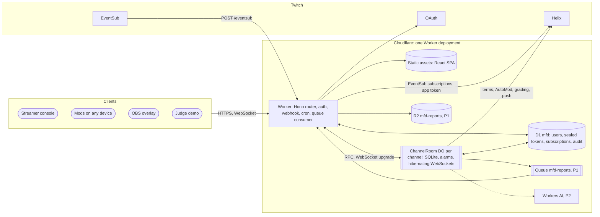

# Architecture

A digest of SRS §2, §3, §7 and §14, with pointers to the normative sections. For exact code and schemas, open the SRS.

## 1. The product loop

1. Read the channel's public blocked terms, AutoMod levels and recent chat.
2. Run a drill (30 s to 3 min): generated attacks mixed with harmless banter in a practice chat only the app shows.
3. Score every mod: caught, false bans, reaction time; count what slipped through.
4. Twitch grades every attack line against the live filters (Check AutoMod Status).
5. The rule finder proposes up to six blocked terms that catch what got past and match none of the clean set.
6. Prove them on wave B, a held-out wave built from tricks the rule finder never saw.
7. Push on approval, re-grade with Twitch (P1), save an after-action report, undo any time.

## 2. System context (SRS §2.1)

## 3. Components (SRS §3.2)

| Component | Location | Responsibility |
|---|---|---|
| Core engine | `packages/core` (`@mfd/core`) | Pure TypeScript: PRNG, tokenizer and matcher, tricks, templates, wave builder, rule finder, clean index, proof, scoring, Kai (sim), pace, zod schemas, shared types, views, protocol, fixtures |
| Worker entry | `app/worker/index.ts` | Hono app; exports `ChannelRoom`; `fetch`, `scheduled` (hourly cron) and `queue` handlers |
| Routes | `app/worker/routes/*` | `auth`, `api`, `mod`, `demo`, `public`, `eventsub`, `ws` |
| Auth | `app/worker/auth/*` | `crypto` (sealing), `session` (signed tokens), `cookies`, `origin` (CSRF check) |
| Twitch | `app/worker/twitch/*` | `oauth`, `helix`, `eventsub` (subscription management), `verify` (webhook HMAC), `types` |
| Room | `app/worker/room/*` | `ChannelRoom` split into `schema`, `scheduler`, `hub` (sockets), `drill`, `chatlog`, `grading`, `rules`, `push`, `report`, `demo`, `tokens`, `tickets` |
| Jobs | `app/worker/jobs/*` | `hourly.ts` (validate tokens, purge, subscription health), `reportExport.ts` (P1) |
| Web app | `app/src/*` | React routes: landing, console, mod, overlay, demo, report, privacy; `useRoom` hook owns the socket |

**Request routing.** `assets.run_worker_first = ["/api/*", "/auth/*", "/ws/*", "/eventsub"]`. Every other path is a free static asset or the SPA's `index.html` (`not_found_handling: "single-page-application"`).

## 4. The `ChannelRoom` Durable Object (SRS §3.4, §8.5)

**Identity.** `env.ROOM.getByName('ch:' + broadcasterId)` for live channels, `env.ROOM.getByName('demo:' + uuid)` for demo rooms. One room owns everything about one channel, so there is never cross-room coordination.

**Concurrency.** A Durable Object handles one event at a time. Atomic changes (first action wins, slip marking, push bookkeeping) run inside `ctx.storage.transactionSync()` with no `await`. SQL cursors are consumed with `.toArray()` or `.one()` before any `await`.

**Initialisation.**
- `bootstrap()` runs migrations the first time. The constructor runs them inside `blockConcurrencyWhile()` only if a `meta` table already exists.
- Every RPC and `fetch` except `bootstrap()` answers `ignored` or 404 on a never-bootstrapped room, so stray requests never create storage.
- The constructor restores the socket map from `ctx.getWebSockets()` and attachments, and sets `setWebSocketAutoResponse(ping → pong)` so keepalives never wake the room.

**WebSockets.** `ctx.acceptWebSocket(server, tags)`, tags = role (`console`, `mod`, `overlay`) plus `p:<participantId>` for mods. Attachments hold only `{ role, pid?, name? }` (16 KB cap). Broadcast helpers build **one payload per role**, so overlays only ever get redacted data. Connect authorises a single-use ticket (console, mods) or the overlay key, then sends `hello` and a role-appropriate `drill.state`.

**Scheduler: one alarm, many jobs.** The `schedule` table holds `(due_at, kind, key, payload, attempts)` with `UNIQUE(kind, key)`.
- `schedule()` upserts a job and re-arms the alarm to the earliest `due_at`.
- `alarm()` runs every due job. Drill jobs run first. A job's row is deleted after success only if `due_at` still matches, so a job that rescheduled itself survives.
- Failures retry with exponential backoff, up to 5 attempts.
- Every Helix call from a job uses `AbortSignal.timeout(4000)`.
- While a drill is `running`, `grade.tick` moves itself to the drill's end, so Twitch latency never holds back the drill clock.

| Job | Key | Does |
|---|---|---|
| `line.emit` | `<drillId>:<idx>` | Shows line `idx` if running and not shown; schedules its slip, Kai's action and the next emit |
| `line.slip` | `<lineId>` | Marks an unacted attack line slipped |
| `sim.act` | `<lineId>` | Applies Kai (sim)'s action if the line is still open |
| `drill.end` | `<drillId>` | Scheduled by the last emit at `shownAt + slipWindowMs`; slips remaining, scores, reveals, saves report v1 |
| `grade.tick` | `<phase>` | Sends the next Check AutoMod Status batch when the quota allows |
| `vote.close` | `<drillId>` | Closes the chat vote (P2) |
| `chatlog.purge` | `daily` | Deletes chat past retention, old drills, nonces, join counters; reschedules itself +24 h |
| `room.gc` | `demo` | Demo rooms: delete all storage after 2 idle hours |
| `report.export` | `<drillId>` | Live rooms with P1 bindings: send the report to the Queue 60 s after its last update |

**Drift-free clock.** Line `idx` is due at `startedAt + idx × intervalMs`, never "now plus interval".

**Drill lifecycle (FR-20).** At most one drill in `draft` or `running` per room. `draft → running → ended`, or `draft → cancelled`, or with P2 votes `draft → voting → running`. The draft is created when console step 2 opens, so the join code works while settings change. `PATCH` rebuilds wave A and keeps the code. `stopDrill` slips shown attacks and drops unshown lines from scoring.

**Participants.** Belong to the room, not one drill. A mod joins once; mods with an open socket are added to each new draft through `drill_participants`. An action counts only if the mod belongs to the line's drill.

**Reports.** Rebuilt and upserted after `drill.end`, every `grade.done`, `findRules`, `proveFreshWave`, `push` and `undo`, then `report.ready` is broadcast.

**Lifecycle.** Live rooms last while the streamer is signed in; `destroy()` calls `ctx.storage.deleteAll()` (which also deletes the alarm on compatibility dates from 2026-02-24). Demo rooms delete themselves 2 hours after their last activity.

## 5. Where data lives (SRS §7)

| Store | Holds |
|---|---|
| Room SQLite (one per channel or demo) | Channel meta, cached filters, chat log, drills, wave lines, line states, participants, grades, grading queue and sends, rule runs, proofs, pushes, reports, votes, schedule, ticket nonces, join-attempt counters |
| D1 `mfd` | Users, sealed OAuth tokens, app token, channels index, EventSub subscriptions, audit log, report summaries |
| R2 `mfd-reports` (P1) | `reports/<broadcasterId>/<reportId>.json` and `.md` |
| Browser | Session cookies; a mod's participant token in `sessionStorage` |

**Room tables** (normative SQL in SRS §7.2): `meta` (key/value: schema_version, room_name, mode, broadcaster_id, login, display_name, broadcaster_type, overlay_key, hide_names, logging, last_activity, filters_fetched_at, automod_json, subscription_status), `blocked_terms`, `chat_log` (stores pre-tokenised `tokens`; index on `sent_at`), `schedule`, `drills`, `wave_lines`, `participants`, `drill_participants`, `join_attempts`, `line_state`, `grades` (PK line, phase, engine), `grade_queue`, `grade_sends`, `rule_runs`, `proofs`, `pushes` (status `pending|added|failed|removed`, `preexisting` flag, `UNIQUE(drill_id, term)`), `reports`, `votes`, `ws_nonces`.

**D1 tables** (normative SQL in SRS §7.3, file `app/migrations/0001_init.sql`): `users` (with `session_epoch`), `oauth_tokens` (sealed access and refresh, status `ok|invalid|revoked`), `app_state` (sealed app token, revoke subscription ID), `channels` (`last_chat_at` copied hourly, never per message), `eventsub_subscriptions`, `audit_log`, `report_summaries`. Deletions are explicit in code; no cascades.

**Write budget rule.** D1 is never written per chat message. Each chat message costs one Worker request, one DO request and about three room rows (message plus two index entries). The Free plan fits channels up to roughly 15,000 chat messages a day (SRS §3.5).

## 6. Core algorithms pipeline (SRS §5)

| Step | File | Key function | Notes |
|---|---|---|---|
| Seeded randomness | `prng.ts` | `Rng`, `mulberry32`, `hash32` | All randomness flows from a seed |
| Matching model | `matcher.ts` | `tokenize`, `parseTerm`, `termHits`, `blockedBy`, `validateTerm` | Our model of Twitch blocked terms: case-insensitive, all words in any order, `*` prefix/suffix wildcards, no Unicode normalisation `[verify]` (A-01) |
| Tricks | `tricks.ts` | `TRICK`, `LINK_TRICK`, `NEEDS_BOT_RULE` | Training pools for wave A; held-out pools for wave B (look-alike, dotted, leet link and "dot" never appear in A) |
| Templates | `templates.ts` | `TACTICS`, `GIFTS`, `SLURS`, `BANTER`, `REGULARS` | Tactics: `linkscam`, `spam`, `botwave`, `hateraid` |
| Waves | `waves.ts` | `buildWaveA` (14 attacks + 8 banter by default), `buildWaveB` (30 held-out attacks) | Wave B seed = `(seed × 7 + 101) >>> 0` |
| Validation | `schema.ts` | `DrillConfigInputZ`, `ClientMsgZ`, `TermListZ`, `JoinZ` | 6 to 30 attacks, 4 to 20 banter, at most 40 lines |
| Clean index | `cleanIndex.ts` | `buildCleanIndex`, `bruteForceIndex` | Sorted vocab plus reversed vocab; must equal brute force exactly |
| Rule finder | `ruleFinder.ts` | `findRules` | Greedy set cover, at most 6 terms, each covering ≥ 2 passed lines and 0 clean-set lines |
| Proof | `proof.ts` | `proveOnFreshWave` | Push allowed only when every selected term has 0 real-chat matches |
| Scoring | `scoring.ts` | `scoreDrill` | Server timestamps only |
| Kai (sim) | `sim.ts` | `simDecision` | Deterministic per `(seed, lineId)` |
| Grading pace | `pace.ts` | `nextAllowedAt`, `LIMITS` | Counts quota in units (request or line) |
| Coach note | `coach.ts` | `coachNote` | P2 template fallback |

**Clean set** = chat logged in the last 7 days (latest 20,000 lines at most, `CLEAN_SET_MAX_LINES`) plus the 40-line banter pool. Keep the built index in memory while the room is awake; rebuild only when the chat count changed by more than 1%.

**The demo's tell.** Every generated link contains the token `invalid`, so `invalid` covers many lines, but the clean set holds "that move was invalid lol", so the rule finder rejects `invalid` with that example. Keep that fixture line.

## 7. Key flows (SRS §3.3)

- **Sign-in:** `/auth/login` → Twitch consent → `/auth/callback` checks `state`, exchanges the code, reads the user, seals tokens into D1, bootstraps the room (which reads terms and AutoMod), ensures the chat subscription (app token), sets the session, redirects to `/console`. A failed subscription does not fail sign-in.
- **Chat ingest:** Twitch POSTs `/eventsub` → HMAC verify on the raw body, 10-minute skew check → `room.ingestChat()` dedupes by message ID, drops shared-chat messages from other channels and the app's own announcement, tokenises, inserts → 204 (500 if the room call fails, so Twitch retries).
- **Drill:** console `startDrill` → `line.emit` alarms broadcast `drill.line` per role → mods send `mod.action` → first action wins in one synchronous write → `drill.action` and `drill.score` broadcast → `line.slip` alarms → `drill.end` scores, reveals (console and mods only), saves the report.
- **Grade → rules → proof → push:** `requestGrading(A)` queues lines → `grade.tick` sends paced batches → `grade.progress` → `findRules` → `proveFreshWave(selected)` → `push(selected)` re-reads terms, adds one term at a time, writes an audit row → `undo` removes only terms this drill added.

## 8. Observability (SRS §14)

`log(evt, fields)` writes one JSON line `{ evt, ts, room, drill?, ...fields }`. Never log tokens, chat text or attack text.

Events: `auth.signin|signout|refresh|validate`, `eventsub.received|rejected|subscription`, `chat.ingest`, `drill.created|started|ended`, `line.emit` (planned vs actual), `mod.action`, `grade.send`, `grade.done`, `rules.run`, `push.term`, `undo.term`, `report.saved|exported`, `demo.created|gc`, `job.failed`.

The runbook (chat count stuck, reconnect banner, grading stuck, late lines, push failures, blank overlay, demo 429, error 1102 CPU exceeded) is in SRS §14.2.
