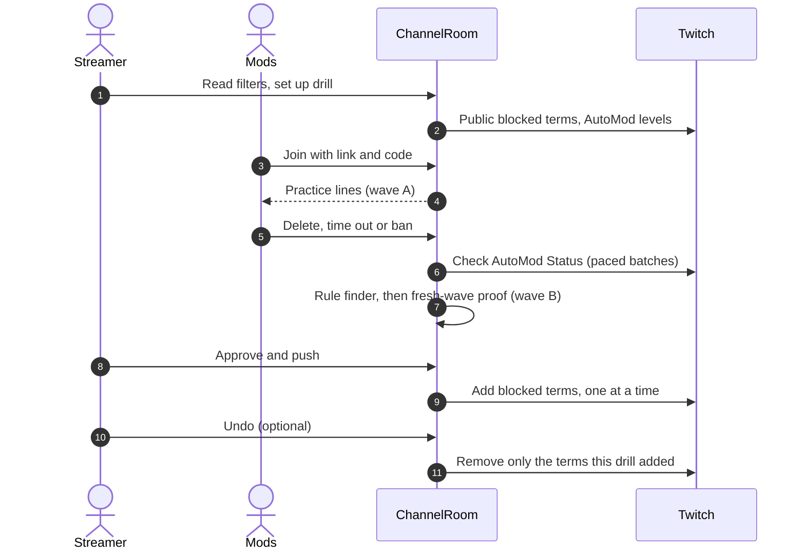

# How it works

[Docs](README.md) / How it works

> A drill is seven steps: read the filters, set up, run the drill, let Twitch grade, find rules, prove them on a fresh wave, then approve, push and undo. This page walks through each step and what the engine does behind it.

## The seven steps

### 1. Read your filters

ModScrim reads the channel's public blocked terms and AutoMod levels through Twitch's API and starts a chat log that lasts 7 days (`CHAT_LOG_RETENTION_DAYS`). The log has one job: checking that new rules will not ban regulars. Twitch does not return private blocked terms to apps, so only public terms are visible, and AutoMod is read-only.

### 2. Set up the drill

Choose the tactics, the number of attack and banter lines, the speed and the slip window. The defaults are the tactics `linkscam`, `spam` and `botwave`, 14 attack lines and 8 banter lines, a line every 1.5 s and a 9 s slip window. Waves are built from a seed, so the same seed gives the same drill. The streamer shares the mod link and the six-digit join code, and can add the OBS overlay.

### 3. Run the drill

The practice chat fills with generated lines mixed with banter from a curated 40-line pool. Each line is emitted on a drift-free clock (line `n` is due at `startedAt + n x interval`). Mods delete, time out or ban; the first action on a line wins in a single synchronous write. A line nobody touches within the slip window is marked **slipped**. Acting on a banter line is a **false ban**. Scores use server timestamps only.

| Tactic | What it imitates |
|---|---|
| `linkscam` | Fake giveaway links, always ending in `.invalid` |
| `spam` | Follower and viewer spam |
| `botwave` | Art and promo bots |
| `hateraid` | Placeholder slurs, off by default, with a content warning |

Evasion tricks include plain, caps, leetspeak, stretched letters, emoji, spaced letters, dotted letters, zero-width characters and look-alike letters.

### 4. Twitch grades your filters

Every attack line goes to Twitch's Check AutoMod Status, which says whether the channel's current AutoMod settings and blocked terms would let it through. Requests are paced to the channel's limits, which depend on its broadcaster type (for example 5 a minute and 50 an hour for a normal channel), and grading waits while a drill is running. When the limit runs out, when there is no valid token, or in demo rooms, ModScrim grades with its own matcher and labels the result **local estimate**. Every number names its engine.

### 5. Find better rules

The rule finder proposes up to six blocked terms in Twitch's syntax. It is a greedy set cover: each term must cover at least two lines that got past the filters and match zero lines in the clean set (the last 7 days of real chat, up to 20,000 lines, plus the banter pool). A term that matches a clean line is rejected and shown with that line. Tricks no blocked term can express are labelled **needs a bot rule**.

### 6. Prove them on a fresh wave

Wave B is 30 attack lines built from a new seed and from tricks the rule finder never saw. ModScrim shows how many it blocks before and after, what still gets through, and how many real messages the new rules would match. Push is allowed only when every selected term has zero real-chat matches, and the room checks this again at push time. On a real channel Twitch re-grades the fresh wave after the push.

### 7. Approve, push and undo

Nothing reaches Twitch until the streamer presses **Approve and push**. The room re-reads the channel's terms, adds one term at a time, stores the ID Twitch returns and records each result and an audit row. A term that already existed is marked preexisting. **Undo** removes exactly the terms that drill added and leaves preexisting terms alone.

After the drill, an after-action report keeps per-mod scores, grades, proposed, rejected and pushed terms, and the fresh-wave result. The numbers-only card is what overlays and share links carry; attack text never leaves the room.

## Scoring in one table

| Word | Meaning |
|---|---|
| Caught | A mod acted on an attack line |
| Slipped | An attack line no mod removed within the slip window |
| Foul or false ban | A mod acted on a banter line |
| Reaction time | When the mod acted minus when the line was shown, both server timestamps |

## Limits worth knowing

- Twitch's check also applies AutoMod categories and permitted terms, which the local matcher does not model, so the two engines can disagree.
- ModScrim never acts on real chat. It is a rehearsal and a tuning aid, not a moderation bot.
- Live Twitch behaviours still to be confirmed on a test channel are tracked in [`for-agents/open-questions.md`](for-agents/open-questions.md).

**Next:** [Safety](safety.md) | [Architecture](architecture.md) | [Glossary](glossary.md)
